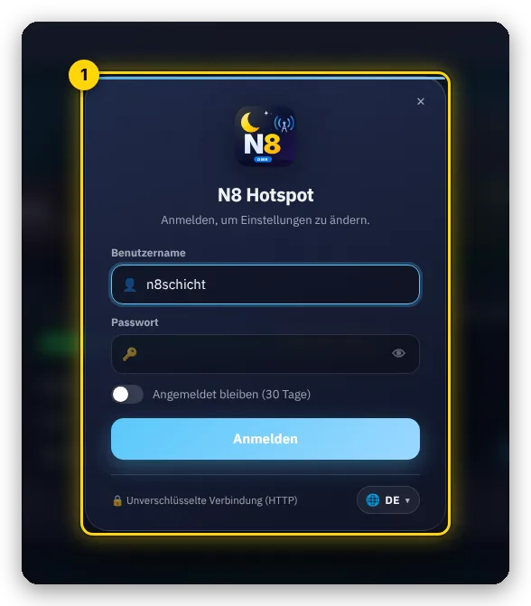
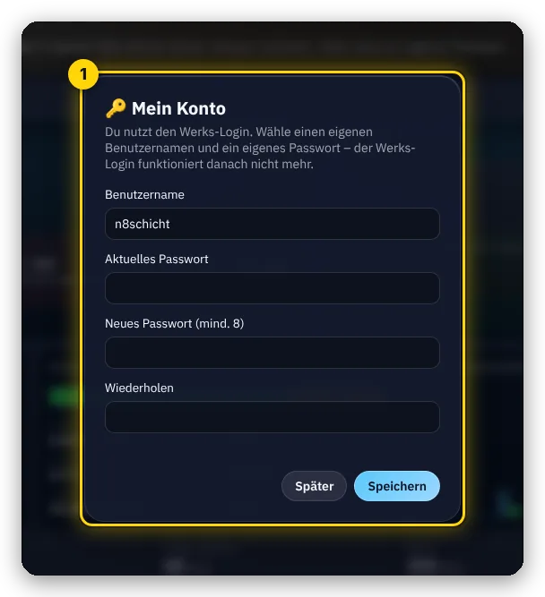
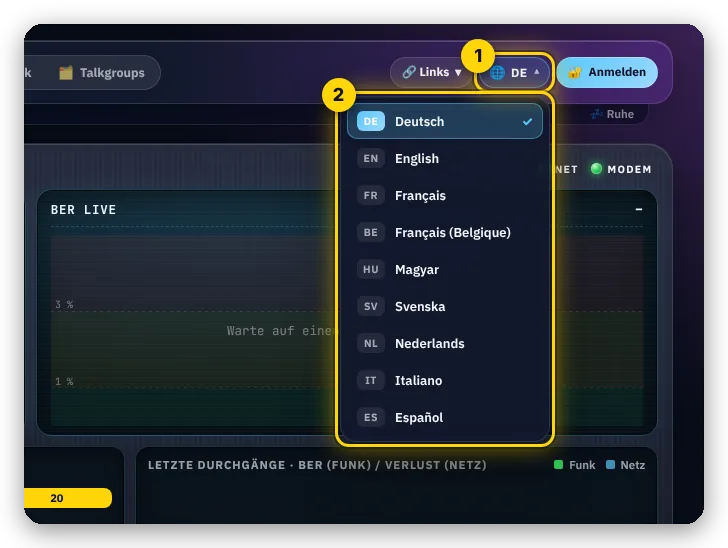
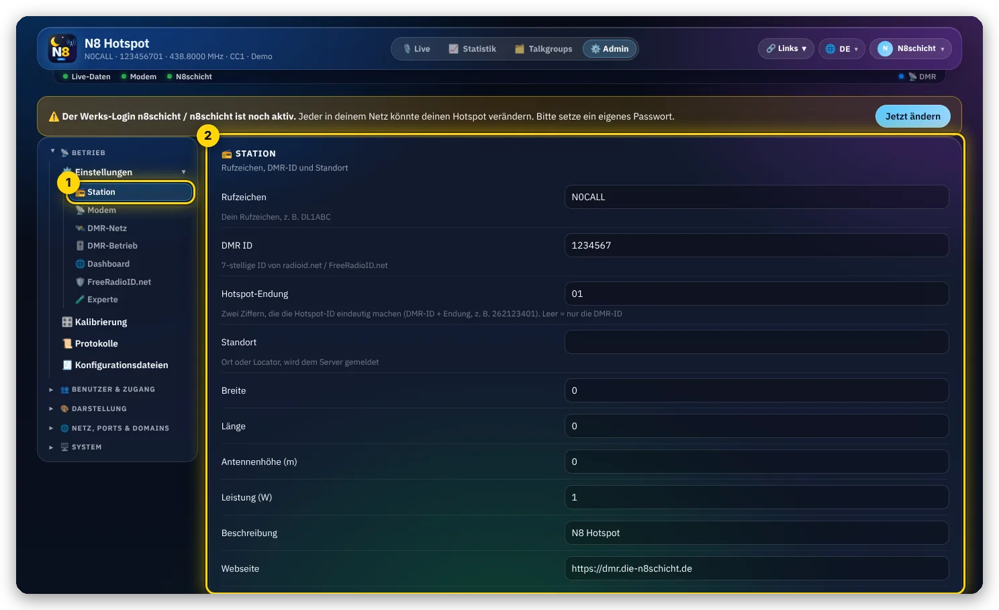
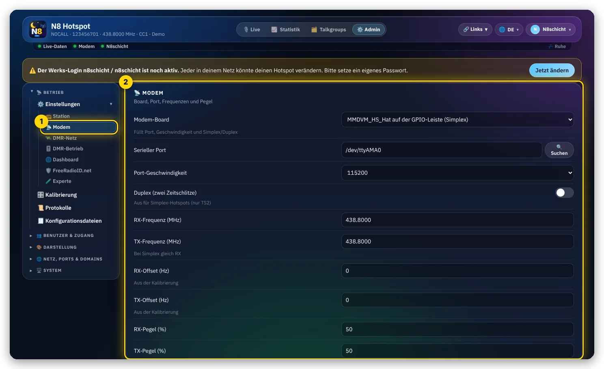
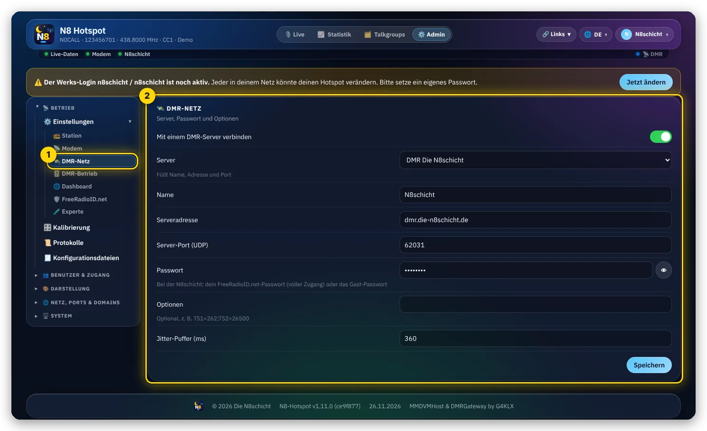
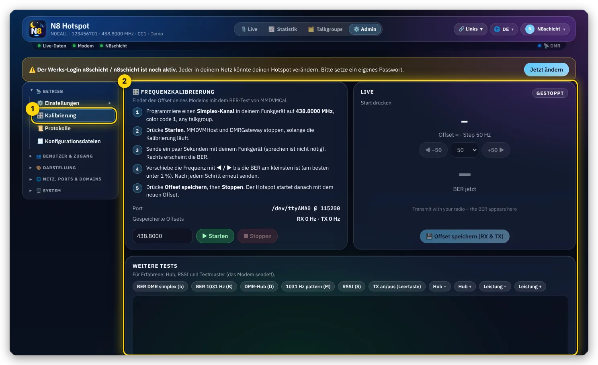
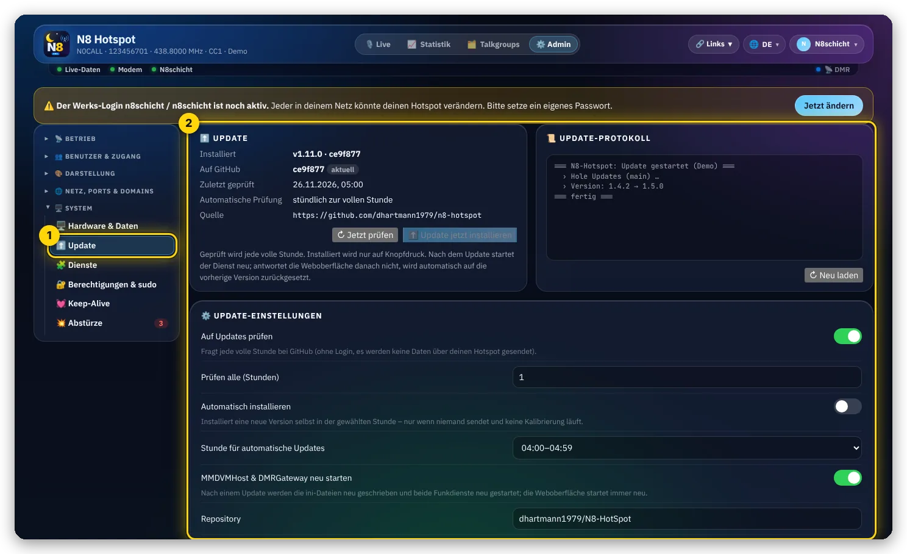

# 📘 N8-Hotspot – Schritt für Schritt

<sub>Sprache: **🇩🇪 Deutsch** · [🇬🇧 English](../en/README.md) · [🇫🇷 Français](../fr/README.md) · [🇧🇪 Français (Belgique)](../fr-BE/README.md) · [🇭🇺 Magyar](../hu/README.md) · [🇸🇪 Svenska](../sv/README.md) · [🇳🇱 Nederlands](../nl/README.md) · [🇮🇹 Italiano](../it/README.md) · [🇪🇸 Español](../es/README.md)</sub>

Der N8-Hotspot ist eine Weboberfläche für MMDVMHost und DMRGateway auf einem Raspberry Pi mit Modem-Hat. Diese Anleitung führt durch die ersten Schritte.

> 💡 Die gelben Ziffern im Bild gehören zu den Ziffern im Text.

## Inhalt

1. [Installieren](#1-installieren)
2. [Anmelden](#2-anmelden)
3. [Eigenes Passwort setzen](#3-eigenes-passwort-setzen)
4. [Sprache wählen](#4-sprache-wählen)
5. [Station eintragen](#5-station-eintragen)
6. [Modem einstellen](#6-modem-einstellen)
7. [Mit dem DMR-Server verbinden](#7-mit-dem-dmr-server-verbinden)
8. [Frequenz kalibrieren](#8-frequenz-kalibrieren)
9. [Aktualisieren](#9-aktualisieren)

## 1. Installieren

Am einfachsten mit dem fertigen DietPi-Image: auf eine SD-Karte schreiben, in den Raspberry Pi stecken, starten. Alternativ auf einem laufenden DietPi:

```bash
git clone https://github.com/dhartmann1979/N8-HotSpot
cd N8-HotSpot
sudo ./scripts/setup.sh
```

Danach ist die Oberfläche unter `http://n8-hotspot.local` (oder der IP-Adresse) erreichbar.

## 2. Anmelden

<p align="center"></p>

Oben rechts auf **🔐 Anmelden** klicken und im Anmeldefenster ① mit dem Werks-Login **n8schicht / n8schicht** anmelden. 👁 zeigt das Passwort, „Angemeldet bleiben“ spart die Anmeldung beim nächsten Mal.

## 3. Eigenes Passwort setzen

<p align="center"></p>

Solange der Werks-Login gilt, öffnet sich **🔑 Mein Konto** ① und es lassen sich keine Einstellungen ändern. Wähle einen eigenen Benutzernamen und ein Passwort mit mindestens 8 Zeichen – danach funktioniert der Werks-Login nicht mehr.

## 4. Sprache wählen

<p align="center"></p>

Oben rechts öffnet **🌐 DE ▾** ① das Sprachmenü ② mit neun Sprachen. Die Wahl gilt sofort und für alle N8-Oberflächen auf diesem Server. Beim ersten Besuch gilt die Sprache des Browsers.

## 5. Station eintragen

<p align="center"></p>

Im Adminbereich unter **📡 Betrieb → ⚙️ Einstellungen → 📻 Station** ① trägst du Rufzeichen, DMR-ID und Standort ein ②. Zwei Ziffern als Hotspot-Suffix machen die Hotspot-ID eindeutig, wenn du mehrere Geräte hast.

## 6. Modem einstellen

<p align="center"></p>

Unter **📡 Modem** ① wählst du das Modem-Board ② – das füllt Port, Geschwindigkeit und Simplex/Duplex aus. **Modem suchen** findet den Port selbst. Dazu kommen Sende- und Empfangsfrequenz; bei Simplex sind beide gleich.

## 7. Mit dem DMR-Server verbinden

<p align="center"></p>

Unter **🛰️ DMR-Netz** ① wählst du den Server aus der Liste ② (füllt Name, Adresse und Port) und trägst das Passwort ein – bei der N8schicht dein FreeRadioID.net-Passwort für vollen Zugang.

## 8. Frequenz kalibrieren

<p align="center"></p>

Unter **🎛️ Kalibrierung** ① findest du den Frequenz-Offset deines Modems ②: Starten, mit dem Funkgerät auf der angezeigten Simplex-Frequenz senden und die Frequenz verschieben, bis die BER am niedrigsten ist (ideal unter 1 %). Dann den Offset speichern.

## 9. Aktualisieren

<p align="center"></p>

Unter **🖥️ System → ⬆️ Update** ① siehst du die installierte Version und ob GitHub eine neuere hat ②. **⬆️ Update jetzt installieren** lädt sie, prüft danach die Weboberfläche und stellt bei einem Fehler automatisch die vorherige Version wieder her. Ein Passwort ist dafür nicht nötig.

---

📖 Ausführliche Beschreibung (Deutsch): [docs/de/installation.md](../../../docs/de/installation.md)
