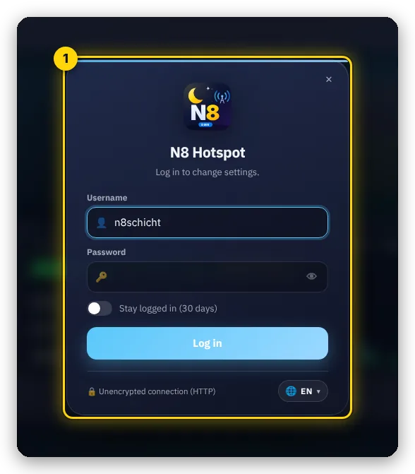
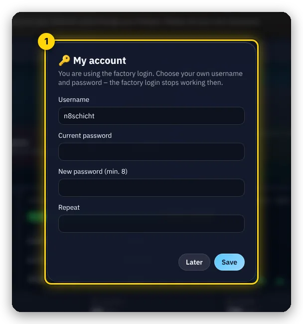
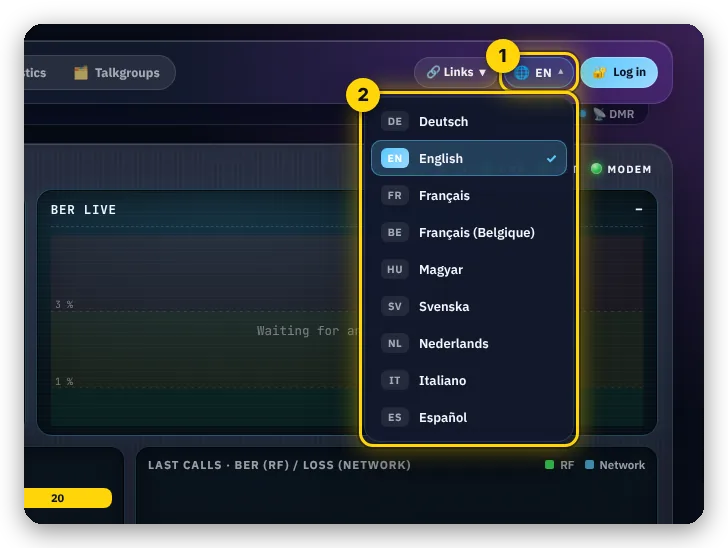
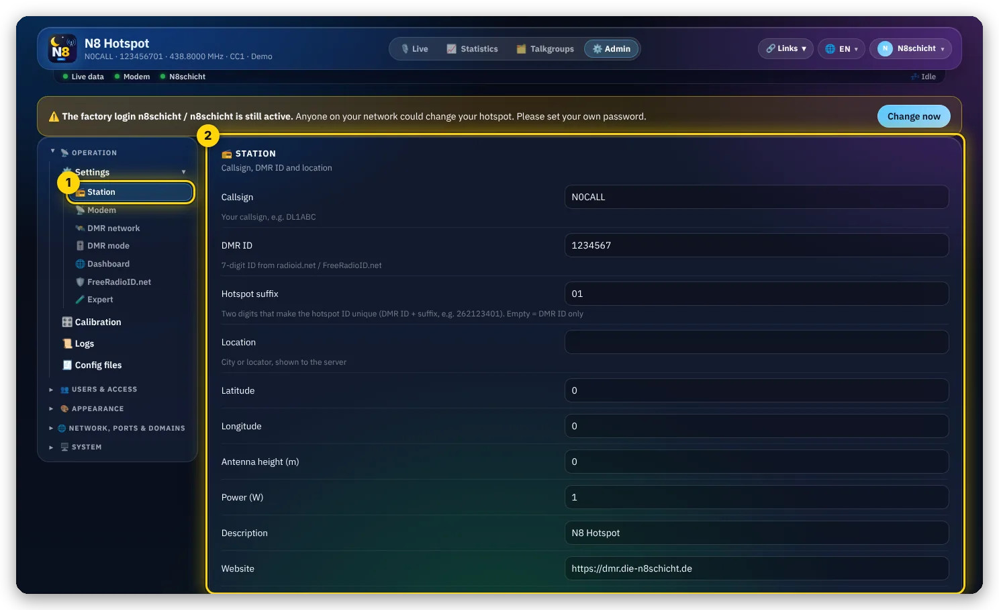
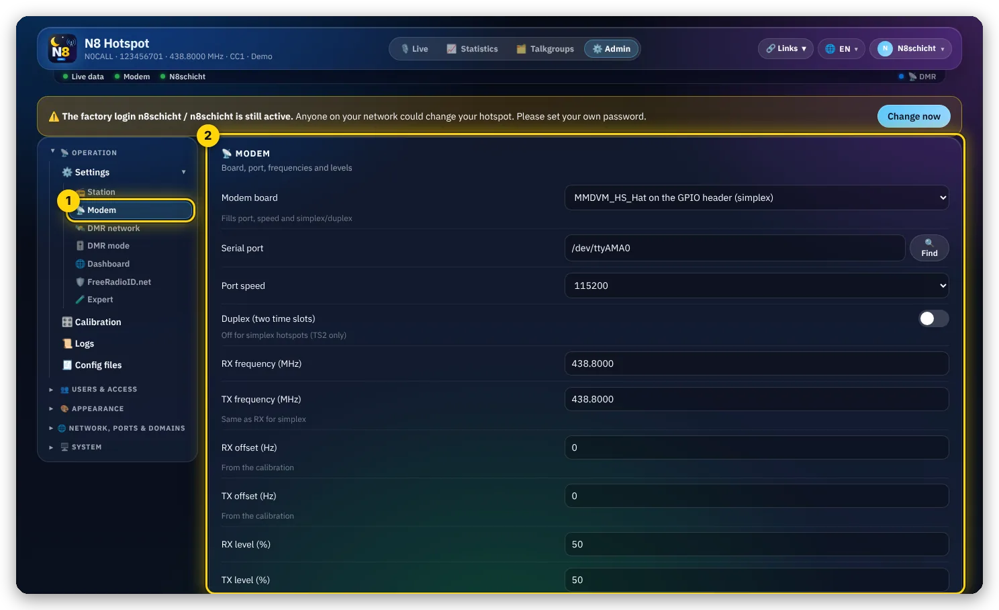
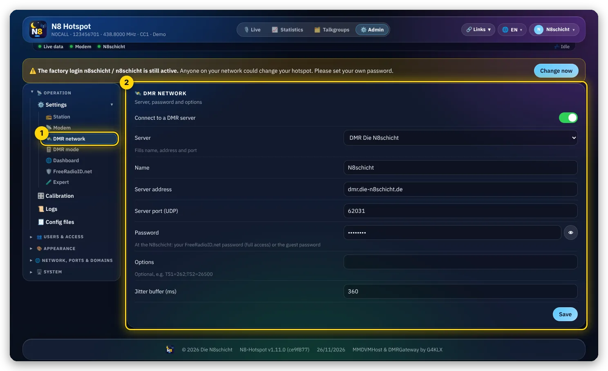
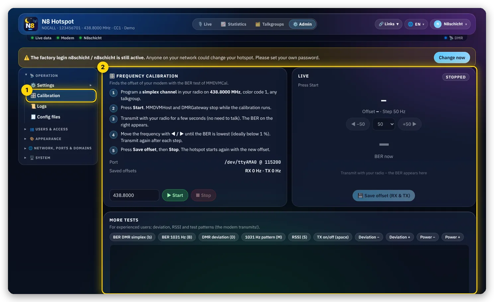
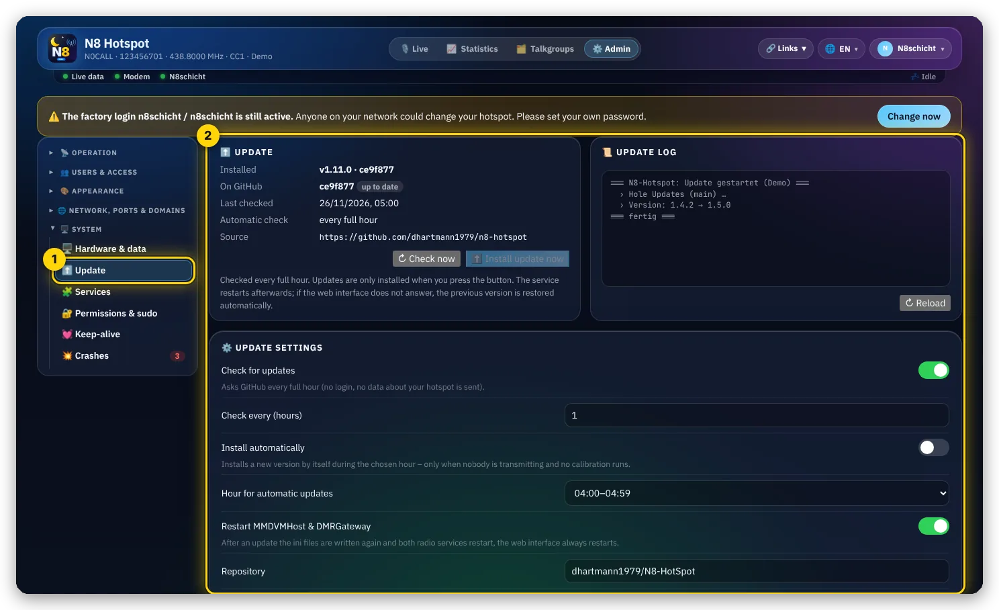

# 📘 N8 Hotspot – Step by step

<sub>Language: [🇩🇪 Deutsch](../de/README.md) · **🇬🇧 English** · [🇫🇷 Français](../fr/README.md) · [🇧🇪 Français (Belgique)](../fr-BE/README.md) · [🇭🇺 Magyar](../hu/README.md) · [🇸🇪 Svenska](../sv/README.md) · [🇳🇱 Nederlands](../nl/README.md) · [🇮🇹 Italiano](../it/README.md) · [🇪🇸 Español](../es/README.md)</sub>

The N8 Hotspot is a web interface for MMDVMHost and DMRGateway on a Raspberry Pi with a modem hat. This guide takes you through the first steps.

> 💡 The yellow numbers in the pictures belong to the numbers in the text.

## Contents

1. [Install](#1-install)
2. [Log in](#2-log-in)
3. [Set your own password](#3-set-your-own-password)
4. [Choose the language](#4-choose-the-language)
5. [Enter the station](#5-enter-the-station)
6. [Set up the modem](#6-set-up-the-modem)
7. [Connect to the DMR server](#7-connect-to-the-dmr-server)
8. [Calibrate the frequency](#8-calibrate-the-frequency)
9. [Update](#9-update)

## 1. Install

The easiest way is the ready-made DietPi image: write it to an SD card, put it into the Raspberry Pi, power on. Alternatively on a running DietPi:

```bash
git clone https://github.com/dhartmann1979/N8-HotSpot
cd N8-HotSpot
sudo ./scripts/setup.sh
```

Afterwards the interface is at `http://n8-hotspot.local` (or the IP address).

## 2. Log in

<p align="center"></p>

Click **🔐 Log in** at the top right and log in in the login window ① with the factory login **n8schicht / n8schicht**. 👁 shows the password, “Stay logged in” saves the login next time.

## 3. Set your own password

<p align="center"></p>

As long as the factory login is active, **🔑 My account** ① opens and no settings can be changed. Choose your own username and a password of at least 8 characters – afterwards the factory login no longer works.

## 4. Choose the language

<p align="center"></p>

At the top right, **🌐 EN ▾** ① opens the language menu ② with nine languages. The choice applies at once and to all N8 interfaces on this server. On the first visit the language of the browser is used.

## 5. Enter the station

<p align="center"></p>

In the admin area under **📡 Operation → ⚙️ Settings → 📻 Station** ① enter callsign, DMR ID and location ②. Two digits as hotspot suffix make the hotspot ID unique if you have several devices.

## 6. Set up the modem

<p align="center"></p>

Under **📡 Modem** ① choose the modem board ② – this fills in port, speed and simplex/duplex. **Find the modem** finds the port by itself. Then enter transmit and receive frequency; for simplex both are the same.

## 7. Connect to the DMR server

<p align="center"></p>

Under **🛰️ DMR network** ① choose the server from the list ② (fills in name, address and port) and enter the password – at the N8schicht your FreeRadioID.net password for full access.

## 8. Calibrate the frequency

<p align="center"></p>

Under **🎛️ Calibration** ① you find the frequency offset of your modem ②: start, transmit with your radio on the simplex frequency shown and move the frequency until the BER is lowest (ideally below 1 %). Then save the offset.

## 9. Update

<p align="center"></p>

Under **🖥️ System → ⬆️ Update** ① you see the installed version and whether GitHub has a newer one ②. **⬆️ Install update now** downloads it, then checks the web interface and restores the previous version automatically if something goes wrong. No password is needed for this.

---

📖 Detailed description (German): [docs/de/installation.md](../../../docs/de/installation.md)
