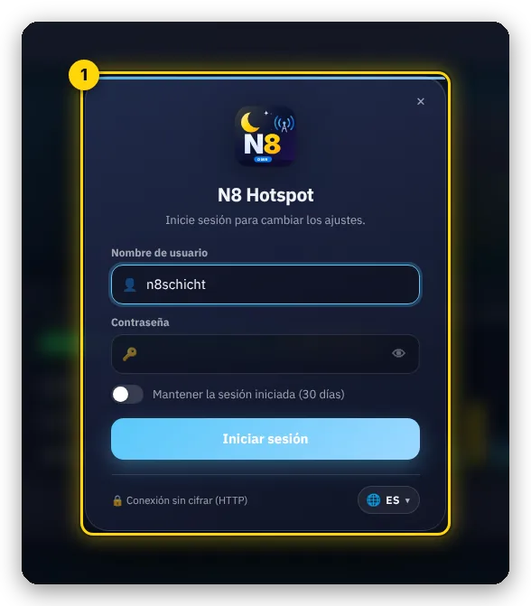
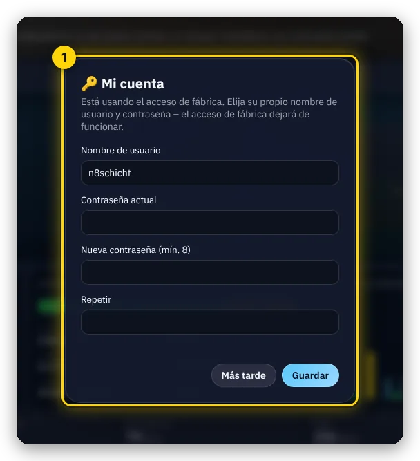
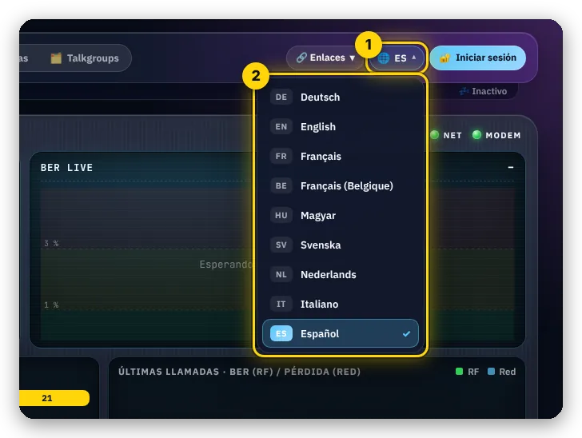
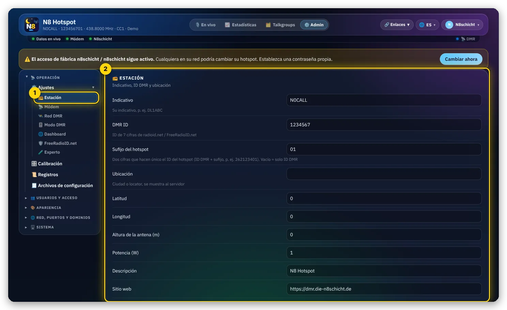
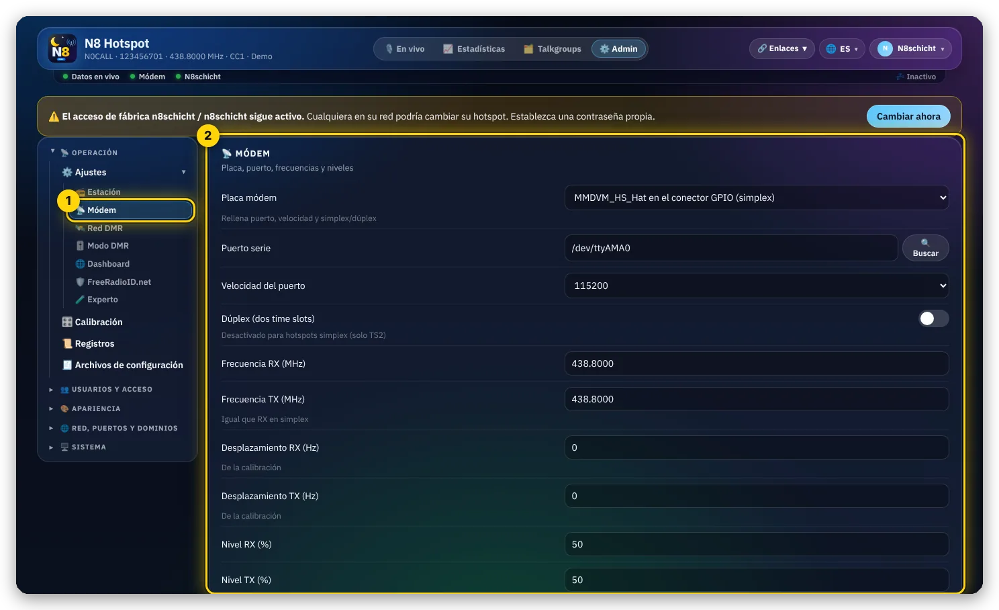
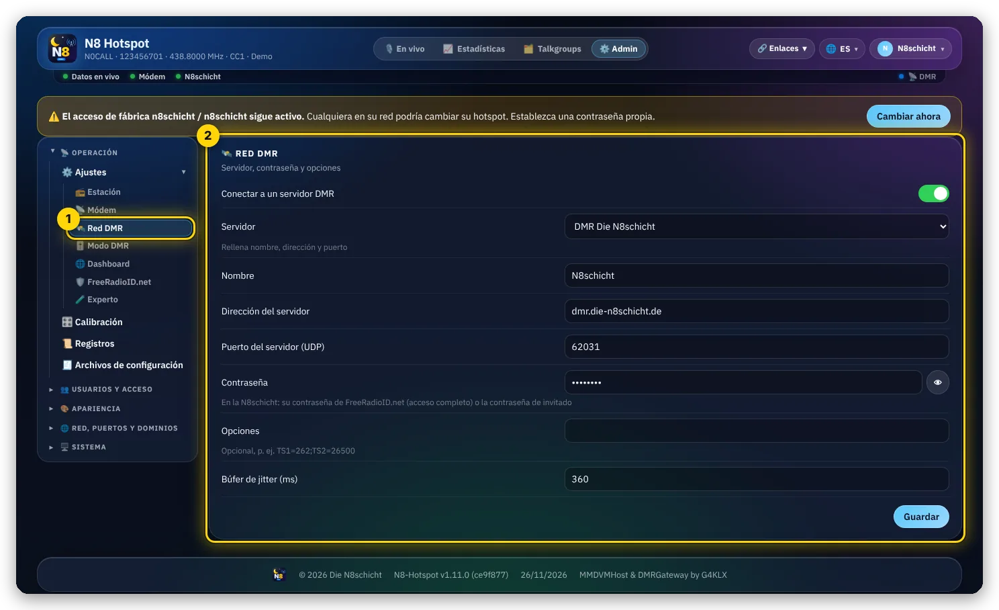
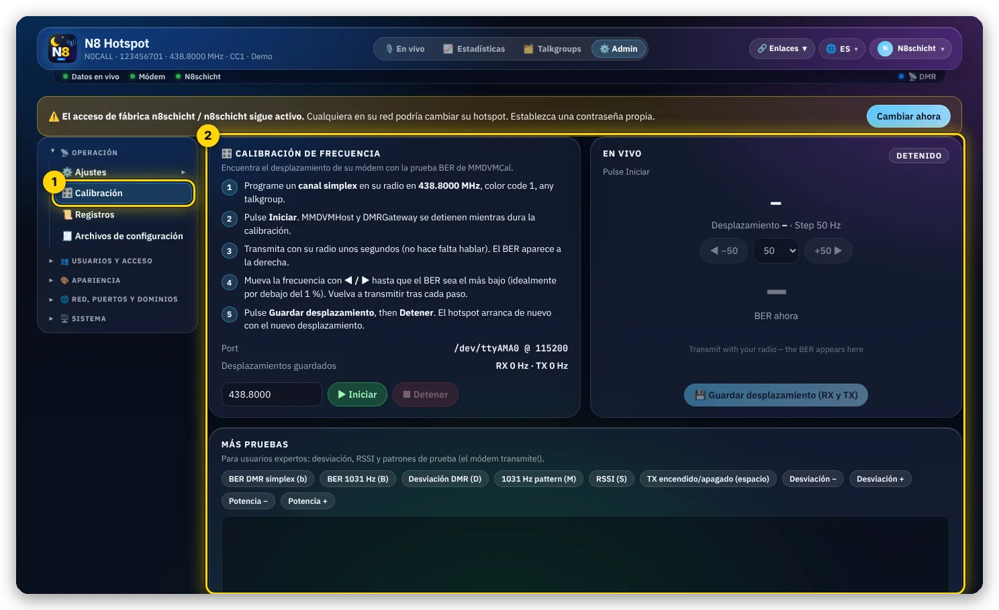
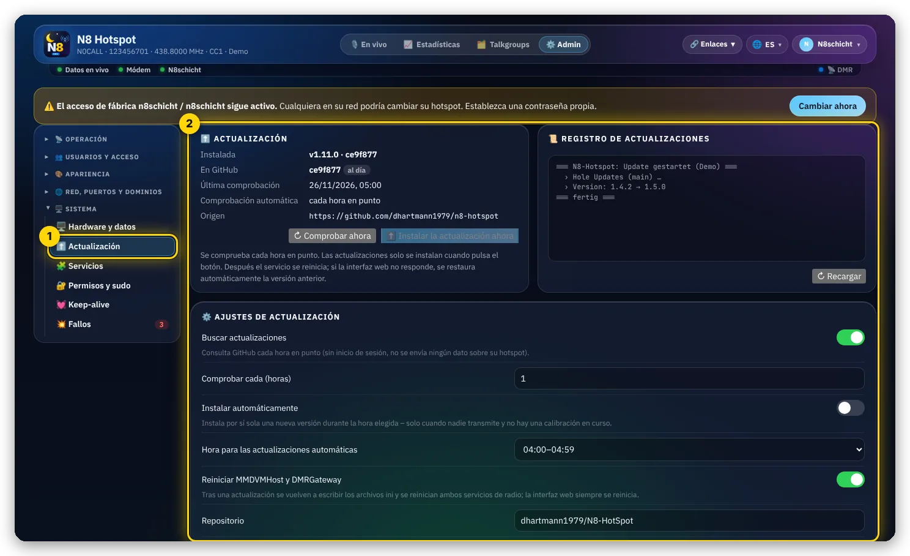

# 📘 N8 Hotspot – Paso a paso

<sub>Idioma: [🇩🇪 Deutsch](../de/README.md) · [🇬🇧 English](../en/README.md) · [🇫🇷 Français](../fr/README.md) · [🇧🇪 Français (Belgique)](../fr-BE/README.md) · [🇭🇺 Magyar](../hu/README.md) · [🇸🇪 Svenska](../sv/README.md) · [🇳🇱 Nederlands](../nl/README.md) · [🇮🇹 Italiano](../it/README.md) · **🇪🇸 Español**</sub>

N8 Hotspot es una interfaz web para MMDVMHost y DMRGateway en una Raspberry Pi con placa módem. Esta guía le acompaña en los primeros pasos.

> 💡 Los números amarillos de las imágenes corresponden a los números del texto.

## Contenido

1. [Instalar](#1-instalar)
2. [Iniciar sesión](#2-iniciar-sesión)
3. [Establecer una contraseña propia](#3-establecer-una-contraseña-propia)
4. [Elegir el idioma](#4-elegir-el-idioma)
5. [Introducir la estación](#5-introducir-la-estación)
6. [Ajustar el módem](#6-ajustar-el-módem)
7. [Conectar con el servidor DMR](#7-conectar-con-el-servidor-dmr)
8. [Calibrar la frecuencia](#8-calibrar-la-frecuencia)
9. [Actualizar](#9-actualizar)

## 1. Instalar

Lo más sencillo es la imagen DietPi lista: grabarla en una tarjeta SD, insertarla en la Raspberry Pi y encender. O bien en una DietPi en marcha:

```bash
git clone https://github.com/dhartmann1979/N8-HotSpot
cd N8-HotSpot
sudo ./scripts/setup.sh
```

Después la interfaz está en `http://n8-hotspot.local` (o la dirección IP).

## 2. Iniciar sesión

<p align="center"></p>

Haga clic en **🔐 Iniciar sesión** arriba a la derecha e inicie sesión en la ventana ① con el acceso de fábrica **n8schicht / n8schicht**. 👁 muestra la contraseña, «Mantener la sesión iniciada» evita iniciar sesión la próxima vez.

## 3. Establecer una contraseña propia

<p align="center"></p>

Mientras el acceso de fábrica esté activo, se abre **🔑 Mi cuenta** ① y no se puede cambiar ningún ajuste. Elija un nombre de usuario propio y una contraseña de al menos 8 caracteres – después el acceso de fábrica deja de funcionar.

## 4. Elegir el idioma

<p align="center"></p>

Arriba a la derecha, **🌐 ES ▾** ① abre el menú de idiomas ② con nueve idiomas. La elección se aplica al instante y a todas las interfaces N8 de este servidor. En la primera visita se usa el idioma del navegador.

## 5. Introducir la estación

<p align="center"></p>

En el área de administración, en **📡 Operación → ⚙️ Ajustes → 📻 Estación** ①, introduzca indicativo, ID DMR y ubicación ②. Dos cifras como sufijo del hotspot hacen único el ID del hotspot si tiene varios equipos.

## 6. Ajustar el módem

<p align="center"></p>

En **📡 Módem** ① elija la placa módem ② – esto rellena puerto, velocidad y simplex/dúplex. **Buscar el módem** encuentra el puerto por sí solo. Después introduzca las frecuencias de emisión y recepción; en simplex son iguales.

## 7. Conectar con el servidor DMR

<p align="center"></p>

En **🛰️ Red DMR** ① elija el servidor de la lista ② (rellena nombre, dirección y puerto) e introduzca la contraseña – en la N8schicht su contraseña de FreeRadioID.net para el acceso completo.

## 8. Calibrar la frecuencia

<p align="center"></p>

En **🎛️ Calibración** ① encuentra el desplazamiento de frecuencia de su módem ②: inicie, emita con su radio en la frecuencia simplex indicada y mueva la frecuencia hasta que el BER sea el más bajo (idealmente por debajo del 1 %). Después guarde el desplazamiento.

## 9. Actualizar

<p align="center"></p>

En **🖥️ Sistema → ⬆️ Actualización** ① ve la versión instalada y si GitHub tiene una más reciente ②. **⬆️ Instalar la actualización ahora** la descarga, comprueba después la interfaz web y, si algo falla, restaura automáticamente la versión anterior. No hace falta contraseña.

---

📖 Descripción detallada (alemán): [docs/de/installation.md](../../../docs/de/installation.md)
