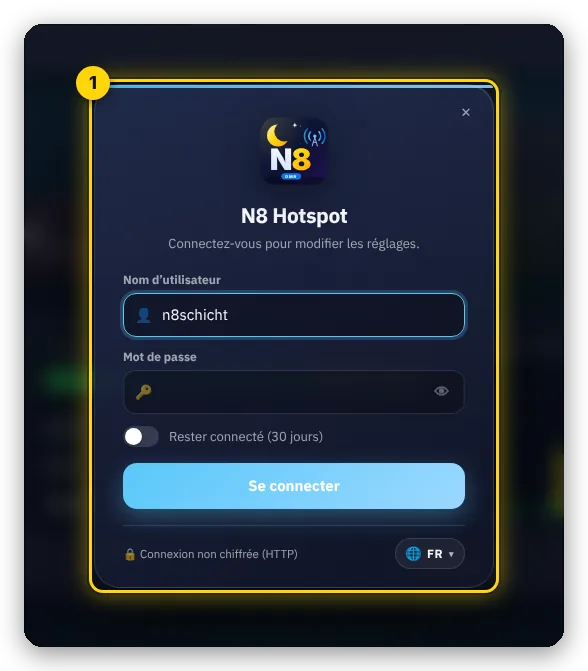
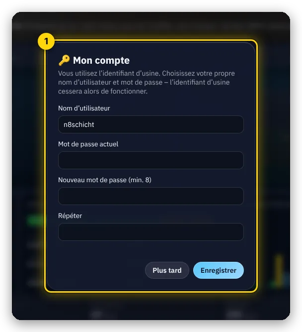
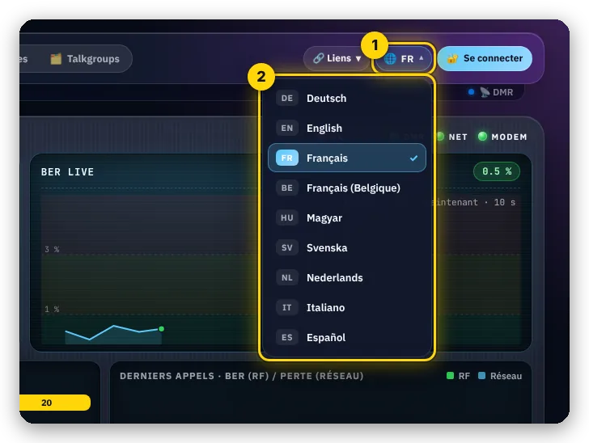
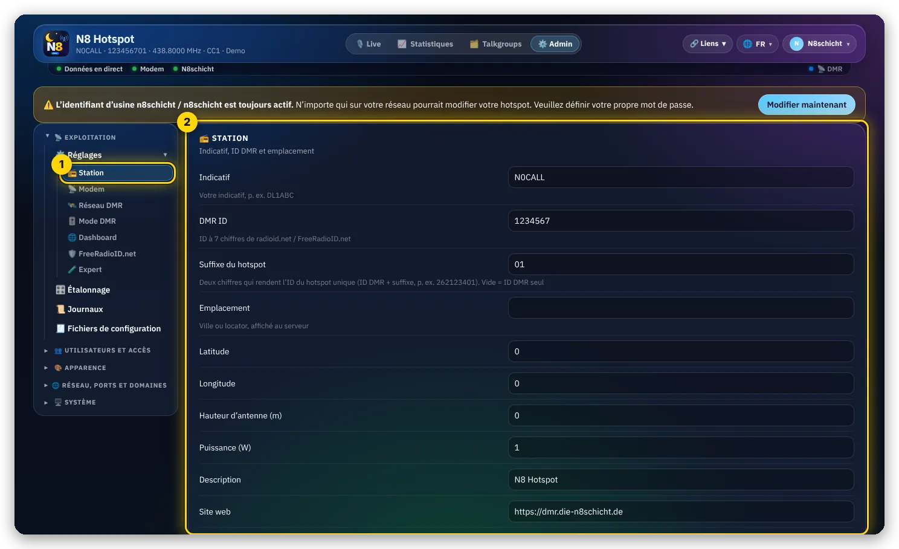
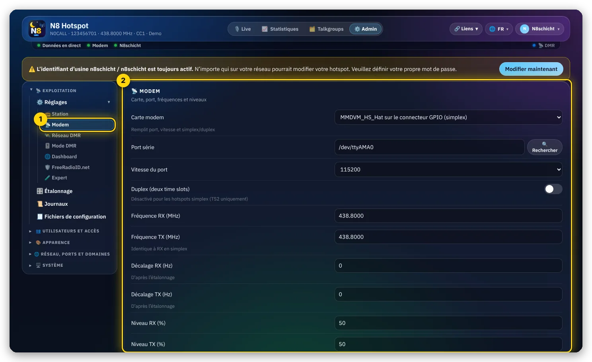
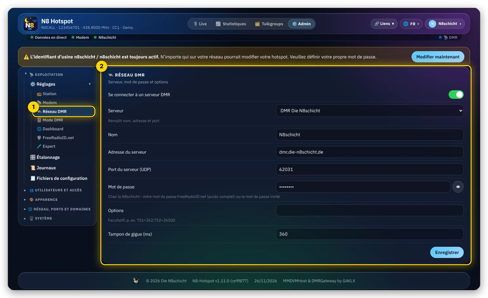
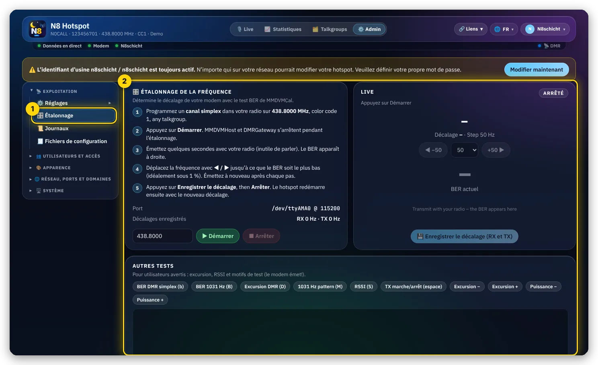
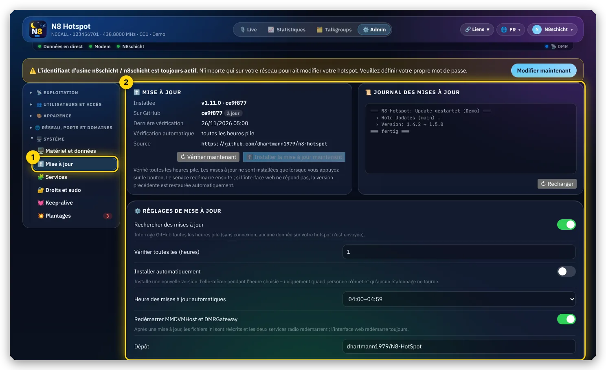

# 📘 N8 Hotspot – Pas à pas

<sub>Langue: [🇩🇪 Deutsch](../de/README.md) · [🇬🇧 English](../en/README.md) · **🇫🇷 Français** · [🇧🇪 Français (Belgique)](../fr-BE/README.md) · [🇭🇺 Magyar](../hu/README.md) · [🇸🇪 Svenska](../sv/README.md) · [🇳🇱 Nederlands](../nl/README.md) · [🇮🇹 Italiano](../it/README.md) · [🇪🇸 Español](../es/README.md)</sub>

Le N8 Hotspot est une interface web pour MMDVMHost et DMRGateway sur un Raspberry Pi équipé d’une carte modem. Ce guide vous accompagne dans les premières étapes.

> 💡 Les chiffres jaunes des images correspondent aux chiffres du texte.

## Sommaire

1. [Installer](#1-installer)
2. [Se connecter](#2-se-connecter)
3. [Définir son propre mot de passe](#3-définir-son-propre-mot-de-passe)
4. [Choisir la langue](#4-choisir-la-langue)
5. [Saisir la station](#5-saisir-la-station)
6. [Régler le modem](#6-régler-le-modem)
7. [Se connecter au serveur DMR](#7-se-connecter-au-serveur-dmr)
8. [Étalonner la fréquence](#8-étalonner-la-fréquence)
9. [Mettre à jour](#9-mettre-à-jour)

## 1. Installer

Le plus simple est l’image DietPi prête à l’emploi : l’écrire sur une carte SD, l’insérer dans le Raspberry Pi, démarrer. Sinon, sur un DietPi en fonctionnement :

```bash
git clone https://github.com/dhartmann1979/N8-HotSpot
cd N8-HotSpot
sudo ./scripts/setup.sh
```

Ensuite, l’interface est accessible sous `http://n8-hotspot.local` (ou l’adresse IP).

## 2. Se connecter

<p align="center"></p>

Cliquez sur **🔐 Se connecter** en haut à droite et connectez-vous dans la fenêtre de connexion ① avec l’identifiant d’usine **n8schicht / n8schicht**. 👁 affiche le mot de passe, « Rester connecté » évite de se reconnecter la prochaine fois.

## 3. Définir son propre mot de passe

<p align="center"></p>

Tant que l’identifiant d’usine est actif, **🔑 Mon compte** ① s’ouvre et aucun réglage ne peut être modifié. Choisissez votre propre nom d’utilisateur et un mot de passe d’au moins 8 caractères – l’identifiant d’usine ne fonctionne plus ensuite.

## 4. Choisir la langue

<p align="center"></p>

En haut à droite, **🌐 FR ▾** ① ouvre le menu des langues ② avec neuf langues. Le choix s’applique immédiatement et à toutes les interfaces N8 de ce serveur. Lors de la première visite, la langue du navigateur est utilisée.

## 5. Saisir la station

<p align="center"></p>

Dans l’espace admin, sous **📡 Exploitation → ⚙️ Réglages → 📻 Station** ①, saisissez l’indicatif, l’ID DMR et l’emplacement ②. Deux chiffres comme suffixe du hotspot rendent l’ID du hotspot unique si vous avez plusieurs appareils.

## 6. Régler le modem

<p align="center"></p>

Sous **📡 Modem** ①, choisissez la carte modem ② – cela remplit le port, la vitesse et simplex/duplex. **Trouver le modem** détecte le port tout seul. Ajoutez ensuite les fréquences d’émission et de réception ; en simplex, elles sont identiques.

## 7. Se connecter au serveur DMR

<p align="center"></p>

Sous **🛰️ Réseau DMR** ①, choisissez le serveur dans la liste ② (remplit nom, adresse et port) et saisissez le mot de passe – chez la N8schicht, votre mot de passe FreeRadioID.net pour un accès complet.

## 8. Étalonner la fréquence

<p align="center"></p>

Sous **🎛️ Étalonnage** ①, déterminez le décalage de fréquence de votre modem ② : démarrez, émettez avec votre radio sur la fréquence simplex affichée et déplacez la fréquence jusqu’à ce que le BER soit le plus bas (idéalement sous 1 %). Enregistrez ensuite le décalage.

## 9. Mettre à jour

<p align="center"></p>

Sous **🖥️ Système → ⬆️ Mise à jour** ①, vous voyez la version installée et si GitHub en propose une plus récente ②. **⬆️ Installer la mise à jour maintenant** la télécharge, vérifie ensuite l’interface web et restaure automatiquement la version précédente en cas de problème. Aucun mot de passe n’est nécessaire.

---

📖 Description détaillée (allemand): [docs/de/installation.md](../../../docs/de/installation.md)
