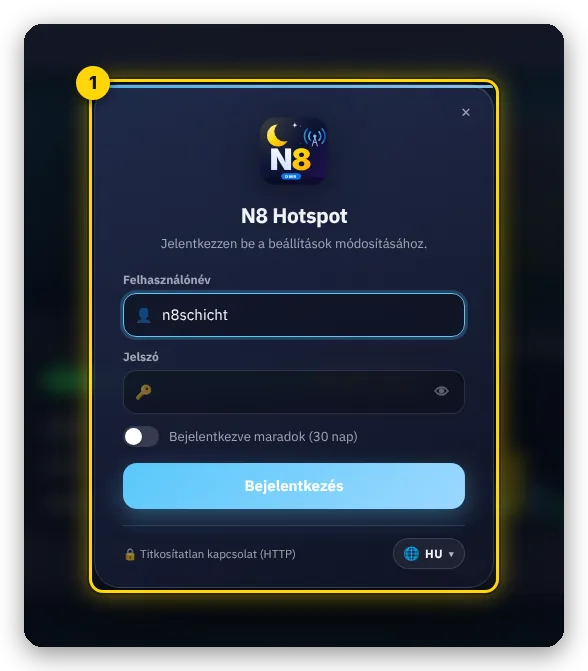
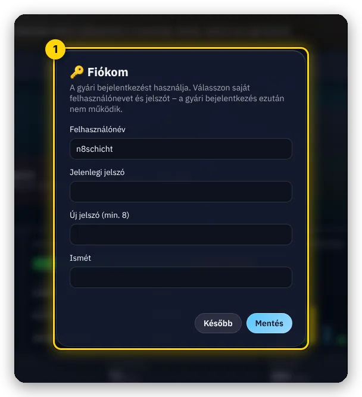
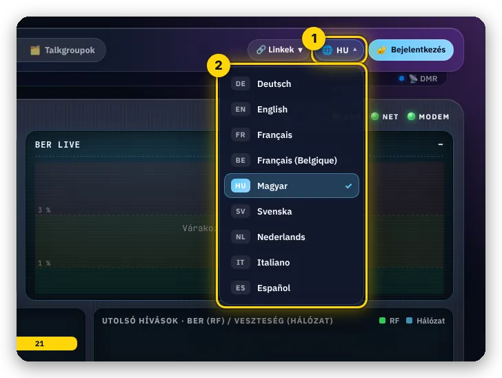
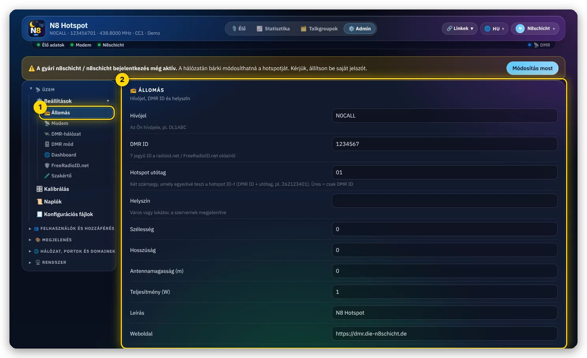
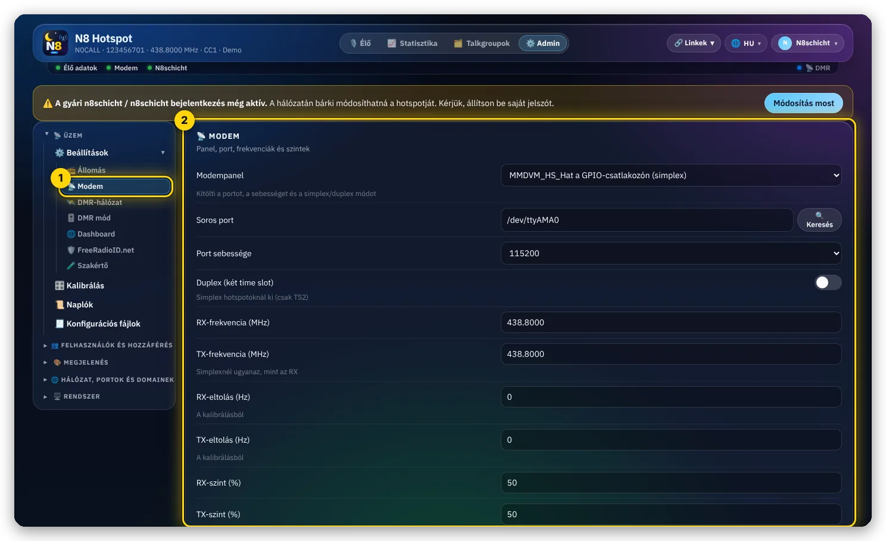
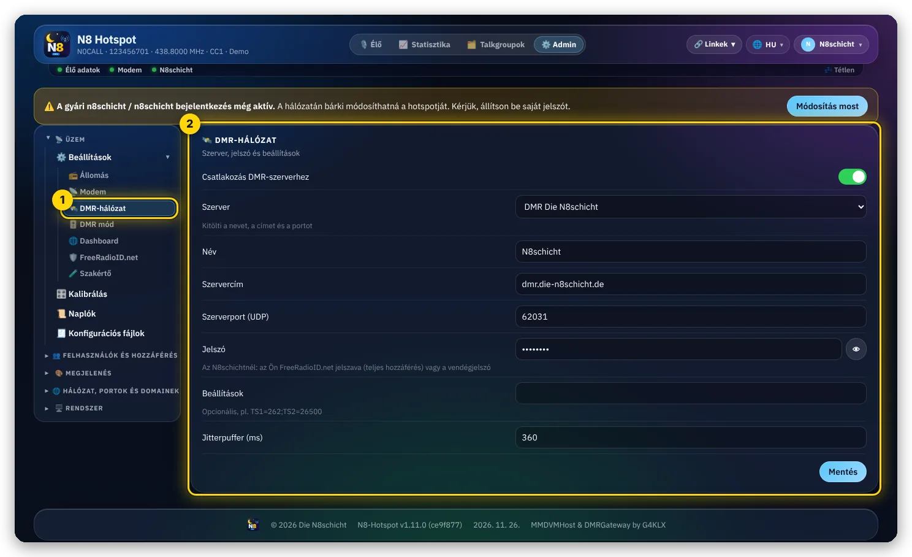
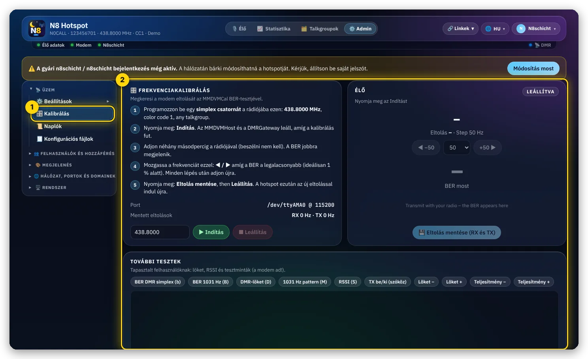
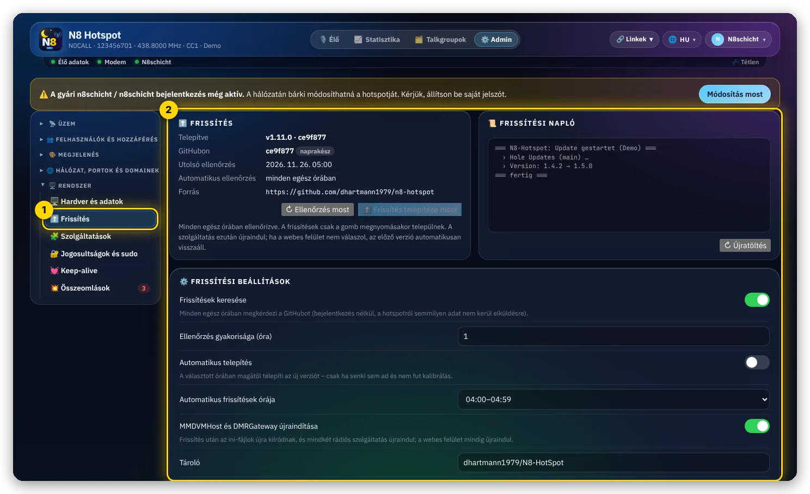

# 📘 N8 Hotspot – Lépésről lépésre

<sub>Nyelv: [🇩🇪 Deutsch](../de/README.md) · [🇬🇧 English](../en/README.md) · [🇫🇷 Français](../fr/README.md) · [🇧🇪 Français (Belgique)](../fr-BE/README.md) · **🇭🇺 Magyar** · [🇸🇪 Svenska](../sv/README.md) · [🇳🇱 Nederlands](../nl/README.md) · [🇮🇹 Italiano](../it/README.md) · [🇪🇸 Español](../es/README.md)</sub>

Az N8 Hotspot webes felület az MMDVMHosthoz és a DMRGatewayhez egy modem-hattal felszerelt Raspberry Pi-n. Ez az útmutató végigvezet az első lépéseken.

> 💡 A képeken lévő sárga számok a szövegben szereplő számokhoz tartoznak.

## Tartalom

1. [Telepítés](#1-telepítés)
2. [Bejelentkezés](#2-bejelentkezés)
3. [Saját jelszó beállítása](#3-saját-jelszó-beállítása)
4. [Nyelv kiválasztása](#4-nyelv-kiválasztása)
5. [Az állomás megadása](#5-az-állomás-megadása)
6. [A modem beállítása](#6-a-modem-beállítása)
7. [Csatlakozás a DMR-szerverhez](#7-csatlakozás-a-dmr-szerverhez)
8. [A frekvencia kalibrálása](#8-a-frekvencia-kalibrálása)
9. [Frissítés](#9-frissítés)

## 1. Telepítés

A legegyszerűbb a kész DietPi-képfájl: írja SD-kártyára, tegye a Raspberry Pi-be, kapcsolja be. Vagy egy futó DietPi-n:

```bash
git clone https://github.com/dhartmann1979/N8-HotSpot
cd N8-HotSpot
sudo ./scripts/setup.sh
```

Utána a felület itt érhető el: `http://n8-hotspot.local` (vagy az IP-cím).

## 2. Bejelentkezés

<p align="center"></p>

Kattintson jobbra fent a **🔐 Bejelentkezés** gombra, és a bejelentkezési ablakban ① lépjen be a gyári **n8schicht / n8schicht** adatokkal. A 👁 megmutatja a jelszót, a „Bejelentkezve maradok” megspórolja a következő bejelentkezést.

## 3. Saját jelszó beállítása

<p align="center"></p>

Amíg a gyári bejelentkezés érvényes, a **🔑 Fiókom** ① nyílik meg, és semmilyen beállítás nem módosítható. Válasszon saját felhasználónevet és legalább 8 karakteres jelszót – ezután a gyári bejelentkezés nem működik.

## 4. Nyelv kiválasztása

<p align="center"></p>

Jobbra fent a **🌐 HU ▾** ① megnyitja a nyelvi menüt ② kilenc nyelvvel. A választás azonnal érvényes, és a szerver összes N8-felületére vonatkozik. Az első látogatáskor a böngésző nyelve érvényes.

## 5. Az állomás megadása

<p align="center"></p>

Az admin területen az **📡 Üzem → ⚙️ Beállítások → 📻 Állomás** alatt ① adja meg a hívójelet, a DMR ID-t és a helyszínt ②. Két számjegy hotspot-utótagként egyedivé teszi a hotspot ID-t, ha több eszköze van.

## 6. A modem beállítása

<p align="center"></p>

A **📡 Modem** alatt ① válassza ki a modempanelt ② – ez kitölti a portot, a sebességet és a simplex/duplex módot. A **Modem keresése** magától megtalálja a portot. Ezután adja meg az adási és vételi frekvenciát; simplexnél a kettő azonos.

## 7. Csatlakozás a DMR-szerverhez

<p align="center"></p>

A **🛰️ DMR-hálózat** alatt ① válassza ki a szervert a listából ② (kitölti a nevet, a címet és a portot), és adja meg a jelszót – az N8schichtnél a FreeRadioID.net-jelszavát a teljes hozzáféréshez.

## 8. A frekvencia kalibrálása

<p align="center"></p>

A **🎛️ Kalibrálás** alatt ① megtalálja a modem frekvenciaeltolását ②: indítsa el, adjon a rádiójával a megjelenített simplex frekvencián, és tolja el a frekvenciát, amíg a BER a legalacsonyabb (ideálisan 1 % alatt). Ezután mentse az eltolást.

## 9. Frissítés

<p align="center"></p>

A **🖥️ Rendszer → ⬆️ Frissítés** alatt ① látja a telepített verziót, és hogy van-e újabb a GitHubon ②. A **⬆️ Frissítés telepítése most** letölti, majd ellenőrzi a webes felületet, és hiba esetén automatikusan visszaállítja az előző verziót. Ehhez nem kell jelszó.

---

📖 Részletes leírás (német): [docs/de/installation.md](../../../docs/de/installation.md)
