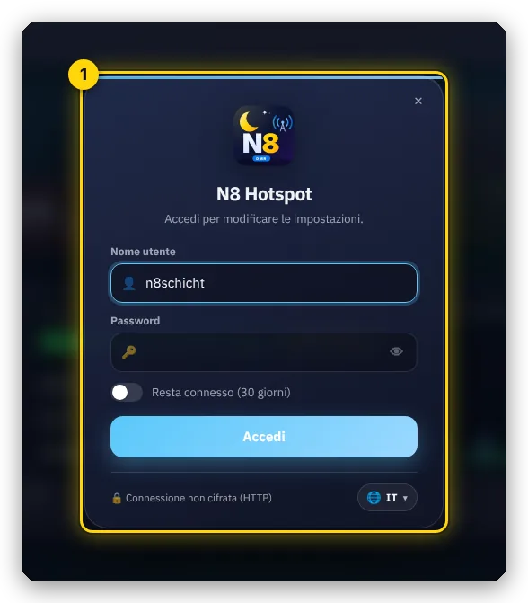
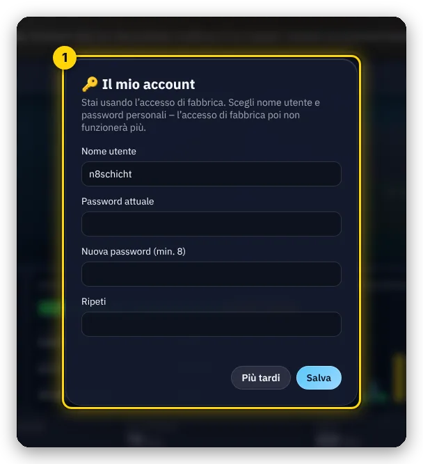
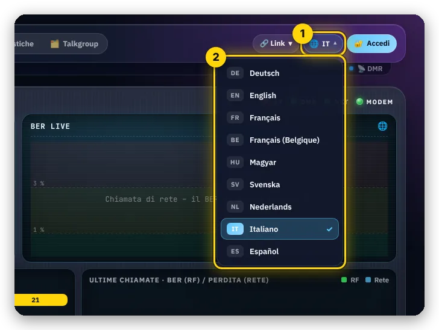
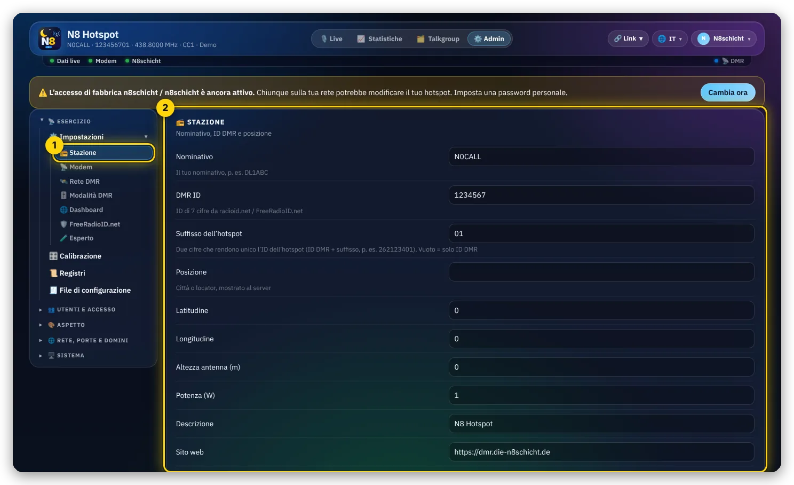
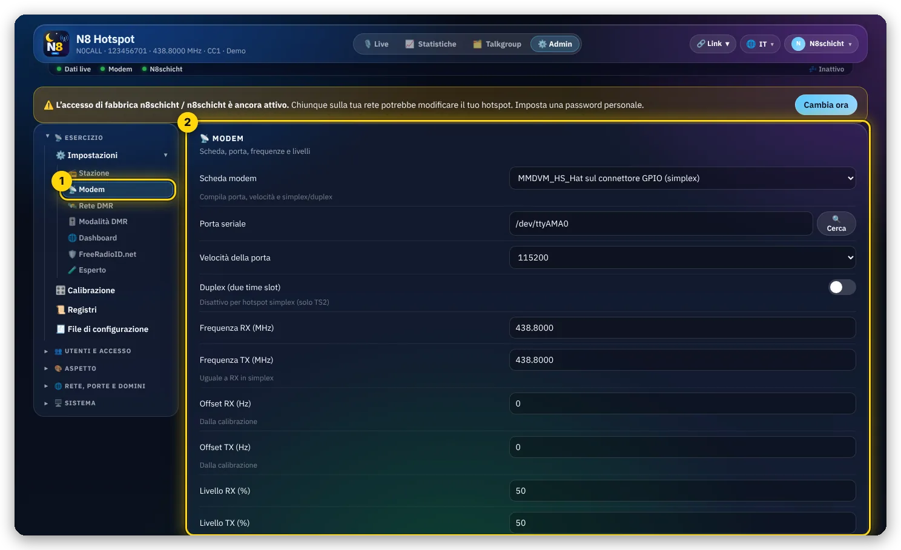
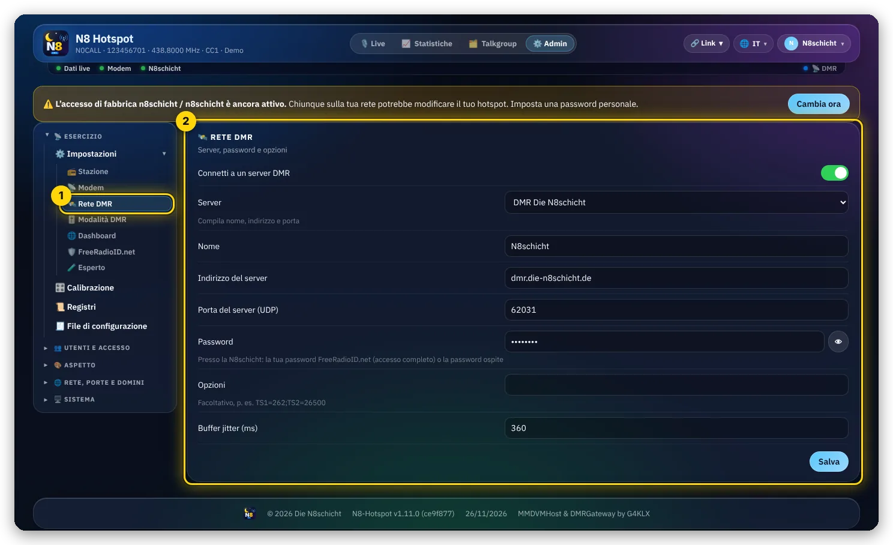
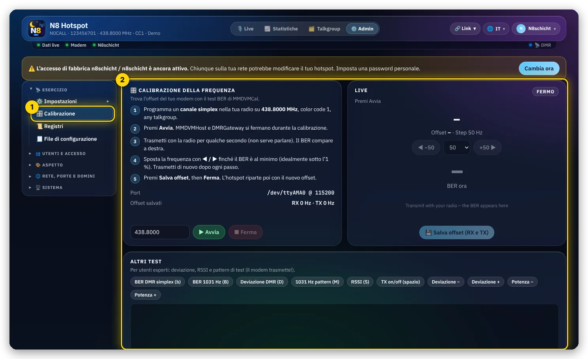
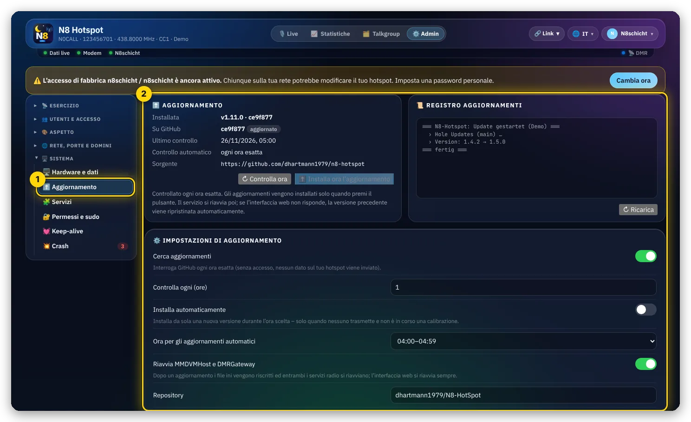

# 📘 N8 Hotspot – Passo dopo passo

<sub>Lingua: [🇩🇪 Deutsch](../de/README.md) · [🇬🇧 English](../en/README.md) · [🇫🇷 Français](../fr/README.md) · [🇧🇪 Français (Belgique)](../fr-BE/README.md) · [🇭🇺 Magyar](../hu/README.md) · [🇸🇪 Svenska](../sv/README.md) · [🇳🇱 Nederlands](../nl/README.md) · **🇮🇹 Italiano** · [🇪🇸 Español](../es/README.md)</sub>

N8 Hotspot è un’interfaccia web per MMDVMHost e DMRGateway su un Raspberry Pi con scheda modem. Questa guida ti accompagna nei primi passi.

> 💡 I numeri gialli nelle immagini corrispondono ai numeri nel testo.

## Indice

1. [Installare](#1-installare)
2. [Accedere](#2-accedere)
3. [Impostare una password personale](#3-impostare-una-password-personale)
4. [Scegliere la lingua](#4-scegliere-la-lingua)
5. [Inserire la stazione](#5-inserire-la-stazione)
6. [Impostare il modem](#6-impostare-il-modem)
7. [Collegarsi al server DMR](#7-collegarsi-al-server-dmr)
8. [Calibrare la frequenza](#8-calibrare-la-frequenza)
9. [Aggiornare](#9-aggiornare)

## 1. Installare

La via più semplice è l’immagine DietPi pronta: scriverla su una scheda SD, inserirla nel Raspberry Pi, accendere. In alternativa su un DietPi già in funzione:

```bash
git clone https://github.com/dhartmann1979/N8-HotSpot
cd N8-HotSpot
sudo ./scripts/setup.sh
```

Dopo l’interfaccia è raggiungibile su `http://n8-hotspot.local` (o l’indirizzo IP).

## 2. Accedere

<p align="center"></p>

Fai clic su **🔐 Accedi** in alto a destra e accedi nella finestra di accesso ① con l’accesso di fabbrica **n8schicht / n8schicht**. 👁 mostra la password, «Resta connesso» evita l’accesso la volta successiva.

## 3. Impostare una password personale

<p align="center"></p>

Finché vale l’accesso di fabbrica, si apre **🔑 Il mio account** ① e non si possono modificare impostazioni. Scegli nome utente e password personali di almeno 8 caratteri – poi l’accesso di fabbrica non funziona più.

## 4. Scegliere la lingua

<p align="center"></p>

In alto a destra **🌐 IT ▾** ① apre il menu delle lingue ② con nove lingue. La scelta vale subito e per tutte le interfacce N8 di questo server. Alla prima visita viene usata la lingua del browser.

## 5. Inserire la stazione

<p align="center"></p>

Nell’area admin, in **📡 Esercizio → ⚙️ Impostazioni → 📻 Stazione** ①, inserisci nominativo, ID DMR e posizione ②. Due cifre come suffisso dell’hotspot rendono unico l’ID dell’hotspot se hai più dispositivi.

## 6. Impostare il modem

<p align="center"></p>

In **📡 Modem** ① scegli la scheda modem ② – questo compila porta, velocità e simplex/duplex. **Trova il modem** trova da solo la porta. Poi inserisci le frequenze di trasmissione e ricezione; in simplex sono uguali.

## 7. Collegarsi al server DMR

<p align="center"></p>

In **🛰️ Rete DMR** ① scegli il server dalla lista ② (compila nome, indirizzo e porta) e inserisci la password – presso la N8schicht la tua password FreeRadioID.net per l’accesso completo.

## 8. Calibrare la frequenza

<p align="center"></p>

In **🎛️ Calibrazione** ① trovi l’offset di frequenza del tuo modem ②: avvia, trasmetti con la radio sulla frequenza simplex indicata e sposta la frequenza finché il BER è minimo (idealmente sotto l’1 %). Poi salva l’offset.

## 9. Aggiornare

<p align="center"></p>

In **🖥️ Sistema → ⬆️ Aggiornamento** ① vedi la versione installata e se GitHub ne ha una più recente ②. **⬆️ Installa ora l’aggiornamento** la scarica, poi controlla l’interfaccia web e in caso di errore ripristina automaticamente la versione precedente. Non serve alcuna password.

---

📖 Descrizione dettagliata (tedesco): [docs/de/installation.md](../../../docs/de/installation.md)
