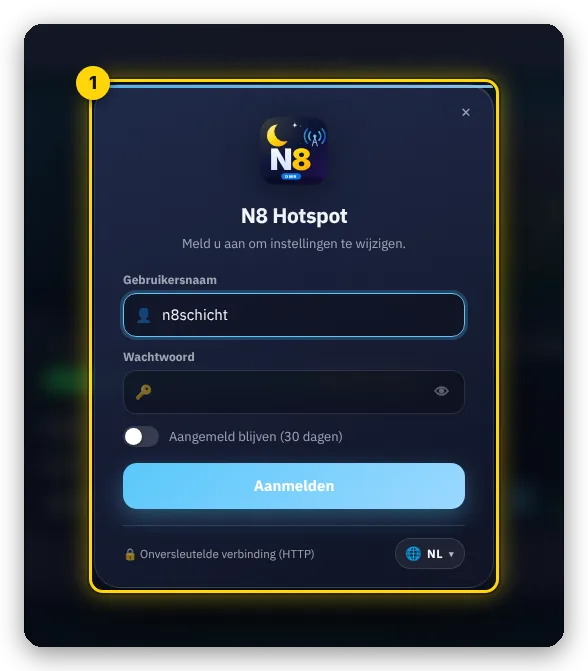
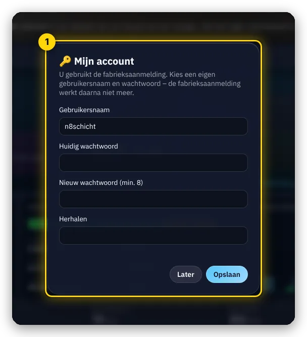
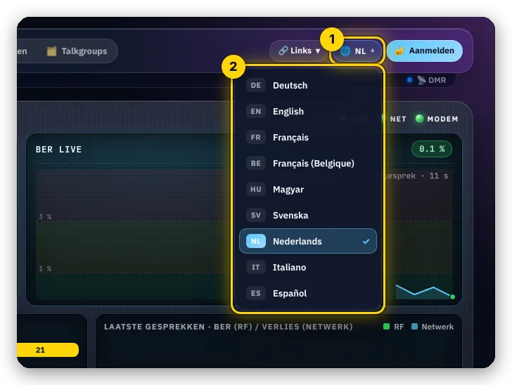
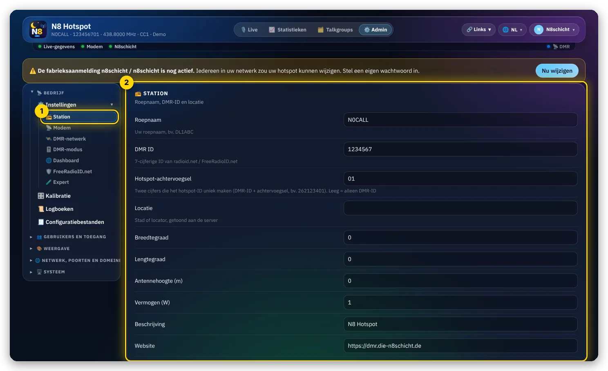
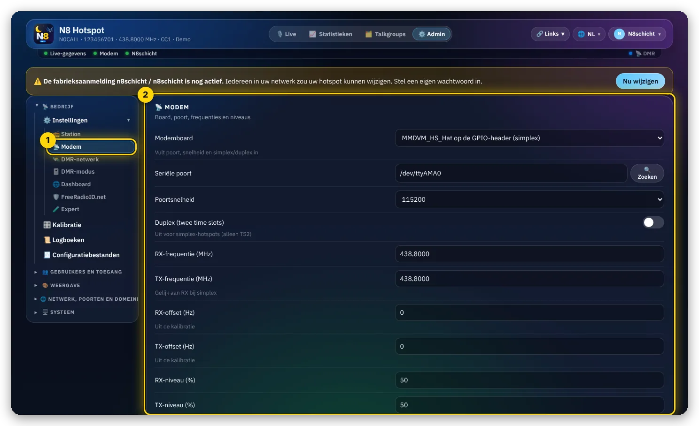
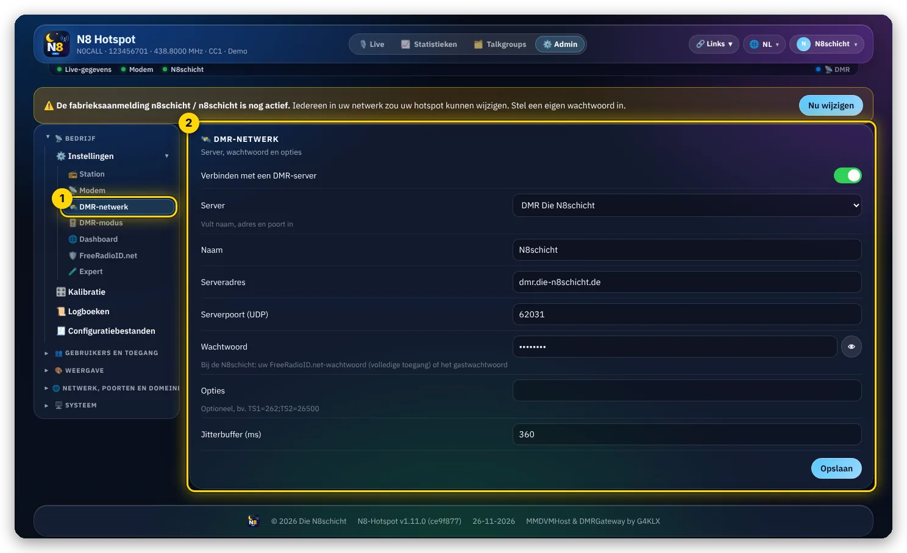
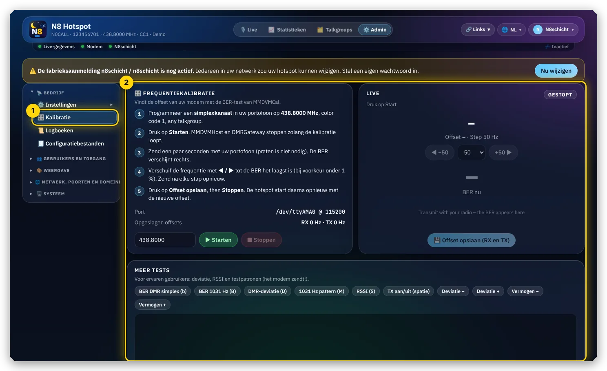
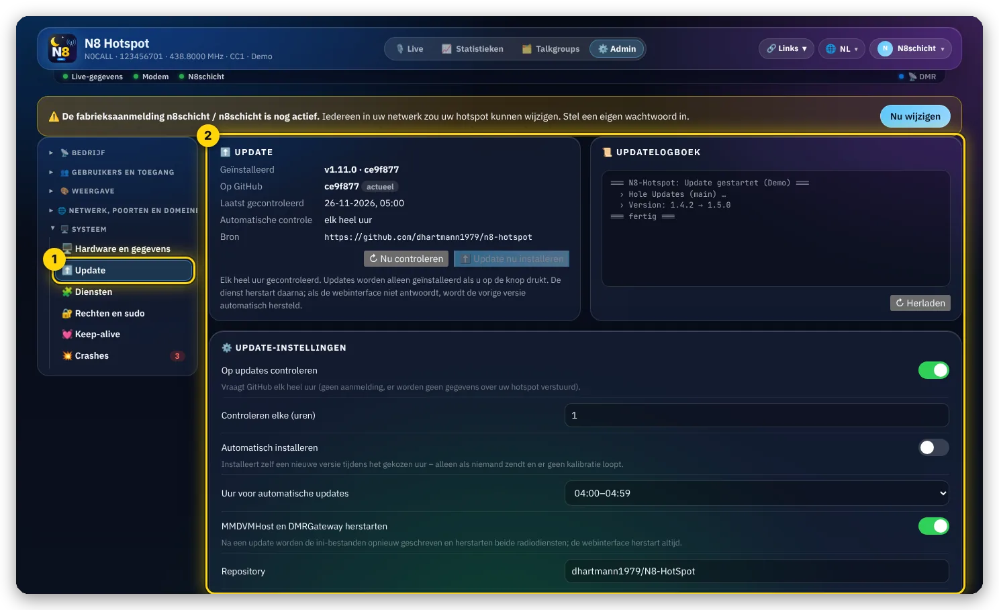

# 📘 N8 Hotspot – Stap voor stap

<sub>Taal: [🇩🇪 Deutsch](../de/README.md) · [🇬🇧 English](../en/README.md) · [🇫🇷 Français](../fr/README.md) · [🇧🇪 Français (Belgique)](../fr-BE/README.md) · [🇭🇺 Magyar](../hu/README.md) · [🇸🇪 Svenska](../sv/README.md) · **🇳🇱 Nederlands** · [🇮🇹 Italiano](../it/README.md) · [🇪🇸 Español](../es/README.md)</sub>

De N8 Hotspot is een webinterface voor MMDVMHost en DMRGateway op een Raspberry Pi met modem-hat. Deze handleiding leidt u door de eerste stappen.

> 💡 De gele cijfers in de afbeeldingen horen bij de cijfers in de tekst.

## Inhoud

1. [Installeren](#1-installeren)
2. [Aanmelden](#2-aanmelden)
3. [Eigen wachtwoord instellen](#3-eigen-wachtwoord-instellen)
4. [Taal kiezen](#4-taal-kiezen)
5. [Het station invoeren](#5-het-station-invoeren)
6. [Het modem instellen](#6-het-modem-instellen)
7. [Verbinden met de DMR-server](#7-verbinden-met-de-dmr-server)
8. [De frequentie kalibreren](#8-de-frequentie-kalibreren)
9. [Bijwerken](#9-bijwerken)

## 1. Installeren

Het eenvoudigst is de kant-en-klare DietPi-image: op een SD-kaart schrijven, in de Raspberry Pi steken, opstarten. Of op een draaiende DietPi:

```bash
git clone https://github.com/dhartmann1979/N8-HotSpot
cd N8-HotSpot
sudo ./scripts/setup.sh
```

Daarna is de interface bereikbaar op `http://n8-hotspot.local` (of het IP-adres).

## 2. Aanmelden

<p align="center"></p>

Klik rechtsboven op **🔐 Aanmelden** en meld u in het aanmeldvenster ① aan met de fabrieksaanmelding **n8schicht / n8schicht**. 👁 toont het wachtwoord, „Aangemeld blijven” bespaart de volgende keer het aanmelden.

## 3. Eigen wachtwoord instellen

<p align="center"></p>

Zolang de fabrieksaanmelding geldt, opent **🔑 Mijn account** ① en kunnen geen instellingen worden gewijzigd. Kies een eigen gebruikersnaam en een wachtwoord van minstens 8 tekens – daarna werkt de fabrieksaanmelding niet meer.

## 4. Taal kiezen

<p align="center"></p>

Rechtsboven opent **🌐 NL ▾** ① het taalmenu ② met negen talen. De keuze geldt direct en voor alle N8-interfaces op deze server. Bij het eerste bezoek wordt de taal van de browser gebruikt.

## 5. Het station invoeren

<p align="center"></p>

In het beheergedeelte onder **📡 Bedrijf → ⚙️ Instellingen → 📻 Station** ① voert u roepnaam, DMR-ID en locatie in ②. Twee cijfers als hotspot-achtervoegsel maken de hotspot-ID uniek als u meerdere apparaten hebt.

## 6. Het modem instellen

<p align="center"></p>

Onder **📡 Modem** ① kiest u het modemboard ② – dat vult poort, snelheid en simplex/duplex in. **Het modem zoeken** vindt de poort zelf. Voer daarna zend- en ontvangstfrequentie in; bij simplex zijn beide gelijk.

## 7. Verbinden met de DMR-server

<p align="center"></p>

Onder **🛰️ DMR-netwerk** ① kiest u de server uit de lijst ② (vult naam, adres en poort in) en voert u het wachtwoord in – bij de N8schicht uw FreeRadioID.net-wachtwoord voor volledige toegang.

## 8. De frequentie kalibreren

<p align="center"></p>

Onder **🎛️ Kalibratie** ① vindt u de frequentie-offset van uw modem ②: starten, met uw portofoon op de getoonde simplexfrequentie zenden en de frequentie verschuiven tot de BER het laagst is (bij voorkeur onder 1 %). Sla daarna de offset op.

## 9. Bijwerken

<p align="center"></p>

Onder **🖥️ Systeem → ⬆️ Update** ① ziet u de geïnstalleerde versie en of GitHub een nieuwere heeft ②. **⬆️ Update nu installeren** downloadt hem, controleert daarna de webinterface en zet bij een fout automatisch de vorige versie terug. Hiervoor is geen wachtwoord nodig.

---

📖 Uitgebreide beschrijving (Duits): [docs/de/installation.md](../../../docs/de/installation.md)
