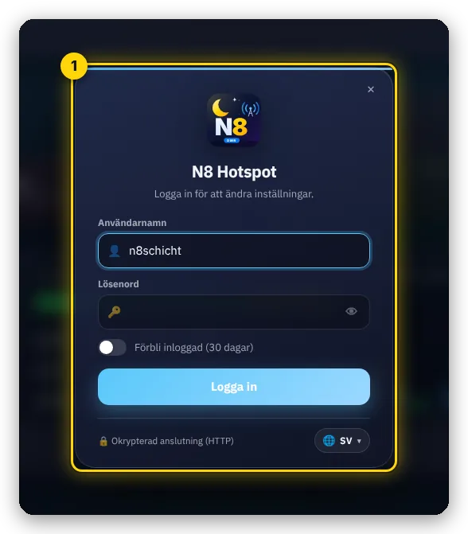
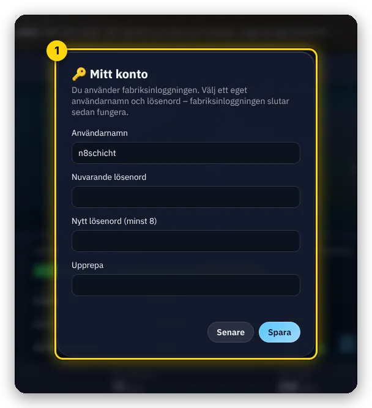
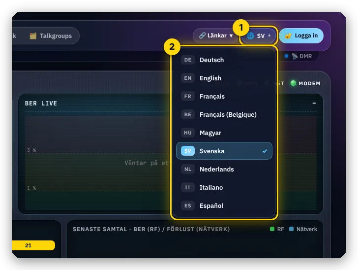
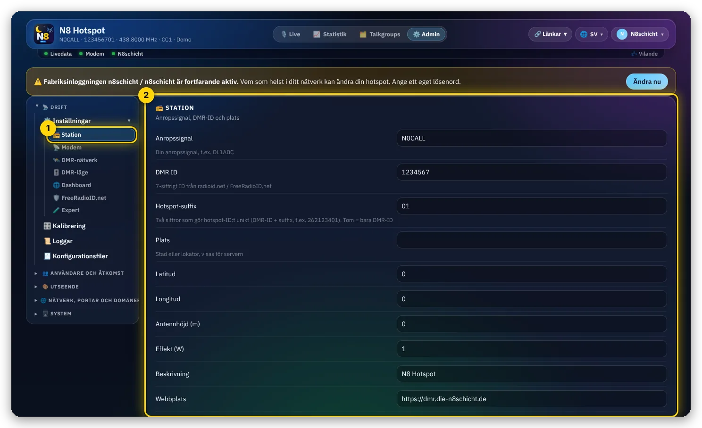
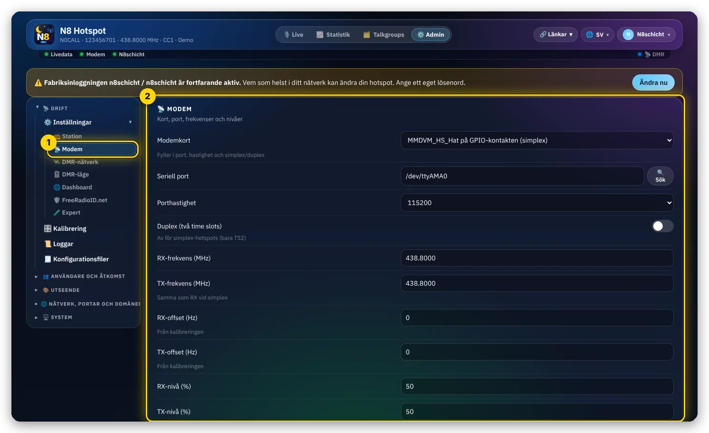
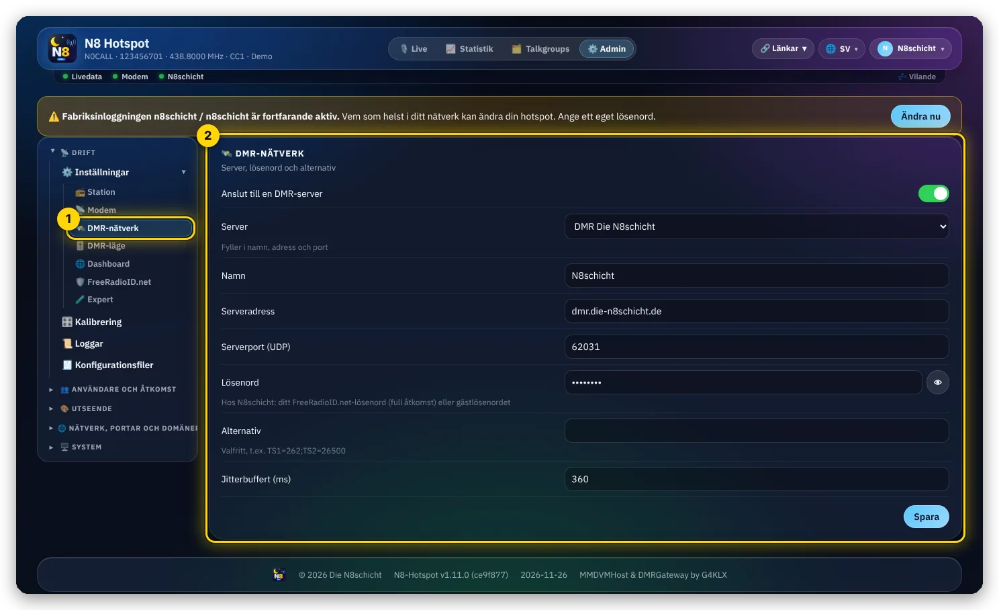
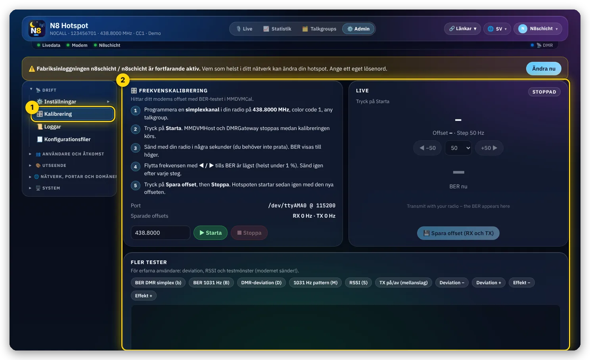
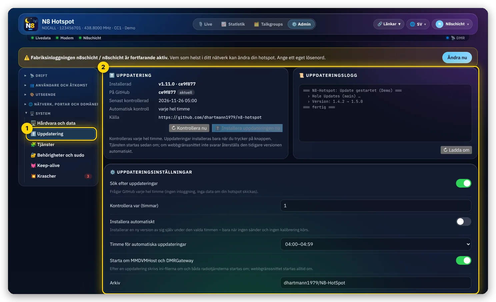

# 📘 N8 Hotspot – Steg för steg

<sub>Språk: [🇩🇪 Deutsch](../de/README.md) · [🇬🇧 English](../en/README.md) · [🇫🇷 Français](../fr/README.md) · [🇧🇪 Français (Belgique)](../fr-BE/README.md) · [🇭🇺 Magyar](../hu/README.md) · **🇸🇪 Svenska** · [🇳🇱 Nederlands](../nl/README.md) · [🇮🇹 Italiano](../it/README.md) · [🇪🇸 Español](../es/README.md)</sub>

N8 Hotspot är ett webbgränssnitt för MMDVMHost och DMRGateway på en Raspberry Pi med modemkort. Denna guide tar dig genom de första stegen.

> 💡 De gula siffrorna i bilderna hör till siffrorna i texten.

## Innehåll

1. [Installera](#1-installera)
2. [Logga in](#2-logga-in)
3. [Sätt ett eget lösenord](#3-sätt-ett-eget-lösenord)
4. [Välj språk](#4-välj-språk)
5. [Ange stationen](#5-ange-stationen)
6. [Ställ in modemet](#6-ställ-in-modemet)
7. [Anslut till DMR-servern](#7-anslut-till-dmr-servern)
8. [Kalibrera frekvensen](#8-kalibrera-frekvensen)
9. [Uppdatera](#9-uppdatera)

## 1. Installera

Enklast är den färdiga DietPi-avbilden: skriv den till ett SD-kort, sätt in det i Raspberry Pi, starta. Alternativt på en körande DietPi:

```bash
git clone https://github.com/dhartmann1979/N8-HotSpot
cd N8-HotSpot
sudo ./scripts/setup.sh
```

Därefter nås gränssnittet på `http://n8-hotspot.local` (eller IP-adressen).

## 2. Logga in

<p align="center"></p>

Klicka på **🔐 Logga in** uppe till höger och logga in i inloggningsfönstret ① med fabriksinloggningen **n8schicht / n8schicht**. 👁 visar lösenordet, ”Förbli inloggad” sparar inloggningen nästa gång.

## 3. Sätt ett eget lösenord

<p align="center"></p>

Så länge fabriksinloggningen gäller öppnas **🔑 Mitt konto** ① och inga inställningar kan ändras. Välj ett eget användarnamn och ett lösenord på minst 8 tecken – därefter fungerar fabriksinloggningen inte längre.

## 4. Välj språk

<p align="center"></p>

Uppe till höger öppnar **🌐 SV ▾** ① språkmenyn ② med nio språk. Valet gäller direkt och för alla N8-gränssnitt på denna server. Vid första besöket används webbläsarens språk.

## 5. Ange stationen

<p align="center"></p>

I adminområdet under **📡 Drift → ⚙️ Inställningar → 📻 Station** ① anger du anropssignal, DMR-ID och plats ②. Två siffror som hotspot-suffix gör hotspot-ID:t unikt om du har flera enheter.

## 6. Ställ in modemet

<p align="center"></p>

Under **📡 Modem** ① väljer du modemkortet ② – det fyller i port, hastighet och simplex/duplex. **Hitta modemet** hittar porten själv. Ange sedan sänd- och mottagningsfrekvens; vid simplex är de lika.

## 7. Anslut till DMR-servern

<p align="center"></p>

Under **🛰️ DMR-nätverk** ① väljer du servern i listan ② (fyller i namn, adress och port) och anger lösenordet – hos N8schicht ditt FreeRadioID.net-lösenord för full åtkomst.

## 8. Kalibrera frekvensen

<p align="center"></p>

Under **🎛️ Kalibrering** ① hittar du modemets frekvensoffset ②: starta, sänd med din radio på den visade simplexfrekvensen och flytta frekvensen tills BER är lägst (helst under 1 %). Spara sedan offseten.

## 9. Uppdatera

<p align="center"></p>

Under **🖥️ System → ⬆️ Uppdatering** ① ser du den installerade versionen och om GitHub har en nyare ②. **⬆️ Installera uppdateringen nu** laddar ner den, kontrollerar sedan webbgränssnittet och återställer automatiskt den tidigare versionen om något går fel. Inget lösenord behövs för detta.

---

📖 Utförlig beskrivning (tyska): [docs/de/installation.md](../../../docs/de/installation.md)
