# ⚙️ Adminbereich

[← Übersicht](../../readme.md) · [Installation](installation.md) · [Live & Statistik](bedienung.md) · **Adminbereich** · [Updates](updates.md) · [Kalibrierung](kalibrierung.md) · [FreeRadioID](freeradioid.md) · [Technik](technik.md) · [Fehlersuche](fehlersuche.md)

---

## Das Menü

<p align="center"></p>

Seit **1.6.0** steht links ein **Baum-Menü** – dasselbe wie im ADN-FRN-Server, HBlink4-FreeRadioID und N8 Crosslink,
mit denselben Gruppen in derselben Reihenfolge:

| Gruppe | Einträge beim Hotspot |
|---|---|
| 📡 **Betrieb** | ⚙️ Einstellungen (Zweige: Station, Modem, DMR-Netz, DMR-Betrieb, Dashboard, FreeRadioID.net, Experte) · 🎛️ Kalibrierung · 📜 Protokolle · 🧾 Konfigurationsdateien |
| 👥 **Benutzer & Zugang** | 👥 Benutzer · 🔑 Sitzungen · 📜 Protokoll |
| 🎨 **Darstellung** | 🎨 Aussehen · 🔗 Links |
| 🌐 **Netz, Ports & Domains** | 🔌 Ports |
| 🖥️ **System** | 🖥️ Hardware & Daten · ⬆️ Update · 🧩 Dienste · 🔐 Berechtigungen & sudo · 💓 Keep-Alive · 💥 Abstürze |

Alle Gruppen sind **anfangs zugeklappt** – offen ist nur die Gruppe der gerade gewählten Seite; ein Klick auf eine Gruppe klappt sie auf (gemerkt bis zum Schließen des Browser-Tabs). Seit 1.6.2 hängen die Abschnitte der Einstellungen als Zweige darunter – ein Zweig zeigt nur diesen Abschnitt in voller Breite. Auf dem Handy wird das Menü zu einer Leiste
„☰ *aktueller Bereich*“, die sich aufklappen lässt. Kacheln einer Reihe sind gleich hoch, die Knöpfe stehen unten bündig.

<p align="center">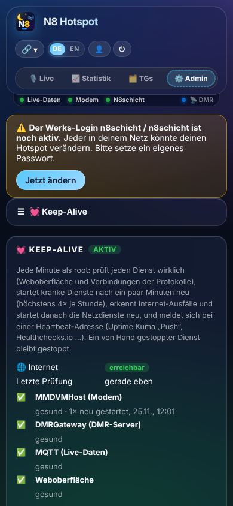</p>

## Anmelden und Standard-Login

<p align="center">
  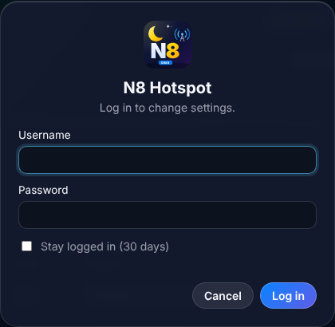
  &nbsp;
  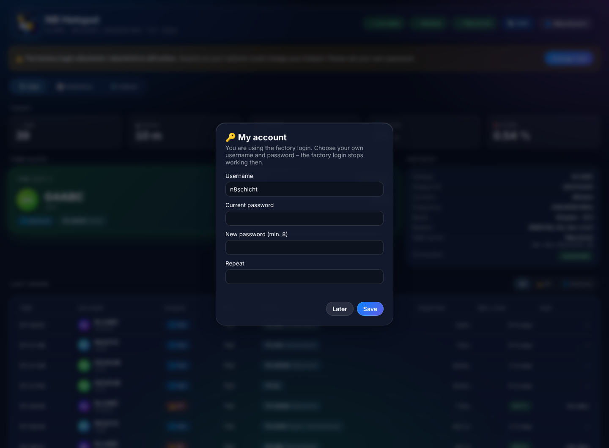
</p>

Ab Werk gibt es einen Admin: **Benutzer `n8schicht`, Passwort `n8schicht`**. Solange dieses Passwort gilt, passiert Folgendes:

- **Nach dem Login** öffnet sich sofort *My account*. Dort setzt du einen eigenen Benutzernamen und ein Passwort mit mindestens 8 Zeichen; `n8schicht` ist nicht erlaubt.
- **Im Adminbereich** steht oben eine gelbe Warnung mit **Change now**.
- **In der Benutzerliste** steht beim Benutzer *factory password*.

Nach der Änderung werden alle Sitzungen beendet und der Werks-Login funktioniert nicht mehr. *My account* erreichst du jederzeit über deinen Namen oben rechts.

Nach 5 falschen Passwörtern ist der Login für 15 Minuten gesperrt. Mit *Stay logged in* bleibst du 30 Tage angemeldet, sonst so lange wie unter *Session length* eingestellt.

## ⚙️ Settings

<p align="center"></p>

Jeder Abschnitt hat einen eigenen **Save**-Knopf. Die Werte landen in SQLite, und daraus schreibt N8-Hotspot sofort `MMDVM-Host.ini` und `DMRGateway.ini`. MMDVMHost und DMRGateway lesen sie beim nächsten Start; dafür erscheint oben der blaue Hinweis mit **Restart now**.

| Abschnitt | Einstellungen |
|---|---|
| 📻 **Station** | Rufzeichen, DMR-ID, Hotspot-Suffix (zwei Ziffern → Hotspot-ID `262123401`), Ort, Koordinaten, Antennenhöhe, Leistung, Beschreibung, Website. Diese Angaben sieht der Server. |
| 📡 **Modem** | Board-Vorlage, die Port, Geschwindigkeit und Simplex/Duplex einträgt: *MMDVM_HS_Hat GPIO*, *Dual Hat GPIO*, *ZUMspot/HS per USB*, *Repeater-Board USB*. Dazu RX/TX-Frequenz in MHz, **RX/TX-Offset** (aus der [Kalibrierung](kalibrierung.md)), RX/TX-Pegel, RF-Leistung, Invertierungen, TX- und DMR-Delay. |
| 🛰️ **DMR network** | Verbindung an/aus. Server-Vorlage: **DMR Die N8schicht** (`dmr.die-n8schicht.de:62031`) oder ein eigener HomeBrew-Server. Dazu Name, Adresse, Port, **Passwort**, *Options* (z. B. `TS1=262;TS2=26500`, wenn der Server das erlaubt) und Jitter-Puffer. |
| 🎚️ **DMR mode** | Color Code, Zeitschlitz 1 (nur Duplex) und 2, *nur eigene ID darf senden*, Talker Alias, Call-/TX-Hang, Timeout, Mode-Hang, CW-ID |
| 🌐 **Dashboard** | Titel, **Public view** (Sichtbereich ohne Login), Sitzungsdauer, DMR-ID-Liste (**FreeRadioID.net**, Vorgabe, oder radioid.net), Uhrzeit des täglichen Updates, Aufbewahrung der Gespräche, **Talkgroup-Liste der N8schicht** an/aus und ihre URL, **eigene Talkgroup-Namen** (`26500 = N8schicht Ortsrunde`, eine pro Zeile; sie überschreiben die Liste oder ergänzen fehlende Talkgroups) |
| 🛡️ **FreeRadioID.net** | registrierte IDs laden (FRID), **Avatare** anzeigen, **Profile** abrufen; siehe [FreeRadioID](freeradioid.md) |
| 🧪 **Expert** | Zusätzliche Zeilen für `MMDVM-Host.ini` und `DMRGateway.ini` im ini-Format. Sie ersetzen gleichnamige Schlüssel oder ergänzen ganze Abschnitte, z. B. `[Modem]` + `Trace=1`. |

### 📰 Live-Daten für die Portal-Seite des ADN FRN Servers (nur im lokalen Netz)

<p align="center">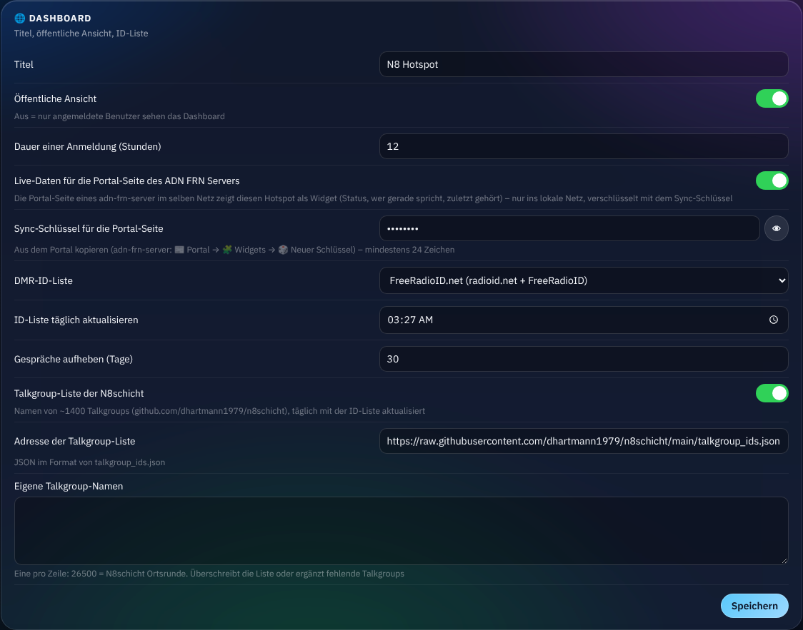</p>

Ab **1.13.0** kann ein [adn-frn-server](https://github.com/dhartmann1979/adn-frn-server/blob/main/docs/de/portal.md#-widgets-am-rand-live-daten-der-anderen-n8-systeme) **im selben Netz** diesen Hotspot als **Widget am Rand seiner Portal-Seite** zeigen:
Netz, wer gerade spricht (TG, Zeitschlitz, RF oder Netz), Durchgänge, Sprechzeit und Stationen heute, zuletzt gehört.

1. Im adn-frn-server: *📰 Portal → 🧩 Widgets → ＋ N8 Hotspot*, **LAN-Adresse** des Hotspots (z. B. `http://192.168.1.20`), **🎲 Neuer Schlüssel**, kopieren.
2. Hier: *Einstellungen → 🌐 Dashboard* → **Live-Daten für die Portal-Seite** an, **Sync-Schlüssel** einfügen, speichern.
3. Im Portal speichern – es ruft sofort ab.

- **Nur im lokalen Netz:** Der Hotspot beantwortet den Feed nur aus privaten Netzen (192.168.x.x, 10.x, 172.16–31.x, fd00::/8,
  Loopback); das Portal nimmt für einen Hotspot nur LAN-Adressen an.
- Verschlüsselt mit dem Sync-Schlüssel, jede Anfrage nur einmal und höchstens 5 Minuten gültig; ohne Anmeldung, auch wenn die öffentliche
  Ansicht aus ist. Es geht nur hinaus, was die Live-Seite zeigt – keine IP-Adressen, keine Konten. Standard: aus.

### 🔍 Wo steckt das Modem?

Neben **Serial port** im Abschnitt *Modem* öffnet **🔍 Find** ein Fenster mit:
- einer kurzen Erklärung, welche Schnittstelle wofür steht
- einem **Scan** aller seriellen Schnittstellen

<p align="center"> 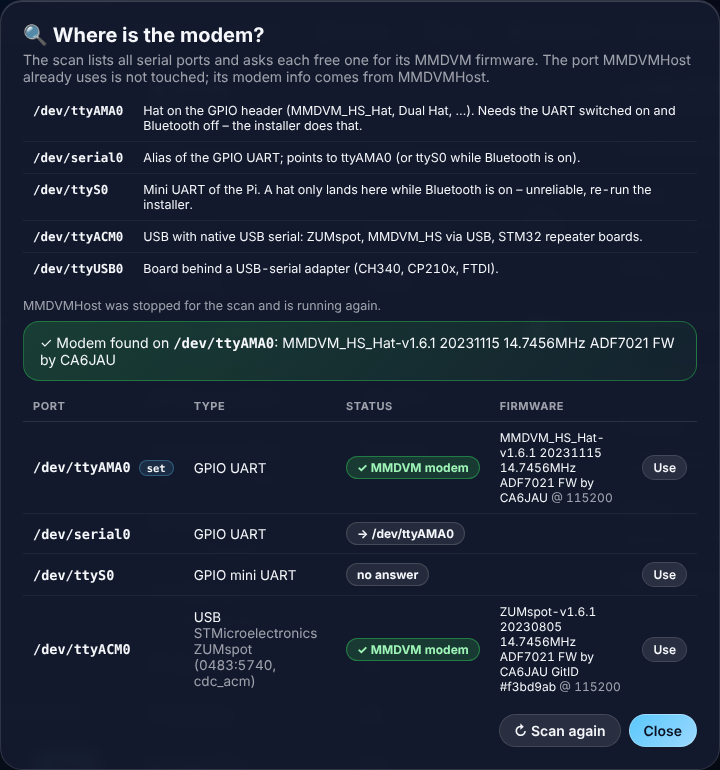</p>

| Schnittstelle | Typisch für |
|---|---|
| `/dev/ttyAMA0` | Hat auf der Stiftleiste (MMDVM_HS_Hat, Dual Hat …); UART an, Bluetooth aus, das erledigt der Installer |
| `/dev/serial0` | Alias der GPIO-Schnittstelle |
| `/dev/ttyS0` | Mini-UART des Pi; ein Hat landet nur hier, solange Bluetooth an ist (unzuverlässig, Installer erneut laufen lassen) |
| `/dev/ttyACM0` | USB mit eingebautem USB-Seriell: ZUMspot, MMDVM_HS per USB, STM32-Repeaterboards |
| `/dev/ttyUSB0` | Board hinter einem USB-Seriell-Adapter (CH340, CP210x, FTDI) |

Der Scan schickt jeder freien Schnittstelle die MMDVM-Abfrage *GET_VERSION* (bei 115200 und 460800 Baud) und zeigt die Antwort, also Board, Firmware und Version.
- **Belegt:** Die Schnittstelle, die MMDVMHost gerade benutzt, fasst der Scan nicht an. Er zeigt, wer sie belegt, und nimmt die Modem-Daten von MMDVMHost.
  Hat MMDVMHost eine Schnittstelle offen, erscheint der Knopf **Stop MMDVMHost & scan**: MMDVMHost wird für ein paar Sekunden angehalten,
  alle Schnittstellen werden direkt gefragt, danach läuft MMDVMHost wieder. Das hilft, wenn MMDVMHost am falschen Port hängt
  und deshalb selbst kein Modem meldet. (Während einer Kalibrierung geht das nicht.)
- **Berechtigungen:** Darf die Weboberfläche eine Schnittstelle nicht öffnen (*no permission*), steht oben ein gelber Kasten mit dem Grund
  und dem Befehl zum Reparieren: `sudo /opt/n8hotspot/scripts/n8-admin.sh fix-perms` (oder *System → Berechtigungen & sudo → Korrigieren*). Siehe [Updates → Dienste, Berechtigungen & sudo](updates.md#-dienste-berechtigungen--sudo).
- **USB:** Bei USB-Geräten stehen Hersteller, Produkt und USB-ID dabei.
- **Übernehmen:** **Use** trägt Port und Geschwindigkeit ein und wählt die passende Board-Vorlage (Simplex/Duplex). Danach **Save**.

Dieselbe Suche macht die [geführte Einrichtung](installation.md#geführte-einrichtung-setupsh) in Schritt 1, und sie gibt es auf der Kommandozeile:

```bash
cd /opt/n8hotspot && sudo python3 -m n8hotspot scan-serial
```

> 💡 **Passwortfeld:** Bleibt es leer oder zeigt `••••••••`, behält N8-Hotspot das alte Passwort. Mit 👁 siehst du, was du tippst.

## 🎛️ Calibration

Eigene Seite: [Kalibrierung](kalibrierung.md).

## 👥 Benutzer

Seit **1.8.0** in der gemeinsamen Ansicht aller N8-Systeme (Vorlage HBlink4-FreeRadioID): „＋ Benutzer anlegen“ in einer Zeile, Tabelle mit Rolle und letzter Anmeldung, je Benutzer **Bearbeiten** (Anzeigename, Passwort, Rolle, gesperrt, Löschen).

<p align="center"></p>

| Rolle | Darf |
|---|---|
| **Admin** | alles: Einstellungen, Kalibrierung, Benutzer, Dienste, Neustart |
| **Viewer** | Live und Statistik sehen, auch wenn *Public view* aus ist; nichts ändern |

Anlegen rechts. Mit **Edit** änderst du Name, Rolle und Passwort, kannst sperren oder löschen. Der letzte Admin kann weder gelöscht noch herabgestuft werden; du kannst dich auch nicht selbst sperren.

## 🎨 Appearance

<p align="center">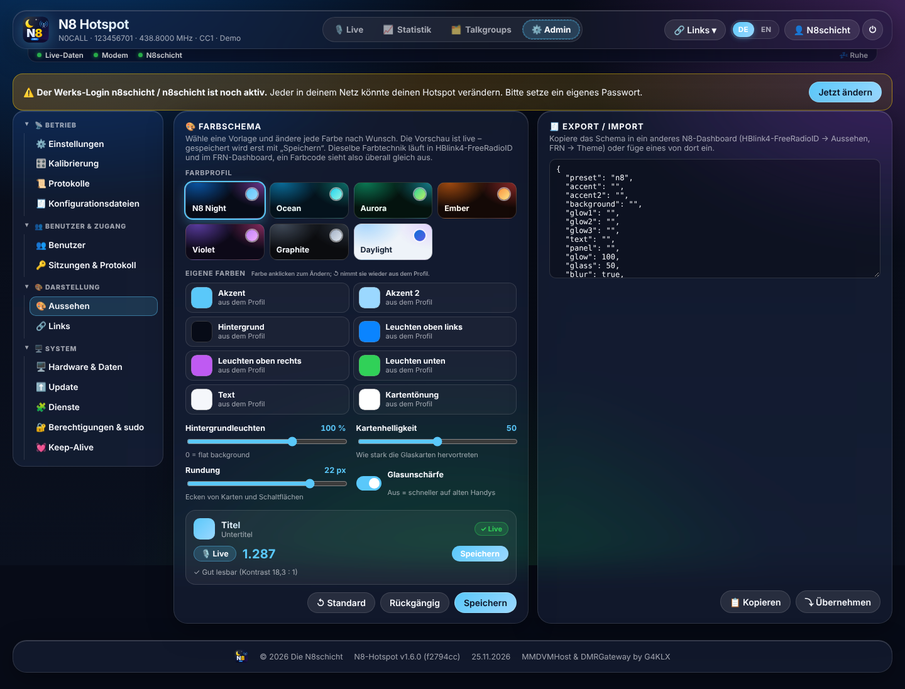</p>

Das Farbschema der ganzen Oberfläche – für alle Besucher, auch vor dem Login. Es ist dieselbe Farb-Engine
(**N8 Theme**) wie im Dashboard von HBlink4-FreeRadioID und in der FRN-Weboberfläche.

- **Colour profile:** sieben fertige Profile – *N8 Night* (Vorgabe), *Ocean*, *Aurora*, *Ember*, *Violet*, *Graphite* und das helle *Daylight*.
- **Own colours:** Jede Farbe lässt sich einzeln überschreiben: *Accent* (Knöpfe, aktive Tabs, Werte), *Accent 2* (Verlauf der Knöpfe und des Titels),
  *Background*, die drei Leuchtfarben (*Glow top left / top right / bottom*), *Text* und *Card tint*.
  „from profile“ heißt: die Farbe kommt aus dem Profil; ↺ setzt eine eigene Farbe wieder zurück.
- **Regler:** *Background glow* (0 = flacher Hintergrund), *Card brightness*, *Roundness* der Ecken und *Glass blur*
  (aus = schneller auf alten Handys).
- **Vorschau:** Unten im Kasten siehst du Titel, Tab, Zahl und Knopf in den neuen Farben, dazu die **Lesbarkeit**
  (Kontrast von Text zu Hintergrund; unter 4,5 : 1 gibt es eine Warnung).

Alles wirkt sofort als Vorschau auf der ganzen Seite, gespeichert wird erst mit **Save**. **Undo** holt das gespeicherte Schema zurück,
**↺ Default** das Werks-Schema. Rechts unter **Export / import** steht das Schema als JSON: **📋 Copy** kopiert es,
**⤵ Take over** übernimmt ein eingefügtes Schema (z. B. aus HBlink4-FreeRadioID → Appearance). So sehen alle N8-Dashboards gleich aus.

<p align="center">
  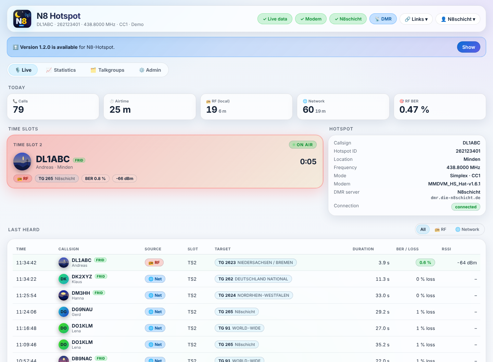
  
</p>
<p align="center">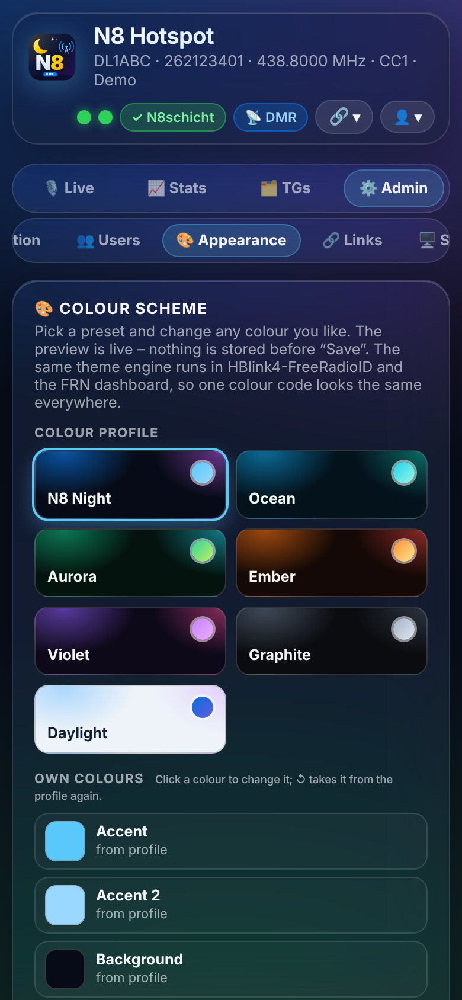</p>

## 🔗 Links

<p align="center"></p>

Eigene Links für das Menü **🔗 Links** oben rechts – sichtbar für alle Besucher.

| Spalte | Bedeutung |
|---|---|
| **Icon** | Emoji, das angezeigt wird, solange es kein Site-Icon gibt |
| **Name** | Text im Menü (max. 40 Zeichen) |
| **Address** | `https://…`, `http://…`, `mailto:…` oder eine Adresse auf dem Hotspot (`/…`, `#…`) |
| **Site icon** | holt das Favicon der verlinkten Seite (✓ = im Cache, – = keins gefunden) |
| **New tab** | Link in einem neuen Tab öffnen |

Mit ↑ änderst du die Reihenfolge, ✕ entfernt einen Link, **＋ Link** fügt einen hinzu. Mit *Show the link menu* blendest du das Menü ganz aus,
*Button text* ändert die Beschriftung.

<p align="center"></p>

**Site-Icons:** Nach dem Speichern lädt der Hotspot im Hintergrund das Icon jeder Seite (aus `<link rel="icon">` der Startseite oder
`/favicon.ico`) und legt es in seiner SQLite-Datenbank ab (Tabelle `link_icons`, 30 Tage gültig; fehlt eins, wird es nach einer Stunde neu versucht). Der Browser holt es dann vom Hotspot,
nicht von der fremden Seite. Ohne Internet bleibt das Emoji stehen. Abgefragt werden nur öffentliche Adressen (keine Adressen im
Heimnetz), höchstens 256 KB, und SVG-Dateien mit Skripten werden abgelehnt. Alle Site-Icons werden täglich um Mitternacht neu geladen; **Refresh site icons now** erzwingt den Abruf sofort.

## ⬆️ Update

<p align="center">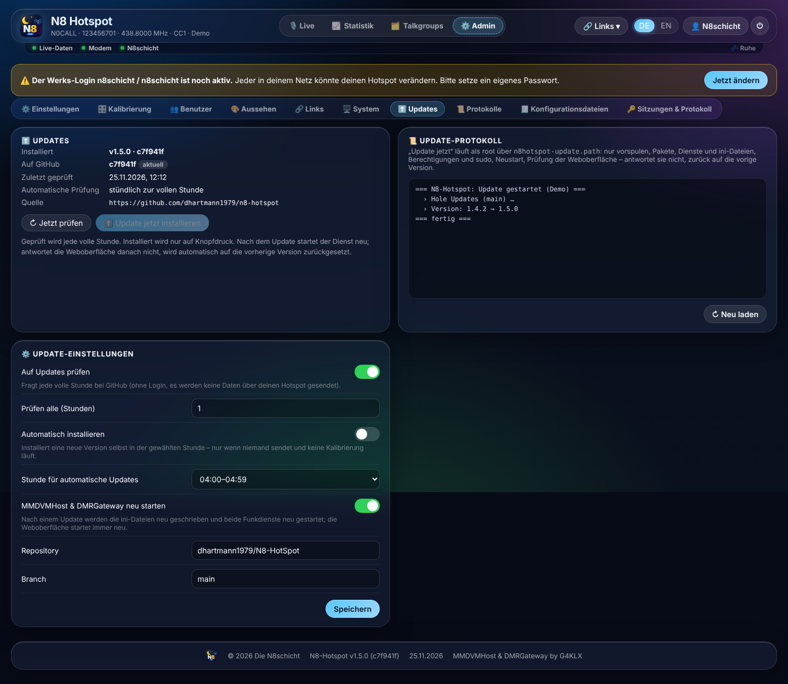</p>

**System → ⬆️ Update** – dieselbe Ansicht wie in allen N8-Systemen: installierte Version, Stand auf GitHub, zuletzt geprüft,
**↻ Jetzt prüfen** und **⬆️ Update jetzt installieren** (seit 1.6.0 **ohne Passwortabfrage**, mit Fortschritt und automatischem
Rollback), rechts das **📜 Update-Protokoll**. Darunter die **Update-Einstellungen** des Hotspots: stündliche Prüfung, automatische
Updates zu einer festen Stunde und ob MMDVMHost/DMRGateway mit neu starten. Alles dazu: **[⬆️ Updates & Versionen](updates.md)**.

## 🧩 Dienste · 🔐 Berechtigungen & sudo · 💓 Keep-Alive

<p align="center">
  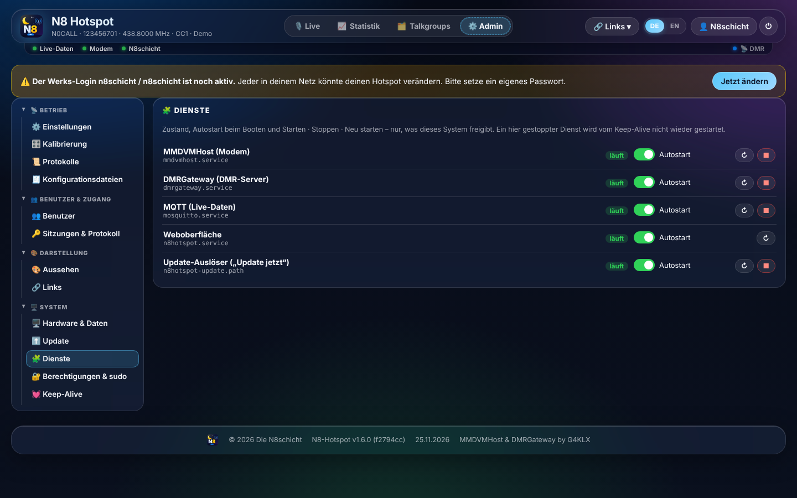
  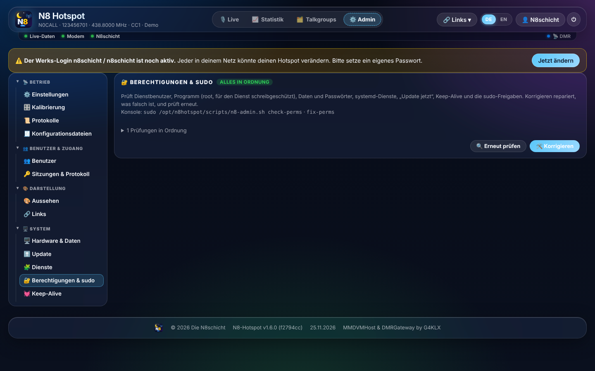
</p>

- **🧩 Dienste**: MMDVMHost, DMRGateway, MQTT, Weboberfläche und Update-Auslöser mit Zustand, Autostart und Starten · Stoppen · Neu starten
- **🔐 Berechtigungen & sudo**: zeigt nur, was nicht stimmt; **🛠️ Korrigieren** repariert und prüft erneut
- **💓 Keep-Alive**: prüft jede Minute als root, ob alles wirklich läuft, startet kranke Dienste neu, erkennt Internet-Ausfälle und
  meldet sich bei einer Heartbeat-Adresse – Einzelheiten unter [Updates & Versionen → Keep-Alive](updates.md#-keep-alive)
- **💥 Abstürze**: jeder Absturz, Hänger und Notfall-Neustart von MMDVMHost, DMRGateway, MQTT und Weboberfläche mit Teil, Ursache und Protokoll;
  neue Befunde erscheinen nach der Anmeldung als Hinweisfenster – siehe [Updates & Versionen → Abstürze](updates.md#-abstürze-erkennen-und-aufklären)

## 🖥️ System

<p align="center"></p>

Seit 1.6.0 heißt der Eintrag **🖥️ Hardware & Daten**; Update, Dienste, Berechtigungen und Keep-Alive haben eigene Einträge im Menü.

- **Hardware**: Board, Betriebssystem, Hostname, IP, **CPU-Temperatur** (grün < 60 °C), Last, Speicher, SD-Karte, Laufzeit; dazu **Reboot** und **Shut down**
- **Versionen** von MMDVMHost, DMRGateway, MMDVMCal und N8-Hotspot, Status der MQTT-Live-Daten (Updates: *System → ⬆️ Update*)
- **DMR ID list**: Zahl der IDs, letztes Update, **⟳ Update now** (lädt auch die FreeRadioID-Liste)
- **FreeRadioID.net**: registrierte IDs, gespeicherte Avatare, letztes Update
- **Talkgroup list**: Zahl der Namen aus der N8schicht-Liste und der eigenen Namen, letztes Update (wird mit **⟳ Update now** neu geladen)

<p align="center">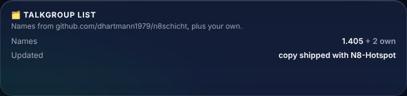</p>
- **Data**: gespeicherte Gespräche und Datenordner

## 📜 Logs

<p align="center">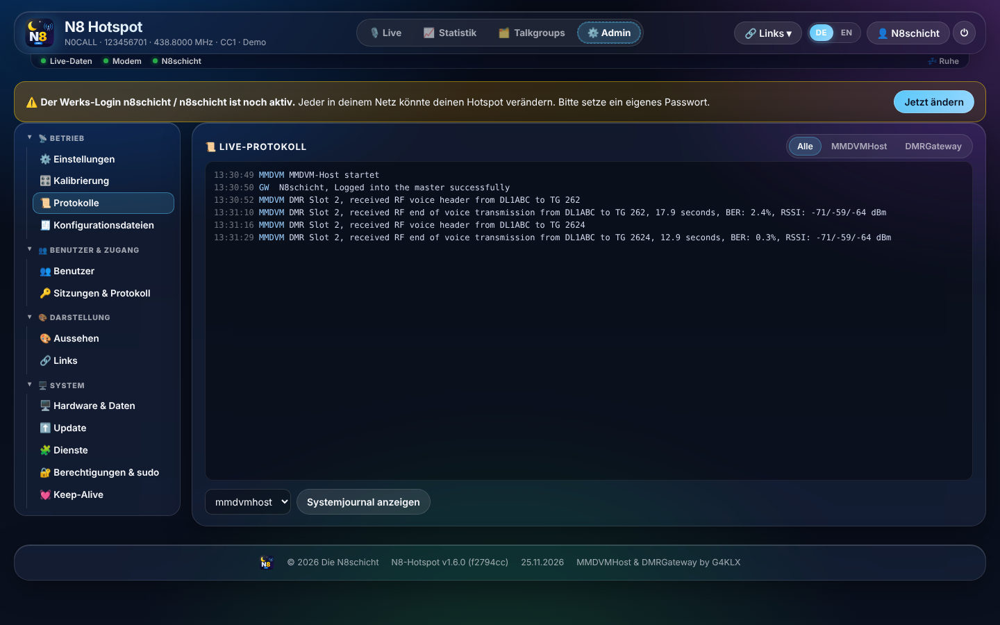</p>

Das Live-Log von MMDVMHost und DMRGateway (über MQTT), filterbar. Warnungen sind gelb, Fehler rot. Darunter holst du das **systemd-Journal** eines Dienstes, z. B. wenn MMDVMHost gar nicht erst startet.

## 🧾 Config files

<p align="center"></p>

Die erzeugten `MMDVM-Host.ini` und `DMRGateway.ini` zum Nachlesen; Passwörter sind ausgeblendet. Ändern bitte nur über *Settings*, sonst sind die Änderungen beim nächsten Speichern weg.

## 🔑 Sitzungen · 📜 Protokoll

<p align="center">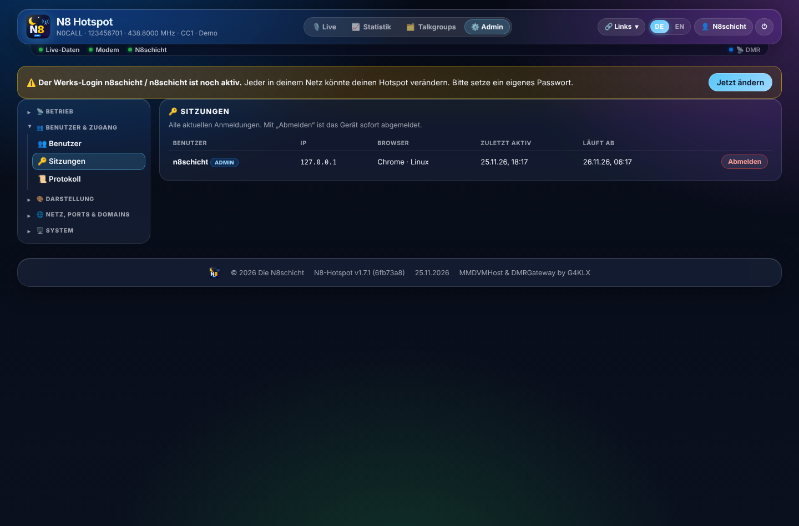 </p>

**🔑 Sitzungen**: aktive Anmeldungen mit Rolle, IP, Browser und Ablauf – **Abmelden** beendet eine sofort. **📜 Protokoll**: alle
Anmeldungen, Fehlversuche, Einstellungen, Neustarts, Kalibrierungen und Benutzeränderungen.

## 🌐 Netz, Ports & Domains

<p align="center">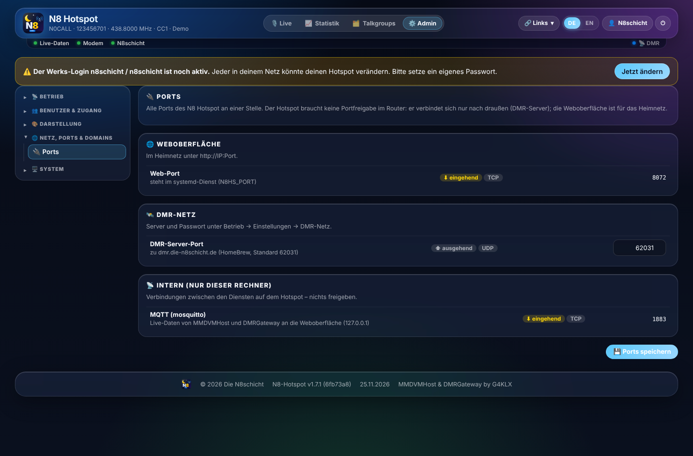</p>

Seit **1.8.0** wie in allen N8-Systemen. Der Hotspot läuft im Heimnetz und braucht **keine Portfreigabe** und kein eigenes HTTPS –
darum gibt es hier nur **🔌 Ports**: Web-Port (aus dem systemd-Dienst), DMR-Server-Port (ausgehend, UDP – änderbar, gleiches Feld wie
unter *Einstellungen → DMR-Netz*) und MQTT (intern, 127.0.0.1).

---

Weiter: [🎛️ Kalibrierung](kalibrierung.md)
