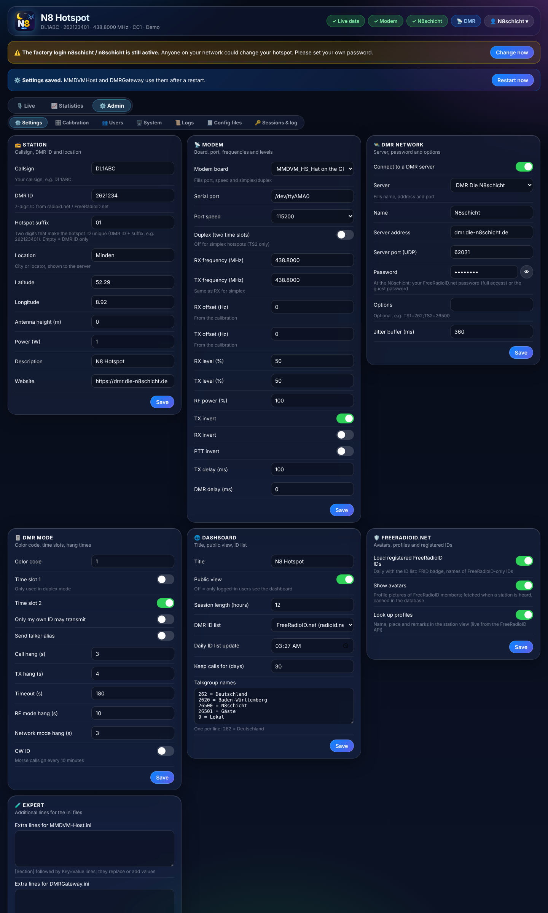
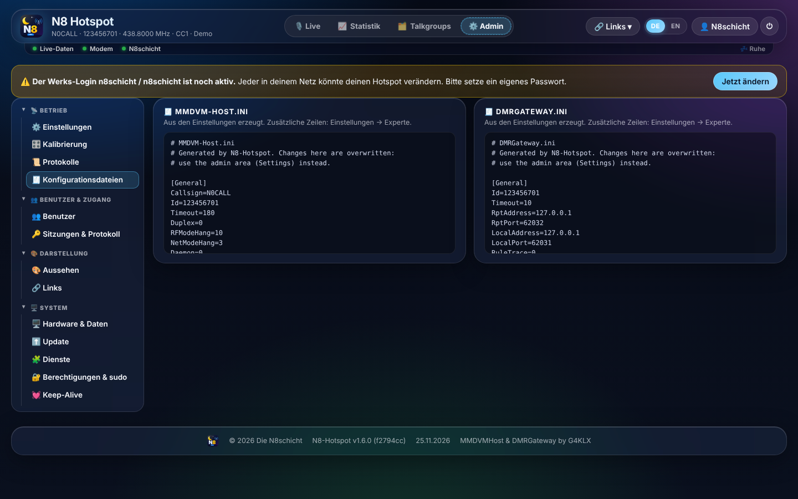

# ⚙️ Adminbereich

[← Übersicht](../../readme.md) · [Installation](installation.md) · [Live & Statistik](bedienung.md) · **Adminbereich** · [Kalibrierung](kalibrierung.md) · [FreeRadioID](freeradioid.md) · [Technik](technik.md) · [Fehlersuche](fehlersuche.md)

---

## Anmelden und Standard-Login

  
  &nbsp;
  

Ab Werk gibt es einen Admin: **Benutzer `n8schicht`, Passwort `n8schicht`**. Solange dieses Passwort gilt, passiert Folgendes:

- **Nach dem Login** öffnet sich sofort *My account*. Dort setzt du einen eigenen Benutzernamen und ein Passwort mit mindestens 8 Zeichen; `n8schicht` ist nicht erlaubt.
- **Im Adminbereich** steht oben eine gelbe Warnung mit **Change now**.
- **In der Benutzerliste** steht beim Benutzer *factory password*.

Nach der Änderung werden alle Sitzungen beendet und der Werks-Login funktioniert nicht mehr. *My account* erreichst du jederzeit über das Menü oben rechts.

Nach 5 falschen Passwörtern ist der Login für 15 Minuten gesperrt. Mit *Stay logged in* bleibst du 30 Tage angemeldet, sonst so lange wie unter *Session length* eingestellt.

## ⚙️ Settings

Jeder Abschnitt hat einen eigenen **Save**-Knopf. Die Werte landen in SQLite, und daraus schreibt N8-Hotspot sofort `MMDVM-Host.ini` und `DMRGateway.ini`. MMDVMHost und DMRGateway lesen sie beim nächsten Start; dafür erscheint oben der blaue Hinweis mit **Restart now**.

| Abschnitt | Einstellungen |
|---|---|
| 📻 **Station** | Rufzeichen, DMR-ID, Hotspot-Suffix (zwei Ziffern → Hotspot-ID `262123401`), Ort, Koordinaten, Antennenhöhe, Leistung, Beschreibung, Website. Diese Angaben sieht der Server. |
| 📡 **Modem** | Board-Vorlage, die Port, Geschwindigkeit und Simplex/Duplex einträgt: *MMDVM_HS_Hat GPIO*, *Dual Hat GPIO*, *ZUMspot/HS per USB*, *Repeater-Board USB*. Dazu RX/TX-Frequenz in MHz, **RX/TX-Offset** (aus der [Kalibrierung](kalibrierung.md)), RX/TX-Pegel, RF-Leistung, Invertierungen, TX- und DMR-Delay. |
| 🛰️ **DMR network** | Verbindung an/aus. Server-Vorlage: **DMR Die N8schicht** (`dmr.die-n8schicht.de:62031`) oder ein eigener HomeBrew-Server. Dazu Name, Adresse, Port, **Passwort**, *Options* (z. B. `TS1=262;TS2=26500`, wenn der Server das erlaubt) und Jitter-Puffer. |
| 🎚️ **DMR mode** | Color Code, Zeitschlitz 1 (nur Duplex) und 2, *nur eigene ID darf senden*, Talker Alias, Call-/TX-Hang, Timeout, Mode-Hang, CW-ID |
| 🌐 **Dashboard** | Titel, **Public view** (Sichtbereich ohne Login), Sitzungsdauer, DMR-ID-Liste (**FreeRadioID.net**, Vorgabe, oder radioid.net), Uhrzeit des täglichen Updates, Aufbewahrung der Gespräche, **Talkgroup-Namen** (`262 = Deutschland`, eine pro Zeile) |
| 🛡️ **FreeRadioID.net** | registrierte IDs laden (FRID), **Avatare** anzeigen, **Profile** abrufen; siehe [FreeRadioID](freeradioid.md) |
| 🧪 **Expert** | Zusätzliche Zeilen für `MMDVM-Host.ini` und `DMRGateway.ini` im ini-Format. Sie ersetzen gleichnamige Schlüssel oder ergänzen ganze Abschnitte, z. B. `[Modem]` + `Trace=1`. |

> 💡 **Passwortfeld:** Bleibt es leer oder zeigt `••••••••`, behält N8-Hotspot das alte Passwort. Mit 👁 siehst du, was du tippst.

## 🎛️ Calibration

Eigene Seite: [Kalibrierung](kalibrierung.md).

## 👥 Users

| Rolle | Darf |
|---|---|
| **Admin** | alles: Einstellungen, Kalibrierung, Benutzer, Dienste, Neustart |
| **Viewer** | Live und Statistik sehen, auch wenn *Public view* aus ist; nichts ändern |

Anlegen rechts. Mit **Edit** änderst du Name, Rolle und Passwort, kannst sperren oder löschen. Der letzte Admin kann weder gelöscht noch herabgestuft werden; du kannst dich auch nicht selbst sperren.

## 🖥️ System

- **Hardware**: Board, Betriebssystem, Hostname, IP, **CPU-Temperatur** (grün < 60 °C), Last, Speicher, SD-Karte, Laufzeit; dazu **Reboot** und **Shut down**
- **Services**: MMDVMHost, DMRGateway, MQTT-Broker und die Weboberfläche mit Status; Start, Stop, Restart
- **Versionen** von MMDVMHost, DMRGateway, MMDVMCal und N8-Hotspot, Status der MQTT-Live-Daten
- **DMR ID list**: Zahl der IDs, letztes Update, **⟳ Update now** (lädt auch die FreeRadioID-Liste)
- **FreeRadioID.net**: registrierte IDs, gespeicherte Avatare, letztes Update
- **Data**: gespeicherte Gespräche und Datenordner

## 📜 Logs

Das Live-Log von MMDVMHost und DMRGateway (über MQTT), filterbar. Warnungen sind gelb, Fehler rot. Darunter holst du das **systemd-Journal** eines Dienstes, z. B. wenn MMDVMHost gar nicht erst startet.

## 🧾 Config files

Die erzeugten `MMDVM-Host.ini` und `DMRGateway.ini` zum Nachlesen; Passwörter sind ausgeblendet. Ändern bitte nur über *Settings*, sonst sind die Änderungen beim nächsten Speichern weg.

## 🔑 Sessions & log

Aktive Anmeldungen mit IP, jede lässt sich beenden. Daneben steht das Protokoll aller Anmeldungen, Fehlversuche, Einstellungen, Neustarts, Kalibrierungen und Benutzeränderungen.

---

Weiter: [🎛️ Kalibrierung](kalibrierung.md)
