# 🎙️ Live & Statistik

[← Übersicht](../../readme.md) · [Installation](installation.md) · **Live & Statistik** · [Adminbereich](adminbereich.md) · [Updates](updates.md) · [Kalibrierung](kalibrierung.md) · [FreeRadioID](freeradioid.md) · [Technik](technik.md) · [Fehlersuche](fehlersuche.md)

---

Dieser Teil ist der **Sichtbereich**: ohne Login sichtbar, solange *Public view* im Adminbereich an ist. Ist er aus, sehen nur angemeldete Benutzer (Admin oder Viewer) etwas.

  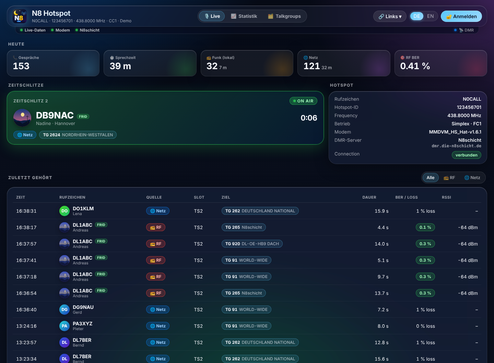
  &nbsp;
  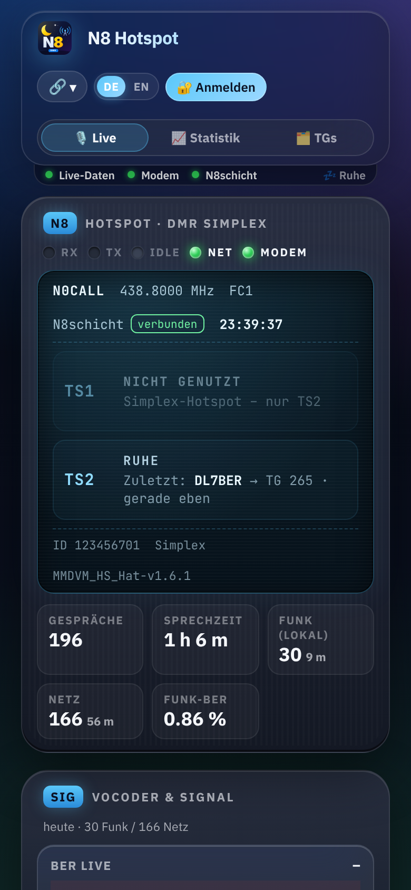

## 🎨 Eine Designsprache mit dem HobbyRadioPortal

Der N8 Hotspot bleibt eigenständig, sieht aber aus wie das [HobbyRadioPortal](https://github.com/dhartmann1979/HobbyRadioPortal):
gleiches Farbsystem (N8 Theme 2), gleiche Kopfzeile mit Statusleiste und seit 1.4.2 die gemeinsame Datei **N8 Look**
(`static/n8-look.css`, identisch im Portal). Sie sorgt für den durchgehenden Hintergrund, die farbig leuchtenden Kacheln
unter **Heute**, die Abschnittsüberschriften und die Fußzeile als Glaskarte:

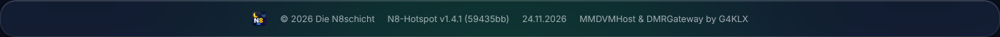

Im Portal kann der Hotspot als Verweis erscheinen (Plugin `hotspot`, Vorgabe aus). Das Portal prüft dann nur,
ob die Oberfläche erreichbar ist, und verlinkt sie im Menü „Links“.

## Kopfzeile und Statusleiste

Oben gibt es **ein** Menü: links Logo, Titel und Untertitel, in der Mitte die Reiter, rechts Links und Anmeldung.
Direkt darunter hängt eine schmale **Statusleiste**, die nur zeigt, wie es den Diensten geht – sie ist bewusst
niedriger als das Menü. Beides bleibt beim Scrollen oben stehen.

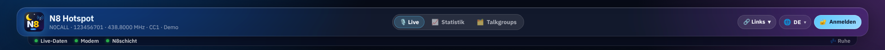

**Menü**

| Eintrag | Bedeutung |
|---|---|
| Titel, Untertitel | Titel aus dem Adminbereich; darunter Rufzeichen, Hotspot-ID, Frequenz, Color Code |
| **🎙️ Live · 📈 Statistics · 🗂️ Talkgroups** | die Ansichten |
| **⚙️ Admin** | erscheint nach dem Login für Admins als eigener Menüpunkt (gestrichelt umrandet) |
| **🔗 Links ▾** | Link-Menü mit Site-Icons der verlinkten Seiten (im Adminbereich unter *Links* einstellbar) |
| **🔐 Login** | ganz rechts; nach dem Anmelden steht dort dein **👤 Name** (Klick = *My account*, Passwort ändern) und daneben **⏻** zum Abmelden – ohne Aufklappmenü |

**Statusleiste** – ein farbiger Punkt sagt den Zustand: grün = ok, gelb = wartet, rot = Fehler, blau = aktiv, grau = aus.

| Anzeige | Bedeutung |
|---|---|
| **Live data** | Der Browser bekommt Live-Daten. Rot (*Live data offline*): Verbindung zum Hotspot weg; sie wird automatisch wieder aufgebaut. |
| **Modem** | MMDVMHost läuft und hat das Modem geöffnet. Rot: *Modem not found* oder *MMDVMHost stopped*. |
| **N8schicht** (Name des DMR-Servers) | DMRGateway ist beim DMR-Server angemeldet. Gelb: *connecting*; rot mit Grund, z. B. *password wrong*, *timeout* oder *gateway stopped*. |
| **💤 Idle / 📡 DMR** (rechts) | aktueller Modus von MMDVMHost |

Am **Smartphone** rutschen die Reiter in eine zweite Zeile (kurze Namen *Stats*, *TGs*), Links und Benutzer sind nur Symbole.
Die Statusleiste bleibt eine Zeile. Die Fußzeile zeigt © Die N8schicht, die installierte Version mit Commit und deren Datum.

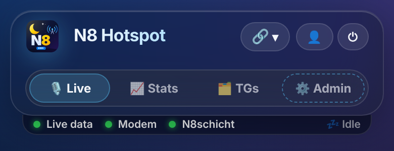

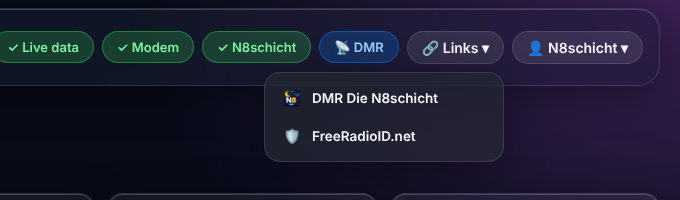

## Zeitschlitze

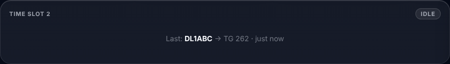

Ein Simplex-Hotspot nutzt nur **Zeitschlitz 2**, ein Duplex-Hotspot beide. Läuft ein Gespräch, zeigt die Karte **ON AIR** mit:

- **Wer spricht:** Avatar von FreeRadioID.net, Rufzeichen mit **FRID** (falls dort registriert), Name und Ort aus der ID-Liste; die Sprechzeit läuft live mit.
- **Quelle:** 📻 **RF** (rote Karte) heißt, jemand sendet lokal in den Hotspot. 🌐 **Network** (grüne Karte) heißt, das Gespräch kommt vom Server.
- **Talkgroup:** mit Namen aus dem Adminbereich.
- **Signal bei RF:** **BER** (Bitfehlerrate) und **RSSI** (Empfangsstärke) live.

In Ruhe steht dort, wer zuletzt auf diesem Zeitschlitz war.

## Hotspot

Rufzeichen, Hotspot-ID, Standort, Frequenz, Simplex/Duplex mit Color Code, Modem-Firmware, DMR-Server mit Adresse und der Verbindungsstatus.

## Last Heard

Die letzten 20 Gespräche: Zeit, Avatar und Rufzeichen mit Name (**FRID** = bei FreeRadioID.net registriert), Quelle, Zeitschlitz, Ziel (Talkgroup oder 👤 Einzelruf), Dauer.
- **Qualität:** bei RF die BER als farbige Marke (grün < 1 %, gelb < 3 %, rot darüber) und die RSSI; bei Netz-Gesprächen der Paketverlust.
- **Filter:** Mit *All / 📻 RF / 🌐 Network* zeigst du nur lokale oder nur Netz-Gespräche.

## Stationsansicht

Ein Klick auf ein Rufzeichen, egal ob in Last Heard, auf der ON-AIR-Karte oder in der Statistik, zeigt großen Avatar, FreeRadioID-Profil, Gespräche und Talkgroups dieser Station auf deinem Hotspot. Mehr dazu unter [FreeRadioID](freeradioid.md#stationsansicht).

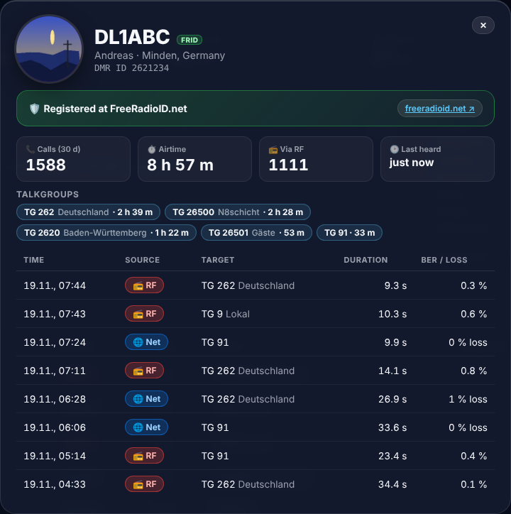

## 🗂️ Talkgroups

  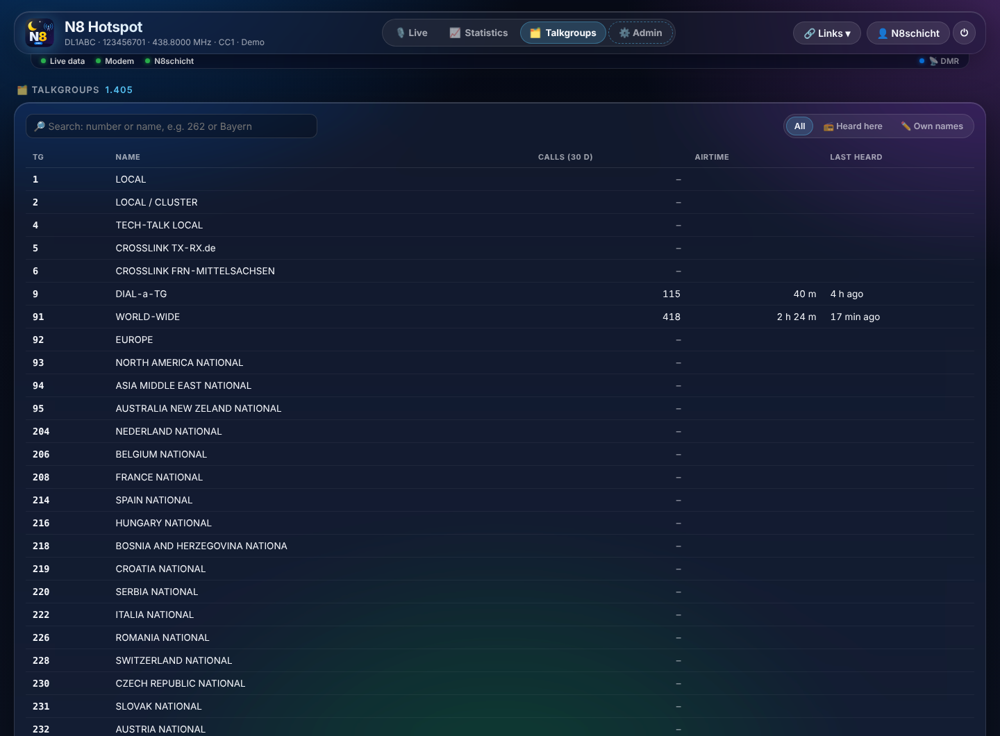
  &nbsp;
  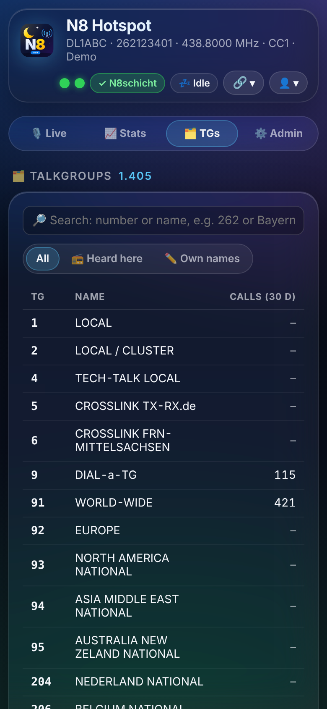

Der Tab **🗂️ Talkgroups** (am Smartphone „TGs“) ist das Verzeichnis aller Talkgroups. Die Namen kommen aus der **Talkgroup-Liste der N8schicht** ([`talkgroup_ids.json`](https://github.com/dhartmann1979/n8schicht/blob/main/talkgroup_ids.json), rund 1.400 Einträge) und deinen eigenen Namen aus dem Adminbereich (*own*).

- **Suche** nach Nummer (Anfang, z. B. `262`) oder Namen (z. B. `bayern`)
- **📻 Heard here**: nur Talkgroups, die dein Hotspot in den letzten 30 Tagen gehört hat, sortiert nach Sprechzeit, mit Gesprächen und „zuletzt gehört“
- **✏️ Own names**: nur deine eigenen Namen

  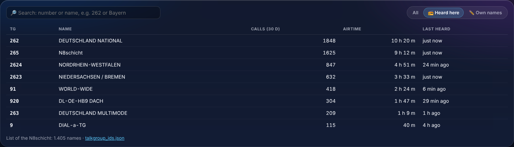
  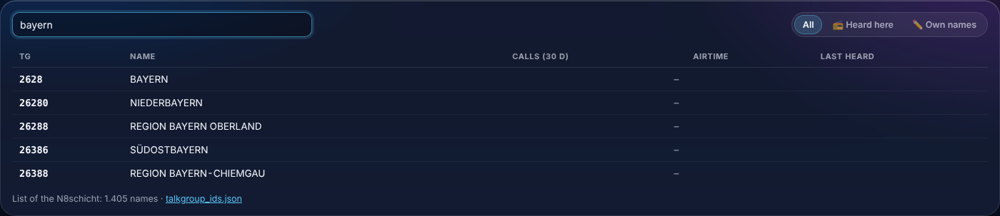

Die Namen stehen auch überall sonst: auf der ON-AIR-Karte, in Last Heard, in der Statistik und in der Stationsansicht. Die Liste wird täglich mit der ID-Liste aktualisiert. Bis dahin nutzt der Hotspot eine mitgelieferte Kopie, die Namen gibt es also auch ohne Internet.

## 📈 Statistik

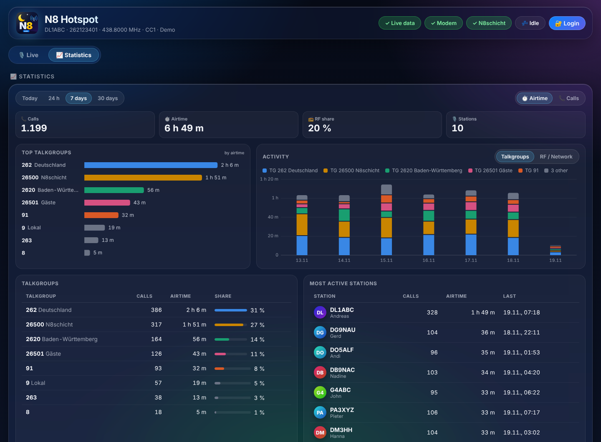

| Element | Inhalt |
|---|---|
| Zeitraum | Heute · 24 h · 7 Tage · 30 Tage |
| Messgröße | ⏱️ Sprechzeit oder 📞 Anzahl Gespräche |
| Kennzahlen | Gespräche, Sprechzeit, Anteil RF, verschiedene Stationen |
| Top talkgroups | die 10 meistgenutzten Talkgroups |
| Activity | pro Stunde oder Tag; umschaltbar zwischen **Talkgroups** (Top 5 farbig, Rest grau) und **RF / Network** |
| Tabellen | alle Talkgroups mit Anteil · aktivste Stationen |

  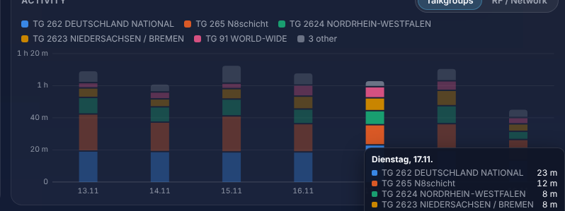
  

Fährst du mit der Maus über Säulen oder Balken, erscheinen die genauen Werte. Eine Talkgroup behält ihre Farbe, auch wenn du den Zeitraum wechselst. Gespeichert werden die Gespräche 30 Tage lang; das lässt sich im Adminbereich ändern.

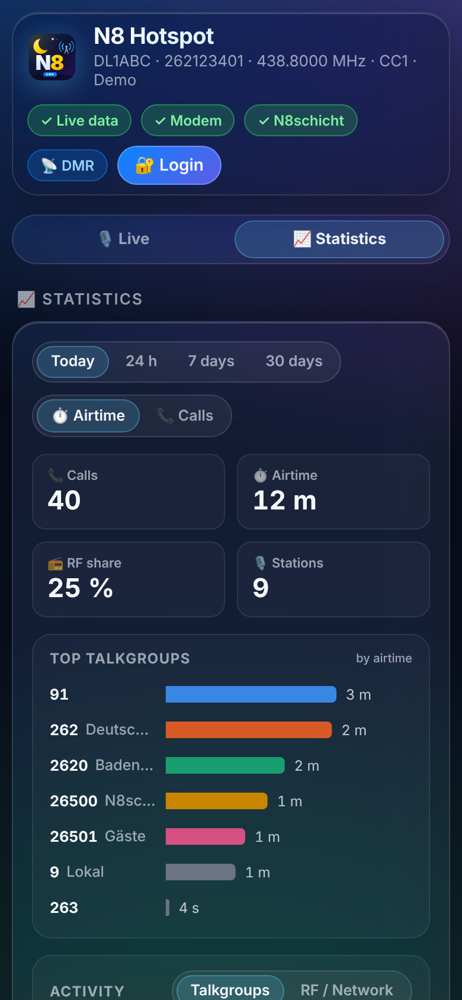

---

Weiter: [⚙️ Adminbereich](adminbereich.md)
