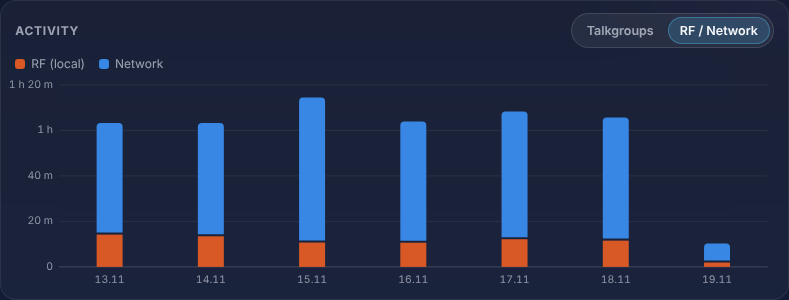

# 🎙️ Live & Statistik

[← Übersicht](../../readme.md) · [Installation](installation.md) · **Live & Statistik** · [Adminbereich](adminbereich.md) · [Kalibrierung](kalibrierung.md) · [Technik](technik.md) · [Fehlersuche](fehlersuche.md)

---

Dieser Teil ist der **Sichtbereich**: ohne Login sichtbar, solange *Public view* im Adminbereich an ist. Ist er aus, sehen nur angemeldete Benutzer (Admin oder Viewer) etwas.

  
  &nbsp;
  

## Kopfzeile

| Anzeige | Bedeutung |
|---|---|
| Titel, Untertitel | Titel aus dem Adminbereich; darunter Rufzeichen, Hotspot-ID, Frequenz, Color Code |
| **✓ Live data** | Der Browser bekommt Live-Daten. Rot bedeutet, die Verbindung zum Hotspot ist weg; sie wird automatisch wieder aufgebaut. |
| **✓ Modem** | MMDVMHost läuft und hat das Modem geöffnet. Rot: *Modem* (nicht gefunden) oder *MMDVMHost stopped*. |
| **✓ N8schicht** | DMRGateway ist beim DMR-Server angemeldet. Rot mit Grund, z. B. *password wrong*, *timeout* oder *gateway stopped*. |
| **💤 Idle / 📡 DMR** | aktueller Modus von MMDVMHost |

## Zeitschlitze

Ein Simplex-Hotspot nutzt nur **Zeitschlitz 2**, ein Duplex-Hotspot beide. Läuft ein Gespräch, zeigt die Karte **ON AIR** mit:

- **Wer spricht:** Rufzeichen, Name und Ort aus der ID-Liste; die Sprechzeit läuft live mit.
- **Quelle:** 📻 **RF** (rote Karte) heißt, jemand sendet lokal in den Hotspot. 🌐 **Network** (grüne Karte) heißt, das Gespräch kommt vom Server.
- **Talkgroup:** mit Namen aus dem Adminbereich.
- **Signal bei RF:** **BER** (Bitfehlerrate) und **RSSI** (Empfangsstärke) live.

In Ruhe steht dort, wer zuletzt auf diesem Zeitschlitz war.

## Hotspot

Rufzeichen, Hotspot-ID, Standort, Frequenz, Simplex/Duplex mit Color Code, Modem-Firmware, DMR-Server mit Adresse und der Verbindungsstatus.

## Last Heard

Die letzten 20 Gespräche: Zeit, Rufzeichen mit Name, Quelle, Zeitschlitz, Ziel (Talkgroup oder 👤 Einzelruf), Dauer.
- **Qualität:** bei RF die BER als farbige Marke (grün < 1 %, gelb < 3 %, rot darüber) und die RSSI; bei Netz-Gesprächen der Paketverlust.
- **Filter:** Mit *All / 📻 RF / 🌐 Network* zeigst du nur lokale oder nur Netz-Gespräche.

## 📈 Statistik

| Element | Inhalt |
|---|---|
| Zeitraum | Heute · 24 h · 7 Tage · 30 Tage |
| Messgröße | ⏱️ Sprechzeit oder 📞 Anzahl Gespräche |
| Kennzahlen | Gespräche, Sprechzeit, Anteil RF, verschiedene Stationen |
| Top talkgroups | die 10 meistgenutzten Talkgroups |
| Activity | pro Stunde oder Tag; umschaltbar zwischen **Talkgroups** (Top 5 farbig, Rest grau) und **RF / Network** |
| Tabellen | alle Talkgroups mit Anteil · aktivste Stationen |

  
  

Fährst du mit der Maus über Säulen oder Balken, erscheinen die genauen Werte. Eine Talkgroup behält ihre Farbe, auch wenn du den Zeitraum wechselst. Gespeichert werden die Gespräche 30 Tage lang; das lässt sich im Adminbereich ändern.

---

Weiter: [⚙️ Adminbereich](adminbereich.md)
