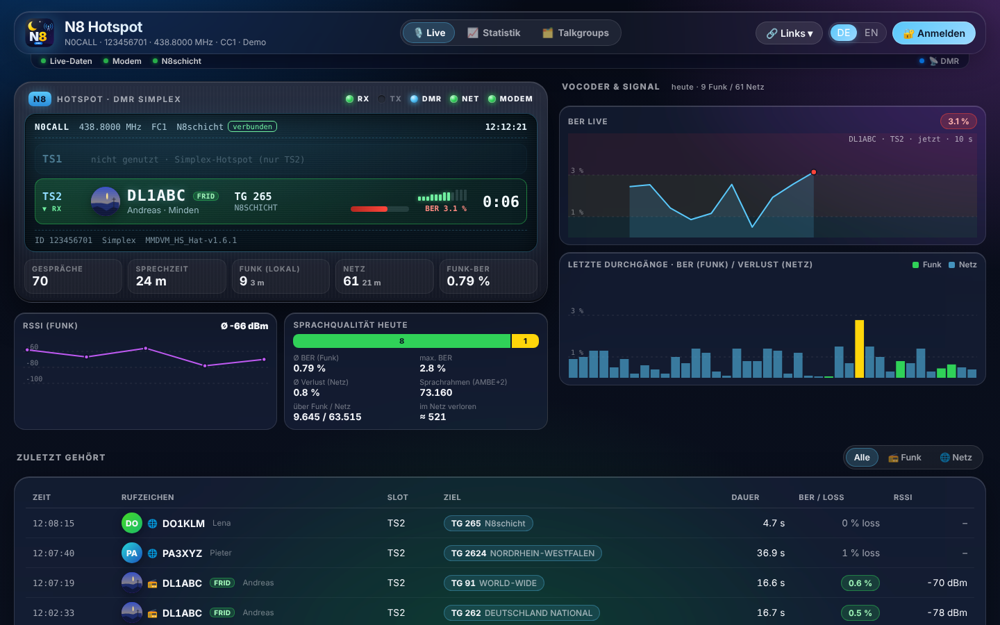
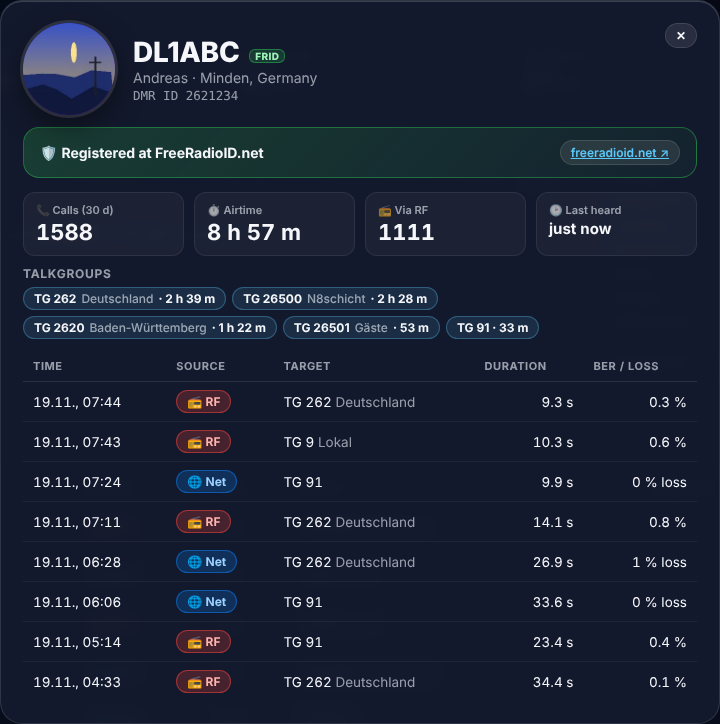
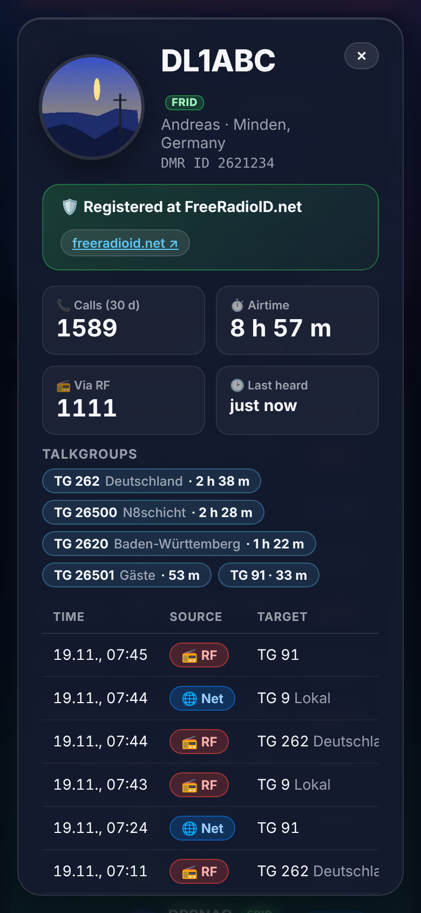
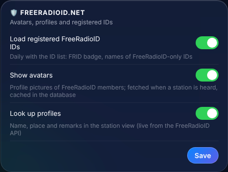
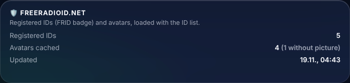

# 🛡️ FreeRadioID.net

[← Übersicht](../../readme.md) · [Installation](installation.md) · [Live & Statistik](bedienung.md) · [Adminbereich](adminbereich.md) · [Updates](updates.md) · [Kalibrierung](kalibrierung.md) · **FreeRadioID** · [Technik](technik.md) · [Fehlersuche](fehlersuche.md)

---

[FreeRadioID.net](https://freeradioid.net) von Andi, DO5ALF, gibt jeder DMR-ID ein persönliches Passwort, ein Profil und einen Avatar. N8-Hotspot nutzt die [FreeRadioID-API](https://freeradioid.net/api-index.html) an vier Stellen:

| | API | Wofür |
|---|---|---|
| 📘 **ID-Datenbank** | `api/subscriber_ids.csv` | Rufzeichen, Vorname, Ort, Land für alle DMR-IDs (radioid.net plus FreeRadioID-eigene IDs). Daraus entstehen die Tabelle `dmrids` und die `DMRIds.dat` für MMDVMHost. |
| 🛡️ **Registrierte IDs** | `api/local_subscriber_ids.json` | Wer bei FreeRadioID.net registriert ist, bekommt das grüne **FRID**-Kennzeichen; FreeRadioID-eigene IDs ergänzen die Liste. |
| 🖼️ **Avatare** | `api/idimg-<ID>.png` | Profilbild in Last Heard, im Display (Zeitschlitz), in der Statistik und in der Stationsansicht |
| 👤 **Profile** | `api/dmr/user/?id=<ID>` | Name, Ort, Land, Bemerkung und Registrierung in der Stationsansicht |

Und natürlich das **Passwort**: Bei **DMR Die N8schicht** meldest du den Hotspot mit deinem persönlichen FreeRadioID-Passwort an und hast volle Rechte. Mit dem allgemeinen Gast-Passwort `passw0rd` darfst du nur auf die Gast-Talkgroups senden.

  

## Avatare

- **Nur für registrierte IDs.** FreeRadioID wird nie nach IDs gefragt, die dort nicht registriert sind. Hotspot-IDs mit Suffix (`262123401`) nutzen den Avatar der DMR-ID (`2621234`).
- **Nur was der Hotspot hört.** Ein Hotspot braucht nicht Hunderte Bilder. Der Avatar wird geladen, sobald eine Station zum ersten Mal spricht oder im Browser angezeigt wird.
- **Klein und schnell:** Das Original (500 × 500 px PNG, rund 750 KB) wird auf **192 px WebP** verkleinert, meist 6–10 KB, und in SQLite gespeichert. Der Browser bekommt es danach direkt vom Hotspot und behält es einen Tag im Cache.
- **Aktuell halten:** Echte Avatare prüft der Hotspot wöchentlich neu, IDs ohne eigenes Bild täglich. Den grauen FreeRadioID-Platzhalter erkennt er und zeigt stattdessen die farbigen Initialen.
- **Abgemeldete IDs:** Ist eine ID nicht mehr registriert, löscht der Hotspot ihren Avatar beim nächsten Listen-Update.
- **Datenschutz:** Die Browser laden die Bilder vom Hotspot, nicht von FreeRadioID.net. Die IP der Besucher bekommt FreeRadioID also nicht zu sehen.

## Stationsansicht

Ein Klick auf ein Rufzeichen öffnet die Stationsansicht. Das geht in Last Heard, im Display (Zeitschlitz) und unter *Most active stations*.

  
  &nbsp;
  

| Bereich | Inhalt |
|---|---|
| Kopf | großer Avatar, Rufzeichen, FRID, Name, Ort, Land, DMR-ID |
| 🛡️ Registriert | Hinweis, wenn die Station bei FreeRadioID.net registriert ist, mit Bemerkung und Link zum Profil |
| Kennzahlen | Gespräche und Sprechzeit der letzten 30 Tage auf diesem Hotspot, davon per RF, zuletzt gehört |
| Talkgroups | die meistgenutzten Talkgroups dieser Station |
| Verlauf | die letzten Gespräche mit Quelle, Ziel, Dauer, BER bzw. Paketverlust |

Das Profil wird live bei FreeRadioID abgefragt und eine Stunde zwischengespeichert. Ist die API nicht erreichbar, nimmt der Hotspot die gespeicherte Liste.

## Einstellen

**Admin → Settings → 🛡️ FreeRadioID.net**, wirkt sofort:

| Einstellung | Bedeutung |
|---|---|
| Load registered FreeRadioID IDs | FRID-Kennzeichen und FreeRadioID-eigene IDs, täglich mit der ID-Liste |
| Show avatars | Avatare an/aus. Aus heißt: keine Bilder, nur Initialen, keine Abfragen. |
| Look up profiles | Live-Profil in der Stationsansicht an/aus |

Die **DMR-ID-Liste** selbst wählst du unter *🌐 Dashboard → DMR ID list*: **FreeRadioID.net** (Vorgabe, alle Länder) oder nur radioid.net. Dort stellst du auch die Uhrzeit des täglichen Updates ein (Vorgabe 03:27).

Unter **Admin → System** siehst du die Zahl der IDs und der registrierten FreeRadioID-IDs, die Avatare im Speicher und den Zeitpunkt des letzten Updates. **⟳ Update now** lädt beide Listen sofort neu.

Auch die [geführte Installation](installation.md#geführte-einrichtung-setupsh) fragt die drei Schalter ab. Sie prüft außerdem deine DMR-ID live bei FreeRadioID: ob die ID bekannt ist, wie das Rufzeichen lautet und ob ein persönliches Passwort möglich ist.

---

Weiter: [🧩 Technik](technik.md)
