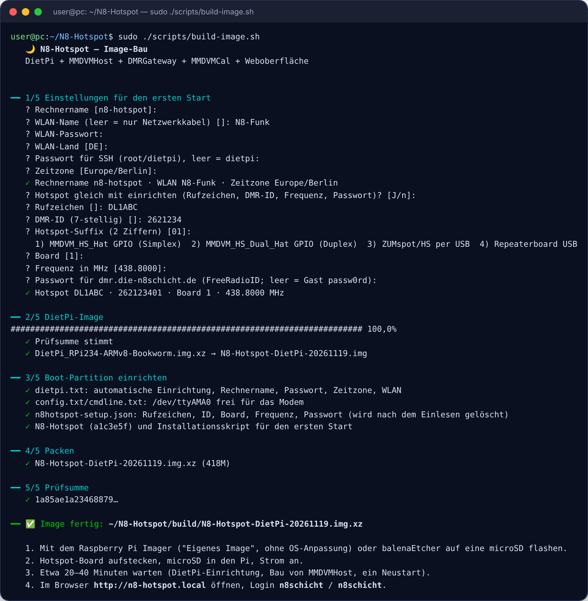
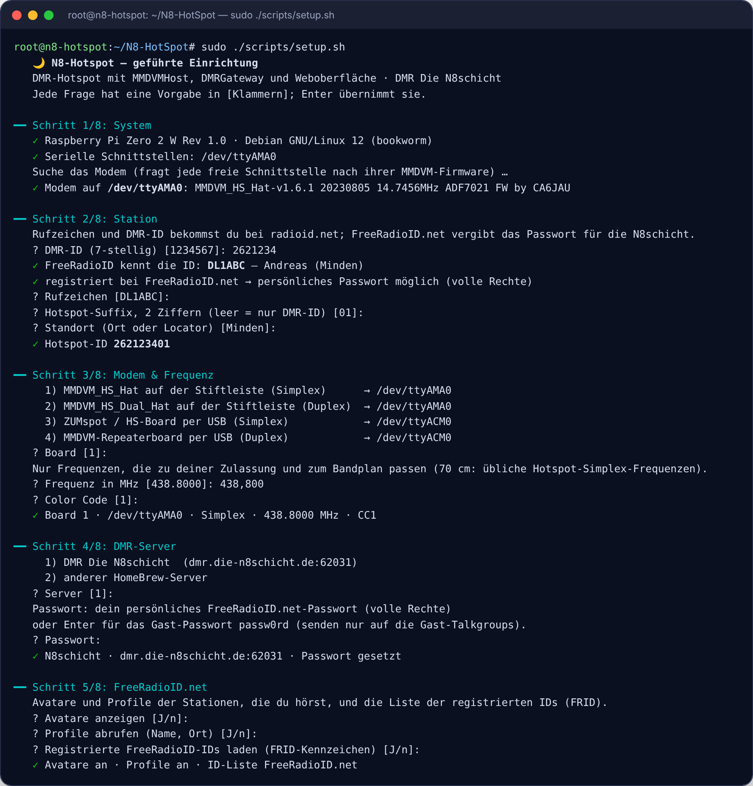
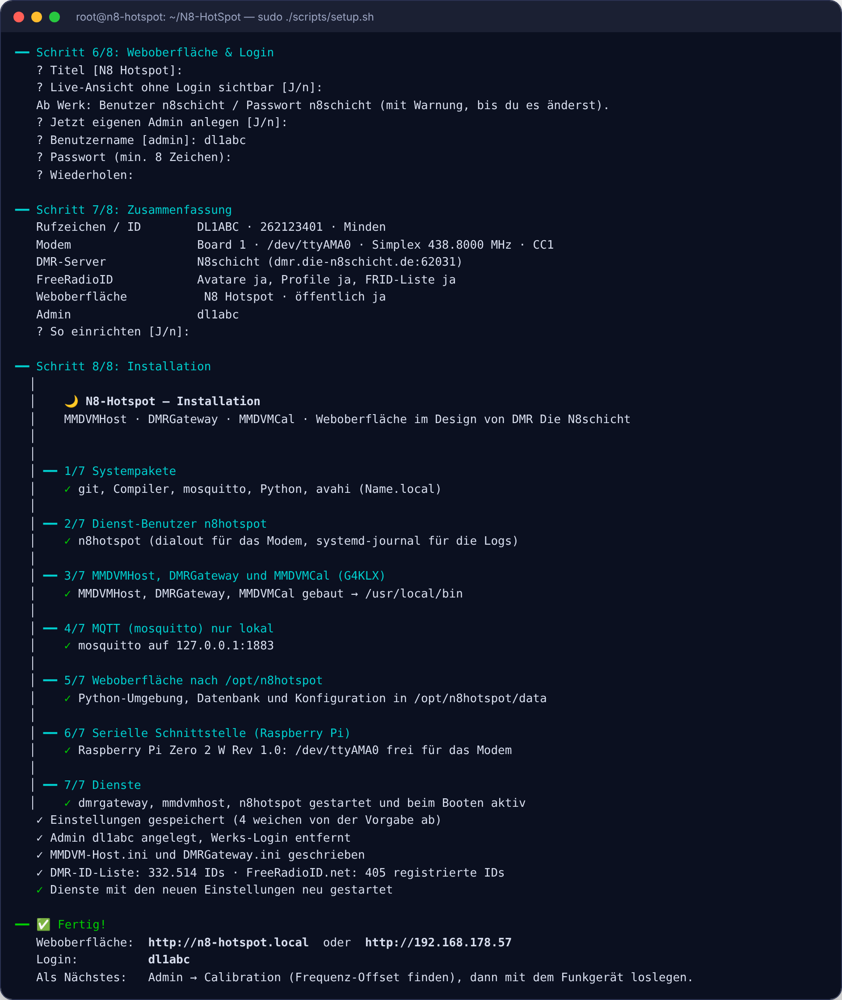
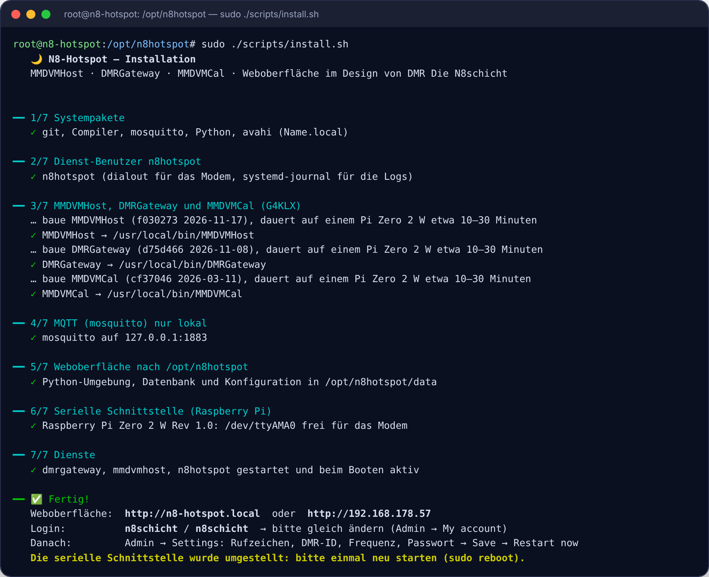

# 📦 Installation & Image

[← Übersicht](../../readme.md) · **Installation** · [Live & Statistik](bedienung.md) · [Adminbereich](adminbereich.md) · [Updates](updates.md) · [Kalibrierung](kalibrierung.md) · [FreeRadioID](freeradioid.md) · [Technik](technik.md) · [Fehlersuche](fehlersuche.md)

---

## Was du brauchst

| | |
|---|---|
| **Raspberry Pi** | Zero 2 W, 3, 4 (64 Bit). Ein Zero 2 W reicht völlig. |
| **Modem** | MMDVM_HS_Hat, MMDVM_HS_Dual_Hat, ZUMspot oder ein anderes MMDVM-Board, auf der Stiftleiste (GPIO) oder per USB |
| **microSD** | ab 8 GB |
| **Netz** | WLAN oder Netzwerkkabel mit Internet |
| **Zugangsdaten** | eigene DMR-ID; für volle Rechte bei der N8schicht ein Passwort von [FreeRadioID.net](https://freeradioid.net), sonst Gastzugang |

> ⚠️ **Nur mit Amateurfunk-Zulassung senden.** Frequenz und Leistung müssen zu deiner Zulassung und zum Bandplan passen. Im 70-cm-Band sind Simplex-Hotspot-Frequenzen üblich, die nicht im Satelliten- oder Relaisbereich liegen.

## Variante A: eigenes Image bauen (empfohlen)

Das Skript läuft auf einem **Linux-PC** (Debian, Ubuntu, auch WSL2), nicht auf dem Pi. Es lädt das offizielle DietPi-Image für Raspberry Pi 2/3/4/Zero 2 und richtet die Boot-Partition so ein, dass der Pi beim ersten Start alles selbst installiert.

```bash
sudo apt install git xz-utils curl
git clone https://github.com/dhartmann1979/N8-HotSpot
cd N8-HotSpot
sudo ./scripts/build-image.sh
```

<p align="center"></p>

| Frage | Bedeutung |
|---|---|
| Rechnername | Name im Netz, Vorgabe `n8-hotspot` → **http://n8-hotspot.local** |
| WLAN-Name / Passwort / Land | leer lassen, wenn der Pi am Kabel hängt |
| Passwort für SSH | für `root` und `dietpi`; leer = `dietpi` |
| Zeitzone | Vorgabe `Europe/Berlin` |
| Hotspot gleich mit einrichten? | Bei **J** fragt das Skript Rufzeichen, DMR-ID, Suffix, Board, Frequenz und das Passwort für dmr.die-n8schicht.de (FreeRadioID) ab. Die Werte landen in `n8hotspot-setup.json` auf der Boot-Partition und werden beim ersten Start eingelesen; danach wird die Datei gelöscht, weil sie das Passwort enthält. Bei **n** stellst du alles später im Browser ein. |

Alle Fragen gehen auch als Option, z. B. für eigene Serien-Images:

```bash
sudo ./scripts/build-image.sh --hostname n8-hotspot --wifi-ssid "MeinWLAN" --wifi-pass "geheim" \
     --password "ssh-passwort" --callsign DL1ABC --dmr-id 2621234 --board 1 --freq 438.8 \
     --net-password "FreeRadioID-Passwort" --yes
sudo ./scripts/build-image.sh --image ~/Downloads/DietPi_RPi234-ARMv8-Bookworm.img.xz   # ohne Download
```

**Was das Skript in das Image schreibt:**

- **`dietpi.txt`**: automatische Einrichtung ohne Rückfragen, mit Rechnername, Passwort, Zeitzone, deutscher Tastatur und abgeschalteter serieller Konsole
- **`dietpi-wifi.txt`**: WLAN-Name und Passwort
- **`config.txt` / `cmdline.txt`**: `enable_uart=1` und `dtoverlay=disable-bt`; die Konsole auf `serial0` wird entfernt, damit **/dev/ttyAMA0** frei für das Modem ist
- **`Automation_Custom_Script.sh`** und **`n8hotspot.tar.gz`**: Installation beim ersten Start

Ergebnis: `build/N8-Hotspot-DietPi-<datum>.img.xz` mit Prüfsumme.

### Flashen und starten

1. Mit dem **Raspberry Pi Imager** („Eigenes Image verwenden“, *keine* OS-Anpassungen) oder **balenaEtcher** auf die microSD schreiben.
2. Modem aufstecken, Karte in den Pi, Strom an.
3. **20–40 Minuten warten.** DietPi richtet sich ein, dann baut der Pi MMDVMHost, DMRGateway und MMDVMCal und startet einmal neu. Den Fortschritt siehst du per SSH in `/var/log/n8hotspot-firstboot.log`.
4. Im Browser **http://n8-hotspot.local** öffnen. Klappt `.local` nicht, findest du die IP im Router.

## Variante B: geführte Einrichtung auf einem vorhandenen System

Auf einem laufenden DietPi, Raspberry Pi OS (Bookworm) oder Debian 12, per SSH:

```bash
sudo apt install git
git clone https://github.com/dhartmann1979/N8-HotSpot
cd N8-HotSpot
sudo ./scripts/setup.sh
```

## Geführte Einrichtung (setup.sh)

`setup.sh` fragt zuerst alles ab, zeigt eine Zusammenfassung und installiert erst nach deinem **J**. Jede Frage hat eine Vorgabe in `[Klammern]`, die du mit Enter übernimmst. Läuft das Skript auf einem schon eingerichteten Hotspot, schlägt es die aktuellen Werte vor. So änderst du später Frequenz oder Passwort auch per SSH.

<p align="center"></p>

| Schritt | Fragen | Hinweise |
|---|---|---|
| 1 System | – | zeigt Board und Betriebssystem und **sucht das Modem**: Jede freie serielle Schnittstelle wird nach ihrer MMDVM-Firmware gefragt (`/dev/ttyAMA0` = GPIO, `/dev/ttyACM0`/`ttyUSB0` = USB). Das gefundene Modem bestimmt die Vorgabe in Schritt 3. Ein GPIO-Hat antwortet oft erst nach dem Neustart, den die Installation verlangt. |
| 2 Station | **DMR-ID**, Rufzeichen, Hotspot-Suffix, Standort | Die ID wird **live bei FreeRadioID.net geprüft**. Das Skript schlägt Rufzeichen und Ort vor und sagt, ob die ID dort registriert ist, also ob ein persönliches Passwort möglich ist. |
| 3 Modem & Frequenz | **Board** 1–4, Frequenz in MHz (Komma oder Punkt), bei Duplex RX und TX, Color Code | Das Board legt Port, Geschwindigkeit und Simplex/Duplex fest. Die Frequenz wird geprüft (100–1000 MHz). |
| 4 DMR-Server | N8schicht oder anderer Server, **Passwort** | Bei der N8schicht: FreeRadioID-Passwort, Enter = Gast `passw0rd`. Auf einem eingerichteten Hotspot behält Enter das bisherige Passwort. |
| 5 FreeRadioID.net | Avatare, Profile, FRID-Liste | alle drei Vorgabe **ja**, siehe [FreeRadioID](freeradioid.md) |
| 6 Weboberfläche & Login | Titel, öffentlich ja/nein, **eigener Admin** | Mit eigenem Admin entfällt der Werks-Login `n8schicht`. Sonst bleibt er und die Oberfläche warnt, bis du ihn änderst. |
| 7 Zusammenfassung | **So einrichten? [J/n]** | Erst ab hier wird etwas verändert. |
| 8 Installation | – | `install.sh` (siehe unten), dann werden die Einstellungen gespeichert, die DMR-ID-Liste und die FreeRadioID-Liste geladen und die Dienste neu gestartet |

<p align="center"></p>

Wer nur die Einstellungen ändern will, ohne neu zu installieren: `sudo N8_SETUP_ONLY=1 ./scripts/setup.sh`. Mit `N8_SKIP_BUILD=1` werden MMDVMHost & Co. nicht neu gebaut.

## Variante C: ohne Fragen installieren (install.sh)

`install.sh` ist der Teil, den `setup.sh` in Schritt 8 aufruft. Allein gestartet installiert es mit Vorgabewerten; alles Weitere stellst du dann im Browser ein.

```bash
sudo git clone https://github.com/dhartmann1979/N8-HotSpot /opt/n8hotspot
sudo /opt/n8hotspot/scripts/install.sh
```

<p align="center"></p>

| Schritt | Was passiert |
|---|---|
| 1 Systempakete | git, Compiler, `libmosquitto-dev`, `nlohmann-json3-dev`, mosquitto, Python, avahi (für `name.local`) |
| 2 Dienst-Benutzer | `n8hotspot` in den Gruppen `dialout` (Modem) und `systemd-journal` (Logs) |
| 3 G4KLX-Programme | **MMDVMHost**, **DMRGateway** und **MMDVMCal** werden aus dem Quellcode gebaut und nach `/usr/local/bin` installiert; auf einem Pi Zero 2 W dauert das 10–30 Minuten |
| 4 MQTT | mosquitto nur auf `127.0.0.1:1883`; darüber schicken MMDVMHost und DMRGateway ihre Live-Daten |
| 5 Weboberfläche | Python-Umgebung in `/opt/n8hotspot/venv`, Datenbank und Konfiguration in `/opt/n8hotspot/data` |
| 6 Serielle Schnittstelle | nur auf einem Raspberry Pi: UART an, Bluetooth und Konsole von `ttyAMA0` weg; danach einmal neu starten |
| 7 Dienste | `dmrgateway`, `mmdvmhost`, `n8hotspot` als systemd-Dienste, Start beim Booten; eine sudo-Regel erlaubt der Weboberfläche nur Start/Stopp/Neustart dieser Dienste sowie Reboot und Shutdown |

Optionen per Umgebungsvariable:

| Variable | Wirkung |
|---|---|
| `N8_PORT=8080` | anderer Web-Port (Vorgabe 80) |
| `N8_SKIP_BUILD=1` | G4KLX-Programme nicht neu bauen, wenn sie schon da sind |
| `N8_SKIP_UART=1` | serielle Schnittstelle nicht anfassen (z. B. Modem per USB) |
| `MMDVMHOST_REF=<commit>` | bestimmten Stand von MMDVMHost bauen (ebenso `DMRGATEWAY_REF`, `MMDVMCAL_REF`) |

## Erster Start

Hast du das Image mit Hotspot-Einstellungen gebaut oder `setup.sh` benutzt, sind die Schritte 3 und 4 schon erledigt.

1. **http://n8-hotspot.local** öffnen. Die Live-Ansicht ist sofort sichtbar.
2. **🔐 Login** mit `n8schicht` / `n8schicht`. Es erscheint sofort *My account*: eigenen Benutzernamen und ein neues Passwort setzen. Danach funktioniert der Werks-Login nicht mehr.
3. **Admin → Settings**:
   - **📻 Station**: Rufzeichen, DMR-ID, zwei Ziffern für die Hotspot-ID (z. B. `01` → `262123401`), Ort
   - **📡 Modem**: Board auswählen, das trägt Port, Geschwindigkeit und Simplex/Duplex ein. Dazu die Frequenz.
   - **🛰️ DMR network**: Server (Vorgabe **DMR Die N8schicht**) und **Passwort**. Bei der N8schicht ist das dein persönliches FreeRadioID-Passwort; mit dem allgemeinen Gast-Passwort darfst du nur auf die Gast-Talkgroups senden.
4. Bei jedem Abschnitt **Save**, dann oben **Restart now**.
5. In der Statusleiste unter dem Menü müssen **Modem** und **N8schicht** einen grünen Punkt haben.
6. Einmal die [Kalibrierung](kalibrierung.md) machen.

## Aktualisieren

Am einfachsten im Browser: Hinweis **Update verfügbar → Jetzt aktualisieren** oder **Admin → ⬆️ Updates → ⬆️ Update jetzt installieren** (ab Version 1.1.0). Der Hotspot prüft jede volle Stunde selbst,
ob es eine neue Version gibt, und zeigt Admins dann einen Hinweis. Details: **[⬆️ Updates & Versionen](updates.md)**.

Auf der Konsole:

```bash
sudo /opt/n8hotspot/scripts/update.sh              # Weboberfläche (git pull, Python-Pakete, Berechtigungen, Neustart)
sudo /opt/n8hotspot/scripts/update.sh --rebuild    # dazu aktuelle MMDVMHost/DMRGateway/MMDVMCal bauen
```

Einstellungen, Benutzer und Statistik bleiben erhalten, sie liegen in `/opt/n8hotspot/data/n8hotspot.db`.

---

Weiter: [🎙️ Live & Statistik](bedienung.md)
