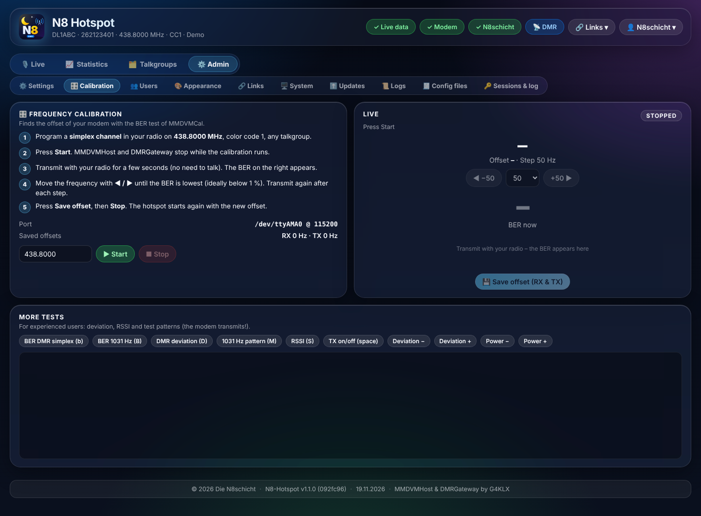
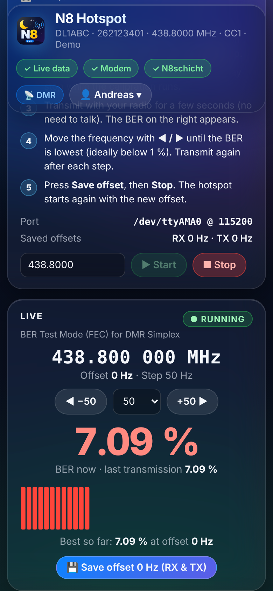
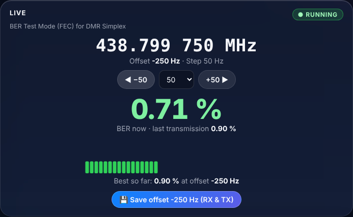

# 🎛️ Kalibrierung

[← Übersicht](../../readme.md) · [Installation](installation.md) · [Live & Statistik](bedienung.md) · [Adminbereich](adminbereich.md) · [Updates](updates.md) · **Kalibrierung** · [FreeRadioID](freeradioid.md) · [Technik](technik.md) · [Fehlersuche](fehlersuche.md)

---

Die Quarze billiger Hotspot-Boards weichen oft einige hundert Hertz ab. Der Hotspot läuft dann zwar, aber mit hoher Bitfehlerrate (**BER**), abgehackter Sprache oder gar nicht. Die Kalibrierung findet den **Offset** und trägt ihn als RX- und TX-Offset ein. Dafür nutzt N8-Hotspot **MMDVMCal** von G4KLX und bedient es aus dem Browser.

  
  &nbsp;
  

## Ablauf (Simplex-Hotspot, MMDVM_HS)

1. **Funkgerät vorbereiten:** einen Simplex-Kanal auf der Hotspot-Frequenz, **Color Code 1**, beliebige Talkgroup, Zeitschlitz egal.
2. **Admin → Calibration → ▶ Start.** MMDVMHost und DMRGateway werden angehalten (oben rot *MMDVMHost stopped*), MMDVMCal öffnet das Modem auf der eingestellten Frequenz und wechselt in den **BER-Test DMR Simplex**.
3. **Mit dem Funkgerät senden**, einige Sekunden, ohne zu sprechen. Rechts erscheint die **BER** groß und darunter ein Verlauf. Nach jedem Durchgang zeigt *last transmission* den Mittelwert.
4. **Frequenz verschieben:** mit **◀ −50 / +50 ▶**. Die Schrittweite stellst du zwischen 10 und 500 Hz ein. Nach jedem Schritt erneut senden. Ziel ist eine BER **unter 1 %**, besser nahe 0 %. Starte grob mit 100–250 Hz und werde dann feiner.
5. **💾 Save offset** übernimmt den angezeigten Offset (z. B. −250 Hz) als RX- und TX-Offset. *Save best* nimmt den besten gemessenen Wert.
6. **■ Stop** beendet MMDVMCal und startet MMDVMHost und DMRGateway mit dem neuen Offset.

| Farbe der BER | Bewertung |
|---|---|
| 🟢 grün, unter 1 % | gut |
| 🟡 gelb, 1–3 % | geht, besser weiter abgleichen |
| 🔴 rot, über 3 % | Offset falsch, Pegel falsch oder Signal zu schwach/zu stark |

> 💡 **Tipp:** Funkgerät nicht direkt neben den Hotspot legen, ein bis zwei Meter Abstand und kleine Leistung. Bei Übersteuerung steigt die BER, obwohl der Offset stimmt.

## Weitere Tests

Unter **More tests** sendet das Modem teilweise selbst, also nur mit Antenne oder Dummy-Load benutzen:

| Knopf | MMDVMCal | Wofür |
|---|---|---|
| BER DMR simplex | `b` | Standard-Test oben (FEC) |
| BER 1031 Hz | `B` | BER mit 1031-Hz-Testmuster (Funkgerät sendet das Testmuster) |
| DMR deviation | `D` | Modem sendet; Hub mit Messempfänger auf 2,75 kHz einstellen |
| 1031 Hz pattern | `M` | Modem sendet ein DMR-Testsignal (CC1, ID1, TG9), z. B. zum Hören im Funkgerät |
| RSSI | `S` | Empfangspegel anzeigen |
| TX on/off | Leertaste | Sender ein/aus |
| Deviation ± / Power ± | `t T` / `p P` | Hub bzw. Leistung in Schritten |

Darunter läuft die Ausgabe von MMDVMCal mit.

## Duplex-Boards

Bei Duplex-Hotspots, etwa einem MMDVM_HS_Dual_Hat, wird RX meist so abgeglichen wie oben. Den TX-Offset prüfst du mit dem 1031-Hz-Muster (`M`) und einem Funkgerät oder Messempfänger. Werte kannst du jederzeit unter **Settings → Modem** von Hand anpassen.

---

Weiter: [🧩 Technik](technik.md)
