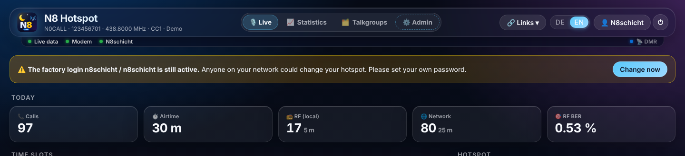
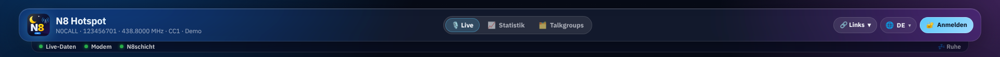

# 🔐 Sicherheit & N8 Kit

[← Übersicht](../../readme.md)

Diese Seite beschreibt, wie das Dashboard sich schützt, was du als Betreiber noch tun kannst (Reverse-Proxy), und das **N8 Kit** – die gemeinsamen Bausteine, die N8-HotSpot, HBlink4-FreeRadioID, adn-frn-server und N8 Crosslink gleich aussehen und sich gleich verhalten lassen.

## Was das Dashboard selbst tut

### Keine offene API-Beschreibung

FastAPI legt normalerweise unter `/docs`, `/redoc` und `/openapi.json` eine vollständige Beschreibung aller Routen an – mit allen Admin-Endpunkten und ihren Datenformaten. Das ist **abgeschaltet**; die drei Adressen antworten mit 404.

Zum Entwickeln lässt sie sich einschalten, nur mit einer Umgebungsvariablen beim Start:

```bash
N8_API_DOCS=1 N8HS_PORT=8080 ./venv/bin/python -m n8hotspot
```

### Sicherheits-Header bei jeder Antwort

| Header | Wert | Wofür |
|---|---|---|
| `Content-Security-Policy` | `default-src 'self'`; Skripte, Styles, Schriften nur vom eigenen Server; Bilder auch `https:` (Kartenkacheln, Avatare); Verbindungen nur zum eigenen Server (`ws:`/`wss:` für Live-Daten); `object-src 'none'`, `base-uri 'self'`, `form-action 'self'`, `frame-ancestors 'self'` | fremde Skripte, Plugins, `<base>`-Tricks, fremde Formularziele und Einbetten in fremde Seiten werden vom Browser blockiert |
| `Strict-Transport-Security` | `max-age=31536000` | nur wenn die Seite über **HTTPS** kommt (direkt oder über einen Proxy mit `X-Forwarded-Proto: https`); verhindert SSL-Stripping |
| `Permissions-Policy` | Kamera, Mikrofon, Zahlung, USB, Seriell, Sensoren aus; Standort nur für die eigene Seite | Seiten können diese Geräte nicht ansprechen |
| `X-Content-Type-Options` | `nosniff` | Dateien werden nur als das ausgeführt, was sie sind |
| `X-Frame-Options` | `SAMEORIGIN` | kein Einbetten in fremde Seiten (Clickjacking) |
| `Referrer-Policy` | `same-origin` | Adressen des Dashboards gehen nicht an fremde Seiten |
| `Cross-Origin-Opener-Policy` / `-Resource-Policy` | `same-origin` / `same-site` | Fenster und Dateien sind von fremden Seiten getrennt |

Der Header `server: uvicorn` wird **nicht** mehr gesendet.

`'unsafe-inline'` ist für Skripte noch erlaubt, weil die Seiten Klick-Handler direkt im HTML haben. Deshalb ist das Escapen (nächster Abschnitt) die eigentliche Schutzschicht gegen XSS; die CSP sorgt dafür, dass ein Angreifer keine **fremden** Skripte nachladen und keine Daten an fremde Server schicken kann.

### Daten aus dem Funkverkehr

Rufzeichen, Namen und Orte kommen aus der ID-Liste, Talkgroup-Namen aus der Liste der N8schicht, Meldungen von MMDVMHost und
DMRGateway aus deren Logs. Jedes dieser Felder geht beim Anzeigen durch `esc()` bzw. wird als `textContent` gesetzt – in Live,
Last heard, Statistik, Talkgroups, Live-Protokoll und im Adminbereich.

### Anmeldung

Sitzungs-Cookie `HttpOnly`, `SameSite`, über HTTPS `Secure`; jede schreibende Anfrage braucht den Header `X-N8` (CSRF-Schutz); fünf
Fehlversuche sperren 15 Minuten. Solange der Werks-Login `n8schicht / n8schicht` gilt, lässt das Dashboard **keine Änderungen** zu – zuerst muss das Passwort unter *Admin → Benutzer & Zugang* geändert werden (die Meldung führt direkt dorthin). So kann niemand, der das Werks-Passwort kennt, einen frisch installierten Hotspot umstellen.


### Schutz vor Flooding und Brute-Force (N8 Guard)

Seit dem Sicherheits-Update im November 2026 läuft in allen N8-Systemen derselbe Wächter **N8 Guard** vor dem Dashboard:

| Was | Grenze je IP-Adresse | Antwort bei Überschreitung |
|---|---|---|
| API-Aufrufe (`/api/…`) | 1200 pro Minute (kurze Spitzen erlaubt) | `429 Too Many Requests` mit `Retry-After` |
| Seitenaufrufe | 600 pro Minute | `429` |
| Anmelde-Versuche (POST an Login/Setup) | 30 pro Minute | `429` |
| WebSocket-Verbindungen | 60 neue pro Minute, höchstens 24 gleichzeitig | Verbindung wird abgelehnt |
| Größe einer Anfrage | 64 MB | `413 Payload Too Large` |

Dazu kommt die **Login-Sperre**: 5 Fehlversuche für denselben Benutzernamen oder 10 Fehlversuche von derselben IP innerhalb von
15 Minuten sperren für 15 Minuten (`429`, mit Hinweis in der Anmeldemaske). Eine erfolgreiche Anmeldung setzt den Zähler zurück.
Die Sperre gilt auch für Anmeldungen, deren Benutzername gar nicht existiert – von außen ist nicht zu erkennen, ob es ihn gibt.

Die IP-Adresse kommt immer aus der Verbindung selbst. Den Header `X-Forwarded-For` nimmt das Dashboard **nur vom eigenen Rechner**
(`127.0.0.1`, also vom Reverse-Proxy) an – ein Angreifer kann sich damit keine neue Adresse ausdenken, um die Sperren zu umgehen.
Statische Dateien (`/static/…`) und die Let's-Encrypt-Prüfung zählen nicht mit.

## Reverse-Proxy davor (empfohlen)

Der Hotspot steht meist im Heimnetz. Soll er von außen erreichbar sein, gehört ein **Reverse-Proxy** mit HTTPS davor – nie den Port 80 direkt ins Internet freigeben. Die Weboberfläche lauscht dann nur lokal (in `n8hotspot.service`: `Environment=N8HS_BIND=127.0.0.1` und z. B. `Environment=N8HS_PORT=8090`).

**Caddy** (holt das Zertifikat selbst):

```caddy
hotspot.example.org {
    encode zstd gzip
    header {
        Strict-Transport-Security "max-age=31536000"
        -Server
    }
    reverse_proxy 127.0.0.1:8090
}
```

**nginx**:

```nginx
server {
    listen 443 ssl http2;
    server_name hotspot.example.org;
    ssl_certificate     /etc/letsencrypt/live/hotspot.example.org/fullchain.pem;
    ssl_certificate_key /etc/letsencrypt/live/hotspot.example.org/privkey.pem;
    server_tokens off;
    add_header Strict-Transport-Security "max-age=31536000" always;

    location / {
        proxy_pass http://127.0.0.1:8090;
        proxy_http_version 1.1;
        proxy_set_header Upgrade $http_upgrade;          # Live-Daten (WebSocket)
        proxy_set_header Connection "upgrade";
        proxy_set_header Host $host;
        proxy_set_header X-Forwarded-For $proxy_add_x_forwarded_for;
        proxy_set_header X-Forwarded-Proto $scheme;      # damit das Dashboard HSTS setzt
        proxy_read_timeout 1h;
    }
}
server { listen 80; server_name hotspot.example.org; return 301 https://$host$request_uri; }
```

Die übrigen Sicherheits-Header setzt das Dashboard selbst; der Proxy muss sie nur durchreichen (beide Beispiele tun das). Die DMR-Verbindung zum Server (UDP) läuft **nicht** über den Proxy.

## N8 Kit

Gemeinsame Bausteine für **HBlink4-FreeRadioID, adn-frn-server, N8-HotSpot und N8 Crosslink**. Die Dateien sind in allen vier Repositories **identisch**; wer eine ändert, kopiert sie in die anderen.

| Datei | Inhalt |
|---|---|
| `static/n8-kit.js` | Sprache DE/EN, Übersetzung, Sprachumschalter, Update-Hinweis, Updates-Kachel, Update-Fortschritt |
| `static/n8-kit.css` | Aussehen dieser Bausteine, auf Basis der N8-Theme-2-Farben |
| `n8hotspot/n8_security.py` | Sicherheits-Header, API-Doku aus, kein `server`-Header |
| `scripts/n8-admin.sh` + `n8hotspot/n8_admin.py` (N8 Admin-Kit) | „Update jetzt“ als root mit Prüfung und automatischem Zurücksetzen, Berechtigungen und sudo prüfen/korrigieren, Dienste |
| `static/i18n-app.js` | die deutschen Texte dieses Dashboards (eigene Datei je Projekt) |

### Sprache DE | EN

<p align="center"></p>
<p align="center"></p>

- Der Umschalter steht in der Kopfzeile neben 🔗 Links und dem Login, auch ohne Anmeldung.
- **Standard ist Deutsch.** Die Wahl gilt **sofort**, ohne Neuladen, und wird im Cookie `n8_lang` gespeichert. Cookies gelten für alle Ports eines Servers – wer also auf dem Hotspot Englisch wählt, sieht auch die APRS-Karte und die anderen N8schicht-Oberflächen auf diesem Server auf Englisch.
- Für einen Link in einer bestimmten Sprache: `?lang=en` oder `?lang=de` an die Adresse hängen.
- Übersetzt wird die fertige Seite: Texte und die Attribute `title`, `placeholder`, `aria-label`, `alt`. Neue Inhalte (Live-Daten, Fenster) werden übersetzt, sobald sie erscheinen; auch Rückfragen (`confirm`) folgen der Sprache. Rufzeichen, Talkgroup-Namen, Log-Zeilen und Code bleiben, wie sie sind.
- Fehlt ein Wort, erscheint das Original. Ergänzen: in `static/i18n-app.js` eine Zeile `'English text': 'Deutscher Text',` – ohne führende Emojis und ohne Satzzeichen am Ende, Zahlen über die `rules` am Ende der Datei.

### Updates – überall gleich

| | |
|---|---|
| Prüfen | jede volle Stunde, auch ohne Anmeldung; installiert wird nur auf Knopfdruck |
| Hinweis | unter der Statusleiste, nur für Admins: *Update verfügbar: alt → neu* · Was ist neu? · Jetzt aktualisieren · Details · Später (ein Tag) |
| Installieren | Fenster mit Neuerungen und Passwortabfrage, dann drei Schritte mit Fortschritt; die Seite lädt danach neu |
| Ausführung | als root über `n8hotspot-update.path` → `n8-admin.sh update` (N8 Admin-Kit), unabhängig von der Weboberfläche |
| Prüfung danach | `n8-admin.sh` ruft die Weboberfläche bis zu 90 Sekunden lang auf |
| Rollback | antwortet sie nicht, geht es sofort auf den alten Stand zurück (`git reset --keep`), die Dienste starten neu |
| Ergebnis | *Letztes Update* und **📜 Update-Protokoll** in Admin → Updates: erfolgreich oder zurückgenommen, mit Zeit und Ablauf |
| Automatisch | *Install automatically* nutzt dieselbe Prüfung und denselben Rollback |

---

Weiter: [⬆️ Updates](updates.md) · [🩺 Fehlersuche](fehlersuche.md)
