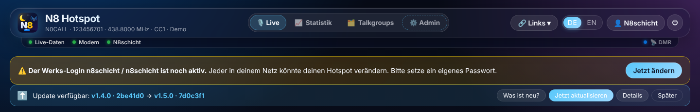
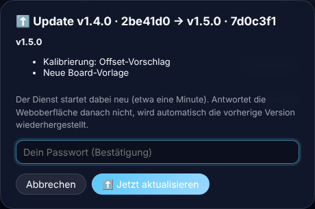
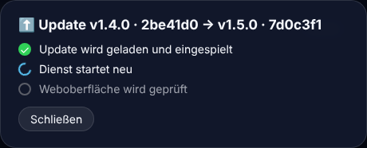
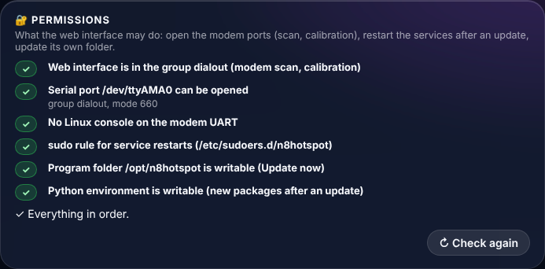

# ⬆️ Updates & Versionen

[← Übersicht](../../readme.md) · [Installation](installation.md) · [Live & Statistik](bedienung.md) · [Adminbereich](adminbereich.md) · **Updates** · [Kalibrierung](kalibrierung.md) · [FreeRadioID](freeradioid.md) · [Technik](technik.md) · [Fehlersuche](fehlersuche.md)

---

Ab Version **1.1.0** aktualisiert sich N8-Hotspot auf Knopfdruck im Browser. Er sieht selbst nach, ob es auf GitHub
eine neue Version gibt, zeigt dir die Änderungen und startet nach dem Update alle Dienste neu.

## Hinweis auf neue Versionen

<p align="center"></p>

Zu jeder vollen Stunde fragt der Hotspot bei GitHub nach dem neuesten Stand von `dhartmann1979/N8-HotSpot` (Zweig `main`).
Dabei wird nur die öffentliche Commit-Liste gelesen, es werden **keine Daten über deinen Hotspot** gesendet.

Gibt es etwas Neues, sehen **nur Admins** unter der Statusleiste den Hinweis *Update verfügbar: v1.4.0 · … → v1.5.0 · …* mit
**Was ist neu?** (klappt die Änderungen auf), **Jetzt aktualisieren**, **Details** (öffnet *Admin → Updates*) und **Später**
(blendet den Hinweis für diese Version einen Tag aus). Besucher und Viewer bekommen davon nichts mit.

Hinweis, Kachel und Fortschritt kommen aus dem **N8 Kit** und sehen in N8-HotSpot, HBlink4-FreeRadioID, adn-frn-server und
N8 Crosslink gleich aus (siehe [Sicherheit & N8 Kit](sicherheit.md)).

## Admin → Updates

<p align="center"></p>

Links steht die Kachel **⬆️ Updates**:

| Zeile | Bedeutung |
|---|---|
| **Installiert** | Versionsnummer aus der Datei `VERSION` und der Commit, auf dem der Hotspot steht |
| **Auf GitHub** | neueste Version und Commit, mit *Update verfügbar* oder *aktuell* |
| **Zuletzt geprüft** | wann zuletzt nachgesehen wurde |
| **Automatische Prüfung** | *stündlich zur vollen Stunde*, bei *Install automatically* mit der Stunde fürs Installieren |
| **Letztes Update** | *erfolgreich* oder *zurückgenommen*, mit Versionen und Zeit |
| **Quelle** | woher das Update kommt: der Git-Remote `origin` auf dem Hotspot |

Darunter stehen die **Änderungen der neuen Version** (*Was ist neu*), direkt aus [CHANGELOG.md](../../CHANGELOG.md).
**↻ Jetzt prüfen** fragt sofort nach, **⬆️ Update jetzt installieren** installiert.

Rechts sind die **Update settings**:

| Einstellung | Vorgabe | Bedeutung |
|---|---|---|
| **Check for updates** | an | stündliche Prüfung und Hinweis für Admins |
| **Check every (hours)** | 1 | 1 bis 168 Stunden |
| **Install automatically** | aus | neue Versionen ohne Klick installieren (siehe unten) |
| **Hour for automatic updates** | 04:00–04:59 | in dieser Stunde wird automatisch installiert |
| **Restart MMDVMHost & DMRGateway** | an | nach dem Update die ini-Dateien neu schreiben und beide Funkdienste neu starten |
| **Repository / Branch** | `dhartmann1979/N8-HotSpot` / `main` | nur ändern, wenn du einen eigenen Fork benutzt |

## Update jetzt installieren

<p align="center">
  
  
</p>

**⬆️ Update jetzt installieren** (oder **Jetzt aktualisieren** im Hinweis) zeigt die Neuerungen und was passiert, und fragt zur
Sicherheit noch einmal **dein Passwort** ab. Nach 5 falschen Versuchen ist 15 Minuten Pause – genau wie beim Login; ein falsches
Passwort lässt das Fenster offen. Dann siehst du drei Schritte: **Update wird geladen und eingespielt → Dienst startet neu →
Weboberfläche wird geprüft**. Im Einzelnen:

1. **Herunterladen:** `git fetch` vom eingetragenen Remote, danach ein *Fast-Forward* auf **genau den Commit, der dir angezeigt wurde**.
   Ist inzwischen etwas anderes auf GitHub, bricht das Update ab und bittet dich, neu zu prüfen.
2. **Python-Pakete:** nur wenn sich `requirements.txt` geändert hat, werden sie in die eigene Umgebung (`venv`) installiert.
3. **Funkdienste:** `MMDVM-Host.ini` und `DMRGateway.ini` werden neu geschrieben, **MMDVMHost** und **DMRGateway** neu gestartet.
4. **Weboberfläche:** `n8hotspot` startet neu. Die Seite wartet und lädt sich von selbst neu, sobald die neue Version antwortet.

**Automatisch zurück (Rollback):** Vor dem Neustart merkt sich der Hotspot den alten Stand (`data/update.pending`). Die neue Version
ruft nach dem Start ihre eigene Weboberfläche auf. Antwortet sie nicht, beendet sie sich; nach **drei erfolglosen Starts** setzt
`scripts/n8-update-guard.sh` (läuft als `ExecStartPre` vor jedem Start von `n8hotspot`) den Programmordner auf den alten Commit zurück.
Das Ergebnis steht unter **Letztes Update** und in `data/update.result`. Das gilt auch für automatische Updates. Die Zeile kommt mit
`permissions.sh` in die installierte Unit – `update.sh` ruft es bei jedem Update auf.

Geht etwas schief (z. B. eine fehlende Berechtigung), erscheint es als Hinweis unten rechts.
 Einstellungen, Benutzer, Statistik und Kalibrierung bleiben erhalten –
sie liegen in `/opt/n8hotspot/data/n8hotspot.db`, nicht im Programmordner.

Ein Update wird **abgelehnt**, wenn

- der Hotspot keine Git-Installation ist (z. B. ein kopierter Ordner) – dann `update.sh` auf der Konsole benutzen,
- Dateien im Programmordner von Hand geändert wurden (sonst wären die Änderungen weg) – `git stash` oder auf der Konsole aktualisieren,
- der Hotspot eigene Commits hat, die es auf GitHub nicht gibt,
- gerade schon ein Update läuft (Pause von 30 Sekunden zwischen zwei Versuchen).

## 🔐 Berechtigungen

<p align="center"></p>

Die Weboberfläche läuft als Benutzer `n8hotspot`, nicht als root. Damit Modem-Scan, Kalibrierung, Neustarts und Updates
funktionieren, braucht sie ein paar Rechte. Die Kachel **🔐 Permissions** unter *Admin → Updates* prüft sie bei jedem Öffnen
(und **↻ Check again**), auch nach jedem Update:

| Prüfung | Wofür | Typische Ursache, wenn rot |
|---|---|---|
| Gruppe **dialout** | Modem-Scan und Kalibrierung öffnen `/dev/ttyAMA0`, `/dev/ttyACM0` … | ältere Installation; Gruppe hinzugefügt, aber Dienst nicht neu gestartet |
| **Serial port … can be opened** | jede Modem-Schnittstelle einzeln | Login-Konsole (getty) belegt den Port (Gruppe `tty`) |
| **No Linux console on the modem UART** | Kernel schreibt sonst Text auf das Modem | `console=serial0,115200` in `cmdline.txt` |
| **GPIO UART is the full PL011** | Hat am Pi braucht den richtigen UART | Bluetooth aktiv, `dtoverlay=disable-bt` fehlt |
| **sudo rule** | Dienste nach Update/Einstellungen neu starten, MMDVMHost für den Scan anhalten | `/etc/sudoers.d/n8hotspot` fehlt oder ist alt |
| **Program folder writable** | *Update jetzt installieren* | Dateien gehören root (z. B. nach `git pull` als root) |
| **Python environment writable** | neue Pakete nach einem Update | `venv` gehört root |

Reparieren lässt sich das nur als root – einmal auf der Konsole:

```bash
sudo /opt/n8hotspot/scripts/permissions.sh            # prüfen und reparieren, danach Dienste neu starten
sudo /opt/n8hotspot/scripts/permissions.sh --check    # nur anzeigen
```

Das Skript setzt die Gruppen (`dialout`, `systemd-journal` …), schreibt die systemd-Dienste und die sudo-Regel neu (der Port der
Weboberfläche bleibt), gibt den Programmordner dem Benutzer `n8hotspot`, schaltet eine Login-Konsole auf der Modem-Schnittstelle ab
und nimmt am Raspberry Pi die Linux-Konsole vom UART (dann einmal `sudo reboot`). **`scripts/update.sh` ruft es bei jedem Update auf**,
`install.sh` ebenfalls. Bewusst nicht im Browser: Ein Skript im Programmordner, das die Weboberfläche selbst ändern darf, als root
auszuführen, wäre eine Hintertür.

Ändert ein Update im Browser die Dienst-Dateien oder fehlt eine Berechtigung, erscheint das als Hinweis mit genau diesem Befehl.

## Automatische Updates

Mit **Install automatically** installiert der Hotspot neue Versionen selbst – genauso wie mit *Update jetzt installieren*, nur ohne Klick:

- nur in der gewählten Stunde (Vorgabe 04:00–04:59 Uhr), mit derselben Prüfung und demselben Rollback,
- nur wenn **niemand sendet** (beide Zeitschlitze frei) und **keine Kalibrierung** läuft,
- jedes Update steht im Protokoll unter *Sessions & log* mit dem Benutzer `auto-update`.

Fällt die Stunde in ein QSO, wird es in der nächsten Runde (spätestens nach einer Stunde) noch einmal versucht.

## Neustart der Dienste – ohne Änderung an sudoers

Die Weboberfläche läuft als Benutzer `n8hotspot`, nicht als root. Für Neustarts legt `install.sh` schon bei der Installation
die Datei `/etc/sudoers.d/n8hotspot` an. Sie erlaubt **nur** diese Befehle ohne Passwort:

```text
n8hotspot ALL=(root) NOPASSWD: /usr/bin/systemctl start|stop|restart mmdvmhost.service,
    /usr/bin/systemctl start|stop|restart dmrgateway.service,
    /usr/bin/systemctl start|stop|restart mosquitto.service,
    /usr/bin/systemctl restart n8hotspot.service, /usr/bin/systemctl reboot, /usr/bin/systemctl poweroff
```

(In der Datei steht jeder Befehl einzeln.) Damit kann die Weboberfläche nach einem Update die Dienste neu starten, aber
**keine anderen Programme** als root ausführen. Fehlt die Regel (z. B. bei einer sehr alten Installation), beendet sich die
Weboberfläche nach dem Update selbst, und systemd startet sie wegen `Restart=always` sofort wieder. Die Regel lässt sich jederzeit
neu anlegen mit:

```bash
sudo /opt/n8hotspot/scripts/permissions.sh
```

Prüfen kannst du sie mit `sudo -l -U n8hotspot`.

## Aktualisieren auf der Konsole

Ohne Browser – oder bei einer Installation ohne Git – geht es wie bisher:

```bash
sudo /opt/n8hotspot/scripts/update.sh              # Weboberfläche (git pull, Python-Pakete, Berechtigungen, Neustart)
sudo /opt/n8hotspot/scripts/update.sh --rebuild    # dazu aktuelle MMDVMHost/DMRGateway/MMDVMCal bauen
```

`update.sh` aktualisiert nur N8-Hotspot. Neue Versionen von MMDVMHost, DMRGateway und MMDVMCal (G4KLX) baut nur `--rebuild`.

## Versionsnummern

N8-Hotspot zählt nach [Semantic Versioning](https://semver.org/lang/de/): `MAJOR.MINOR.PATCH`.

| Teil | Wann er steigt | Beispiel |
|---|---|---|
| **MAJOR** | Änderungen, nach denen etwas von Hand angepasst werden muss | 2.0.0 |
| **MINOR** | neue Funktionen, alles läuft weiter wie bisher | 1.1.0 |
| **PATCH** | nur Fehlerbehebungen | 1.1.1 |

Jede Version steht mit allen Änderungen in [CHANGELOG.md](../../CHANGELOG.md). Für eine neue Version:

```bash
# 1. CHANGELOG.md: neuen Abschnitt „## [1.2.0] – JJJJ-MM-TT“ oben einfügen und alles beschreiben
python3 scripts/release.py 1.2.0      # prüft CHANGELOG.md, schreibt VERSION und macht den Commit
git push
```

Nach dem Push legt GitHub (Workflow `.github/workflows/release.yml`) den Tag `v1.2.0` und das Release mit dem Text aus
`CHANGELOG.md` an. Ändert man später den Text im Changelog, wird das Release automatisch angepasst.

---

Weiter: [🎛️ Kalibrierung](kalibrierung.md)
