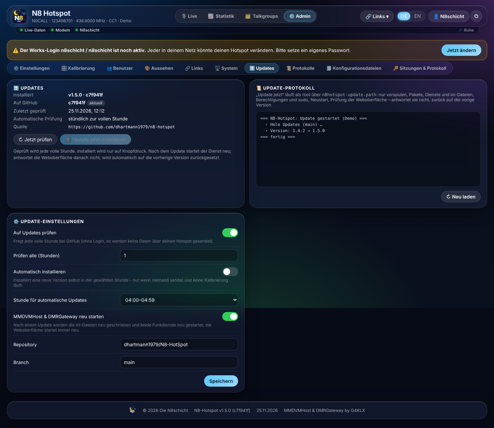
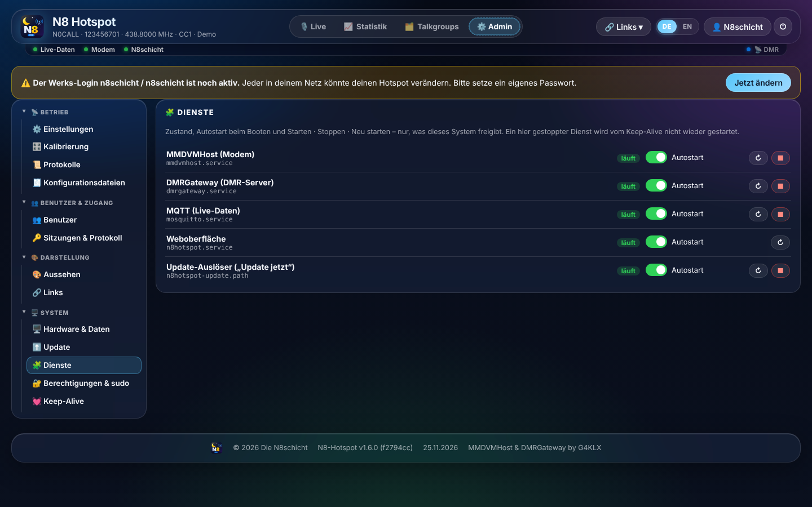
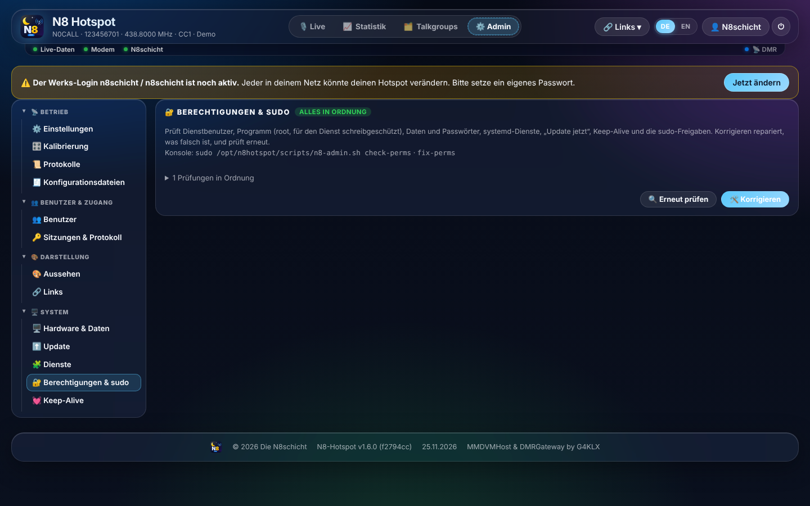
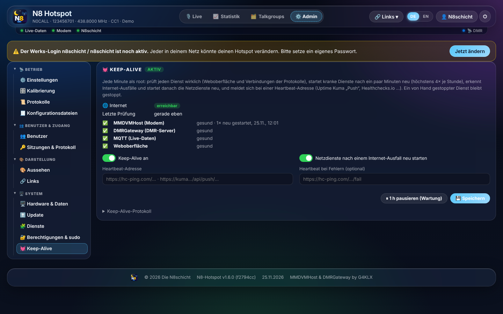
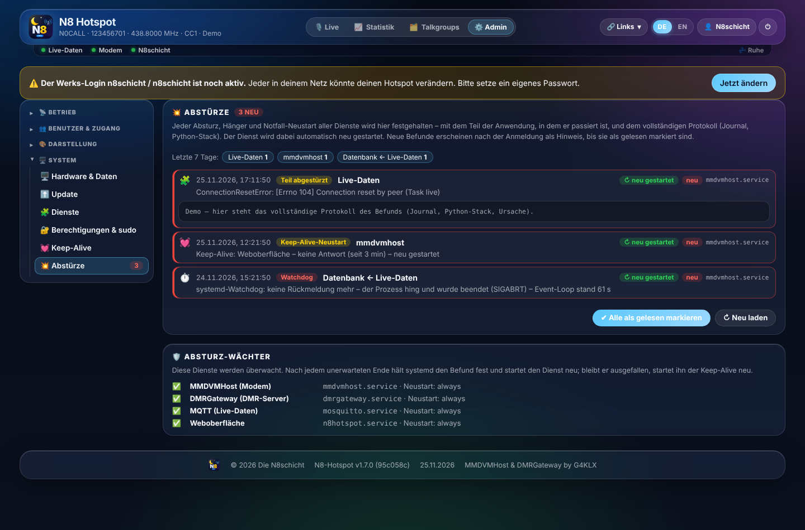
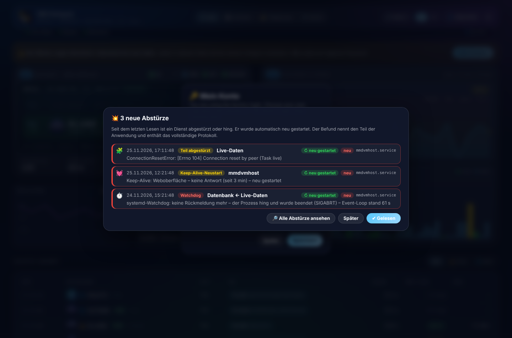

# ⬆️ Updates & Versionen

[← Übersicht](../../readme.md) · [Installation](installation.md) · [Live & Statistik](bedienung.md) · [Adminbereich](adminbereich.md) · **Updates** · [Kalibrierung](kalibrierung.md) · [FreeRadioID](freeradioid.md) · [Technik](technik.md) · [Fehlersuche](fehlersuche.md)

---

Ab Version **1.1.0** aktualisiert sich N8-Hotspot auf Knopfdruck im Browser. Er sieht selbst nach, ob es auf GitHub
eine neue Version gibt, zeigt dir die Änderungen und startet nach dem Update die Weboberfläche neu – MMDVMHost und DMRGateway nur,
wenn sich für sie etwas geändert hat.

## Hinweis auf neue Versionen

<p align="center"></p>

Zu jeder vollen Stunde fragt der Hotspot bei GitHub nach dem neuesten Stand von `dhartmann1979/N8-HotSpot` (Zweig `main`).
Dabei wird nur die öffentliche Commit-Liste gelesen, es werden **keine Daten über deinen Hotspot** gesendet.

Gibt es etwas Neues, sehen **nur Admins** unter der Statusleiste den Hinweis *Update verfügbar: v1.4.0 · … → v1.5.0 · …* mit
**Was ist neu?** (klappt die Änderungen auf), **Jetzt aktualisieren**, **Details** (öffnet *Admin → Updates*) und **Später**
(blendet den Hinweis für diese Version einen Tag aus). Besucher und Viewer bekommen davon nichts mit.

Hinweis, Kachel und Fortschritt kommen aus dem **N8 Kit** und sehen in N8-HotSpot, HBlink4-FreeRadioID, adn-frn-server und
N8 Crosslink gleich aus (siehe [Sicherheit & N8 Kit](sicherheit.md)).

## Admin → System → ⬆️ Update

<p align="center"></p>

Seit 1.6.0 ist das dieselbe Ansicht wie in allen N8-Systemen (N8 Kit 1.1.0). Links steht die Kachel **⬆️ Update**, rechts das **📜 Update-Protokoll**:

| Zeile | Bedeutung |
|---|---|
| **Installiert** | Versionsnummer aus der Datei `VERSION` und der Commit, auf dem der Hotspot steht |
| **Auf GitHub** | neueste Version und Commit, mit *Update verfügbar* oder *aktuell* |
| **Zuletzt geprüft** | wann zuletzt nachgesehen wurde |
| **Automatische Prüfung** | *stündlich zur vollen Stunde*, bei *Install automatically* mit der Stunde fürs Installieren |
| **Letztes Update** | *erfolgreich* oder *zurückgenommen*, mit Versionen und Zeit |
| **Quelle** | woher das Update kommt: der Git-Remote `origin` auf dem Hotspot |

Darunter stehen die **Änderungen der neuen Version** (*Was ist neu*), direkt aus [CHANGELOG.md](../../CHANGELOG.md).
**↻ Jetzt prüfen** fragt sofort nach, **⬆️ Update jetzt installieren** installiert.

Darunter stehen die **Update-Einstellungen**:

| Einstellung | Vorgabe | Bedeutung |
|---|---|---|
| **Check for updates** | an | stündliche Prüfung und Hinweis für Admins |
| **Check every (hours)** | 1 | 1 bis 168 Stunden |
| **Install automatically** | aus | neue Versionen ohne Klick installieren (siehe unten) |
| **Hour for automatic updates** | 04:00–04:59 | in dieser Stunde wird automatisch installiert |
| **Restart MMDVMHost & DMRGateway** | an | nur für das alte Update ohne Admin-Kit: ini-Dateien neu schreiben und beide Funkdienste neu starten. „Update jetzt“ startet sie seit 1.8.1 nur bei Änderungen neu (siehe unten) |
| **Repository / Branch** | `dhartmann1979/N8-HotSpot` / `main` | nur ändern, wenn du einen eigenen Fork benutzt |

## Update jetzt installieren

<p align="center">
  
  
</p>

**⬆️ Update jetzt installieren** (oder **Jetzt aktualisieren** im Hinweis) zeigt die Neuerungen und was passiert. Seit **1.6.0**
fragt es **nicht mehr nach dem Passwort** – eine Admin-Sitzung (mit dem Sicherheits-Header gegen fremde Seiten) genügt, wie in allen
N8-Systemen. Dann siehst du drei Schritte: **Update wird geladen und eingespielt → Dienst startet neu → Weboberfläche wird geprüft**.
Im Einzelnen:

Seit **1.5.0** läuft das Update über das gemeinsame **N8 Admin-Kit** (`scripts/n8-admin.sh`, dasselbe wie im HobbyRadioPortal,
adn-frn-server und HBlink4-FreeRadioID, nach dem Vorbild von N8 Crosslink). Die Weboberfläche schreibt nur eine Anforderung
(`data/update.request`); `n8hotspot-update.path` sieht sie und startet `n8hotspot-update.service` – **als root**, unabhängig
von der Weboberfläche:

1. **Vorspulen:** `git fetch` vom eingetragenen Remote, dann nur ein *Fast-Forward*. Wurden Dateien im Programmordner von Hand
   geändert, bricht das Update ab, ohne etwas zu ändern.
2. **Python-Pakete**, wenn sich `requirements.txt` geändert hat; **Dienste** aus den Vorlagen (`systemd/*.service`, Port bleibt);
   **ini-Dateien** neu geschrieben.
3. **Berechtigungen und sudo** prüfen und korrigieren (`fix-perms`), Update-Units aktuell halten.
4. **Neustart:** zuerst die Weboberfläche. **DMRGateway und MMDVMHost** nur, wenn sich ihre ini-Dateien, ihre Dienst-Dateien oder
   die Programme geändert haben (oder sie nicht laufen) – sonst bleibt das Modem offen und der Hotspot funkt einfach weiter. Im
   Update-Protokoll steht „Funk-Teil unverändert“ bzw. „Funk-Teil neu gestartet“. Die Seite wartet und lädt sich von selbst neu.
5. **Prüfung:** Antwortet die Weboberfläche nicht innerhalb von 90 Sekunden, geht es **automatisch zurück** auf den alten Stand
   (`git reset --keep`) und alles wird neu gestartet.

Das Ergebnis steht unter **Letztes Update** und mit dem ganzen Ablauf in der Kachel **📜 Update-Protokoll**
(`data/update.log`, `data/update.result`). Das gilt auch für automatische Updates.

<p align="center"></p>

Einstellungen, Benutzer, Statistik und Kalibrierung bleiben erhalten – sie liegen in `/opt/n8hotspot/data/n8hotspot.db`,
nicht im Programmordner.

> **Von 1.4.x auf 1.5.0:** Das erste Update läuft noch über den alten Weg (als Dienst-Benutzer). Danach einmal auf der Konsole
> `sudo /opt/n8hotspot/scripts/n8-admin.sh fix-perms` – das richtet sudo und „Update jetzt“ ein; ab dann geht alles im Browser.

Ein Update wird **abgelehnt**, wenn

- der Hotspot keine Git-Installation ist (z. B. ein kopierter Ordner),
- Dateien im Programmordner von Hand geändert wurden (sonst wären die Änderungen weg) – `git stash`, dann erneut,
- der Hotspot eigene Commits hat, die es auf GitHub nicht gibt,
- gerade schon ein Update läuft (Pause von 30 Sekunden zwischen zwei Versuchen).

## 🔐 Dienste, Berechtigungen & sudo

<p align="center">
  
  
</p>

Seit 1.6.0 haben beide einen eigenen Eintrag im Menü unter **System** (vorher Kacheln unter *System*):

**🧩 Dienste** – MMDVMHost, DMRGateway, MQTT (mosquitto), die Weboberfläche und der Update-Auslöser, jeweils mit Zustand,
**Autostart**-Schalter und **↻ Neu starten · ▶ Starten · ■ Stoppen** (die Weboberfläche lässt sich nur neu starten).

**🔐 Berechtigungen & sudo** – *Erneut prüfen* zeigt alle Abweichungen, **Korrigieren** behebt sie (prüfen → korrigieren → erneut
prüfen) und zeigt das Protokoll. Geprüft wird:

| Bereich | Prüfung |
|---|---|
| Dienst-Benutzer | `n8hotspot` vorhanden, ohne Login-Shell, in den Gruppen `dialout` (Modem), `systemd-journal`, `adm`, `gpio`, `i2c`, `spi` (soweit vorhanden) |
| Programm | `/opt/n8hotspot` gehört root und ist für den Dienst **schreibgeschützt**, Skripte 755, `venv` lauffähig |
| Daten | `data/` gehört `n8hotspot` (750); Datenbank und ini-Dateien (Passwort des DMR-Servers) nur für den Dienst (600) |
| systemd | Dienste gehören root (644), laufen nicht als root, „Update jetzt“ (`n8hotspot-update.path`) aktiv, Weboberfläche darf sudo nutzen |
| sudo | installiert, `/etc/sudoers.d` eingebunden, `/etc/sudoers.d/n8hotspot-n8admin` gültig (`visudo`), aktuell und wirksam (`sudo -l`) |
| Modem-Schnittstelle | `n8hotspot` darf `/dev/ttyAMA0` bzw. USB-Modems öffnen, keine Linux- oder Login-Konsole darauf, Bluetooth belegt den UART nicht |

Auf der Konsole:

```bash
sudo /opt/n8hotspot/scripts/n8-admin.sh check-perms    # nur prüfen
sudo /opt/n8hotspot/scripts/n8-admin.sh fix-perms      # prüfen → korrigieren → prüfen  (= scripts/permissions.sh)
```

Installer und jedes Update rufen `fix-perms` selbst auf. Nimmt die Korrektur die Linux-Konsole vom UART, ist einmal
`sudo reboot` nötig.

## 💓 Keep-Alive

<p align="center"></p>

Seit **1.6.0** wacht ein Keep-Alive über den Hotspot. `n8hotspot-keepalive.timer` startet **jede Minute als root**
`scripts/n8-admin.sh keepalive`:

| Was | Wie |
|---|---|
| **Weboberfläche** | antwortet sie auf `http://127.0.0.1:<Port>/api/info`? |
| **MQTT** | sind die Live-Daten verbunden? (`/api/n8/health`, nur lokal erreichbar) |
| **MMDVMHost** | ist das Modem offen? |
| **DMRGateway** | ist die Verbindung zum DMR-Server da? |
| **Neustart** | nach **3 Minuten** krank (sofort bei `failed`), **höchstens 4× je Stunde** – danach „aufgegeben“ im Protokoll |
| **Internet-Ausfall** | 1.1.1.1, 9.9.9.9 und github.com (Port 443) nicht erreichbar → keine sinnlosen Neustarts; ist das Netz nach mindestens 60 s wieder da, wird DMRGateway einmal neu gestartet |
| **Heartbeat** | optional jede Minute ein Ping an Uptime Kuma („Push“) oder Healthchecks.io, bei Fehlern an die Fehler-Adresse |
| **Wartung** | **⏸ 1 h pausieren**; ein unter *Dienste* gestoppter Dienst bleibt gestoppt, bis du ihn dort startest |

Dateien in `data/`: `keepalive.conf` (Einstellungen aus dem Browser), `keepalive.json` (Zustand), `keepalive.log` (Protokoll,
höchstens 400 Zeilen). Eingerichtet wird der Timer von Installer, Update und `fix-perms`; `check-perms` prüft ihn mit.

```bash
systemctl status n8hotspot-keepalive.timer               # läuft der Wächter?
sudo /opt/n8hotspot/scripts/n8-admin.sh keepalive        # eine Runde von Hand
tail -f /opt/n8hotspot/data/keepalive.log
```


## 💥 Abstürze erkennen und aufklären

 

Seit **N8-Hotspot 1.7.0** wird jedes unerwartete Ende festgehalten – in allen N8-Systemen gleich (N8 Kit 1.3). Überwacht werden
MMDVMHost, DMRGateway, MQTT (mosquitto) und die Weboberfläche (`n8hotspot.service`).

| Ebene | Was festgehalten wird |
|---|---|
| **Absturz-Wächter** (systemd, als root) | Drop-in `/etc/systemd/system/<dienst>.d/n8-crashwatch-<id>.conf` mit `ExecStopPost=+… crash-hook`. Nach jedem nicht geplanten Ende: Art (Signal, Fehlercode, Watchdog, OOM, Zeitüberschreitung), letzte 200 Journal-Zeilen, Coredump-Kurzinfo, Python-Stack. systemd startet den Dienst sofort neu |
| **Python-Dienste** | faulthandler (`crash/fault-<dienst>.log`), Hänger-Wächter der Event-Loop (> 8 s, mit Stack und Teil), abgestürzte Tasks und Threads. Teile: Live-Daten (MQTT) · Kalibrierung · Konfiguration (ini) · ID-Listen · Statistik · Datenbank · Update · Modem-Suche · System · Anmeldung · Einstellungen · Webinterface. Zwei Teile bedeuten „wartet auf“, z. B. *Datenbank ← Live-Daten* |
| **Keep-Alive** | jeder Neustart durch den Keep-Alive (mit Grund); Dienste im Zustand `failed` werden mit `reset-failed` neu gestartet; Neustarts durch systemd ohne Absturz-Wächter werden erkannt; fehlt der Wächter, richtet der Keep-Alive ihn ein |

**Anzeigen:** ⚙️ Admin → 🖥️ System → **💥 Abstürze** (Liste mit Art, Teil, Ursache, vollständigem Protokoll, Zähler je Teil). Neue Befunde
erscheinen **nach der Anmeldung als Hinweisfenster** und als roter Zähler im Menü, bis sie als gelesen markiert sind.
Konsole: `sudo /opt/n8hotspot/scripts/n8-admin.sh crashes`. Dateien: `crashes.jsonl` (letzte 300), `crash/<id>.log`, `crash/ack.json`, `crashwatch.json`.

**Bereinigen:** In jedem aufgeklappten Befund löscht **🗑 Diesen Befund löschen** ihn samt Protokoll, unten **🗑 Alle löschen**
(mit Rückfrage) alle – ist oben nach einem Dienst gefiltert, heißt der Knopf **🗑 Angezeigte löschen** und löscht nur diese.
Auf der Konsole: `sudo …/scripts/n8-admin.sh crashes-clear`. Die laufende Faulthandler-Datei (`crash/fault-*.log`) bleibt.

## Automatische Updates

Mit **Install automatically** installiert der Hotspot neue Versionen selbst – genauso wie mit *Update jetzt installieren*, nur ohne Klick:

- nur in der gewählten Stunde (Vorgabe 04:00–04:59 Uhr), mit derselben Prüfung und demselben Rollback,
- nur wenn **niemand sendet** (beide Zeitschlitze frei) und **keine Kalibrierung** läuft,
- jedes Update steht im Protokoll unter *Sessions & log* mit dem Benutzer `auto-update`.

Fällt die Stunde in ein QSO, wird es in der nächsten Runde (spätestens nach einer Stunde) noch einmal versucht.

## sudo: genau diese Befehle

Die Weboberfläche läuft als Benutzer `n8hotspot`, nicht als root. `n8-admin.sh` schreibt `/etc/sudoers.d/n8hotspot-n8admin`
(440, mit `visudo` geprüft, bei jedem Update neu). Sie erlaubt **nur**: `systemctl start|stop|restart|enable|disable` für
`mmdvmhost`, `dmrgateway`, `mosquitto` und `n8hotspot-update.path`, `restart|enable` für `n8hotspot`,
`systemctl start n8hotspot-update.service`, `n8-admin.sh check-perms --json` und `fix-perms` sowie `systemctl reboot|poweroff`.
Keine Shell, keine anderen Programme. Die alte Datei `/etc/sudoers.d/n8hotspot` (bis 1.4) entfernt das erste Update.
Prüfen: `sudo -l -U n8hotspot`.

## Aktualisieren auf der Konsole

Ohne Browser – oder bei einer Installation ohne Git – geht es wie bisher:

```bash
sudo /opt/n8hotspot/scripts/update.sh              # wie „Update jetzt“: vorspulen, Pakete, Dienste, Rechte, Neustart, Prüfung
sudo /opt/n8hotspot/scripts/update.sh --rebuild    # dazu aktuelle MMDVMHost/DMRGateway/MMDVMCal bauen
```

`update.sh` aktualisiert nur N8-Hotspot. Neue Versionen von MMDVMHost, DMRGateway und MMDVMCal (G4KLX) baut nur `--rebuild`.

## Versionsnummern

N8-Hotspot zählt nach [Semantic Versioning](https://semver.org/lang/de/): `MAJOR.MINOR.PATCH`.

| Teil | Wann er steigt | Beispiel |
|---|---|---|
| **MAJOR** | Änderungen, nach denen etwas von Hand angepasst werden muss | 2.0.0 |
| **MINOR** | neue Funktionen, alles läuft weiter wie bisher | 1.1.0 |
| **PATCH** | nur Fehlerbehebungen | 1.1.1 |

Jede Version steht mit allen Änderungen in [CHANGELOG.md](../../CHANGELOG.md). Für eine neue Version:

```bash
# 1. CHANGELOG.md: neuen Abschnitt „## [1.2.0] – JJJJ-MM-TT“ oben einfügen und alles beschreiben
python3 scripts/release.py 1.2.0      # prüft CHANGELOG.md, schreibt VERSION und macht den Commit
git push
```

Nach dem Push legt GitHub (Workflow `.github/workflows/release.yml`) den Tag `v1.2.0` und das Release mit dem Text aus
`CHANGELOG.md` an. Ändert man später den Text im Changelog, wird das Release automatisch angepasst.

---

Weiter: [🎛️ Kalibrierung](kalibrierung.md)
