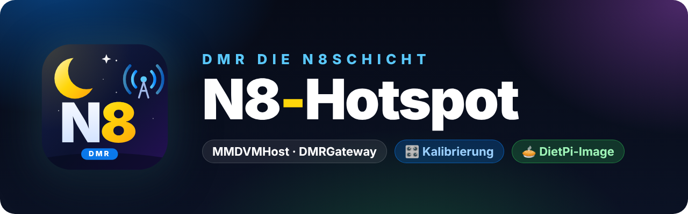
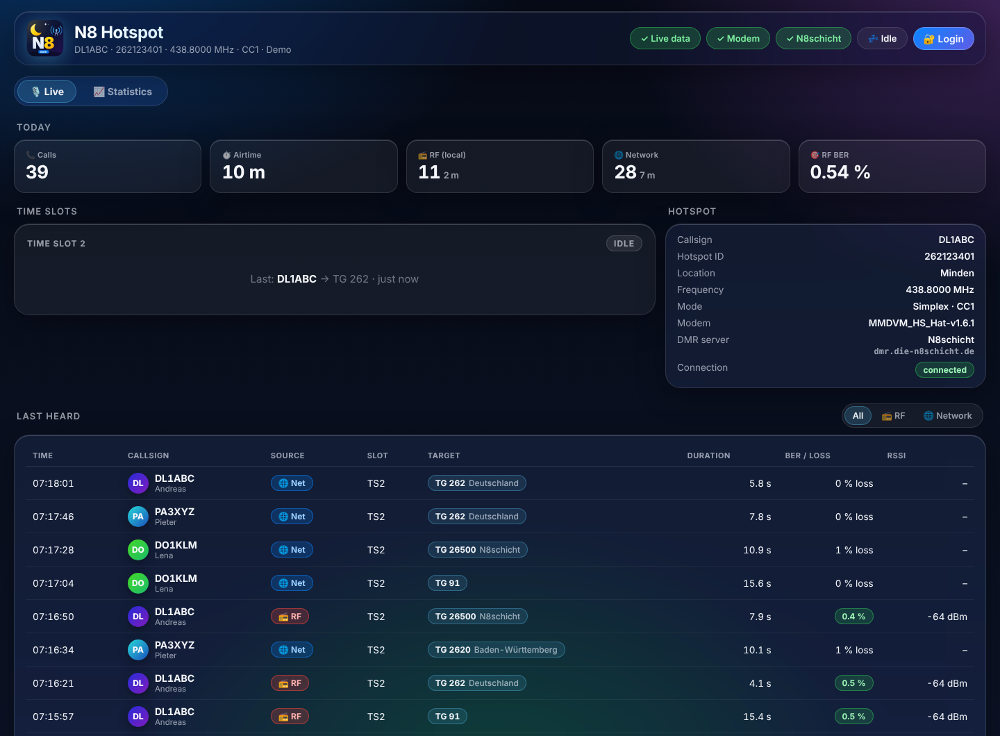
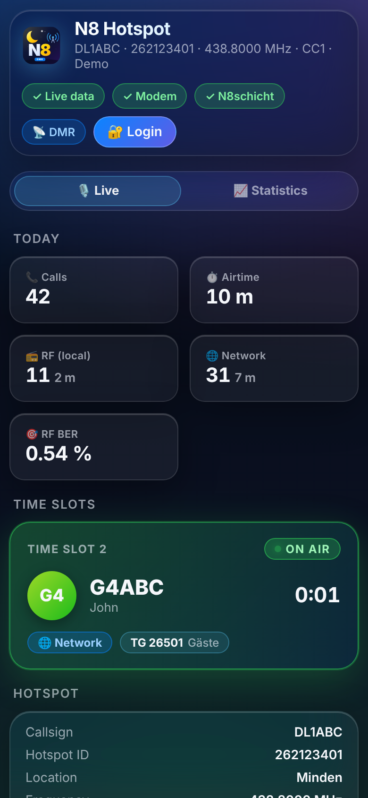
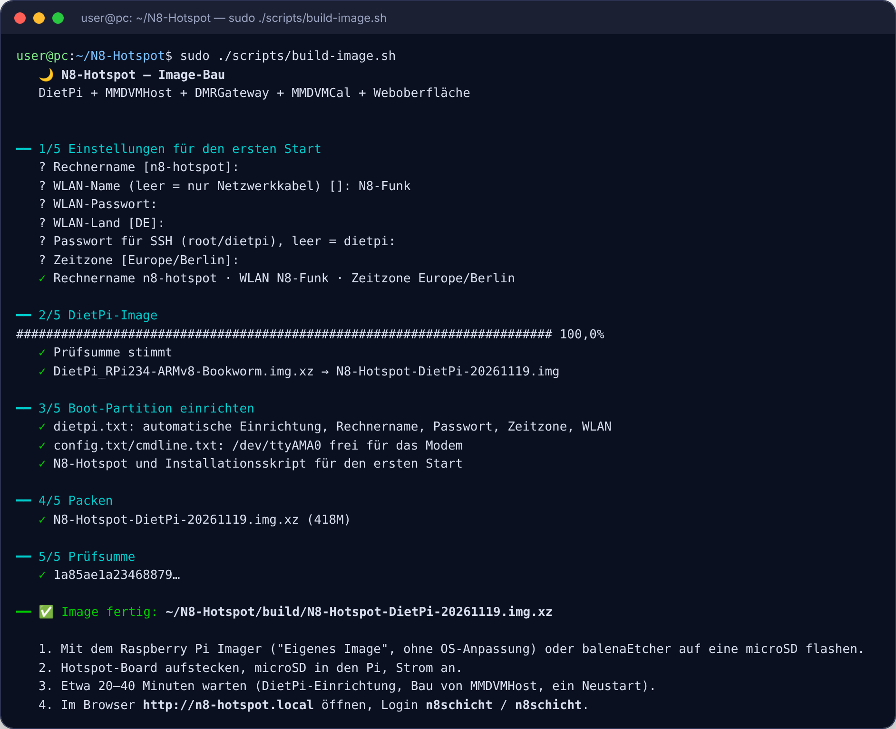
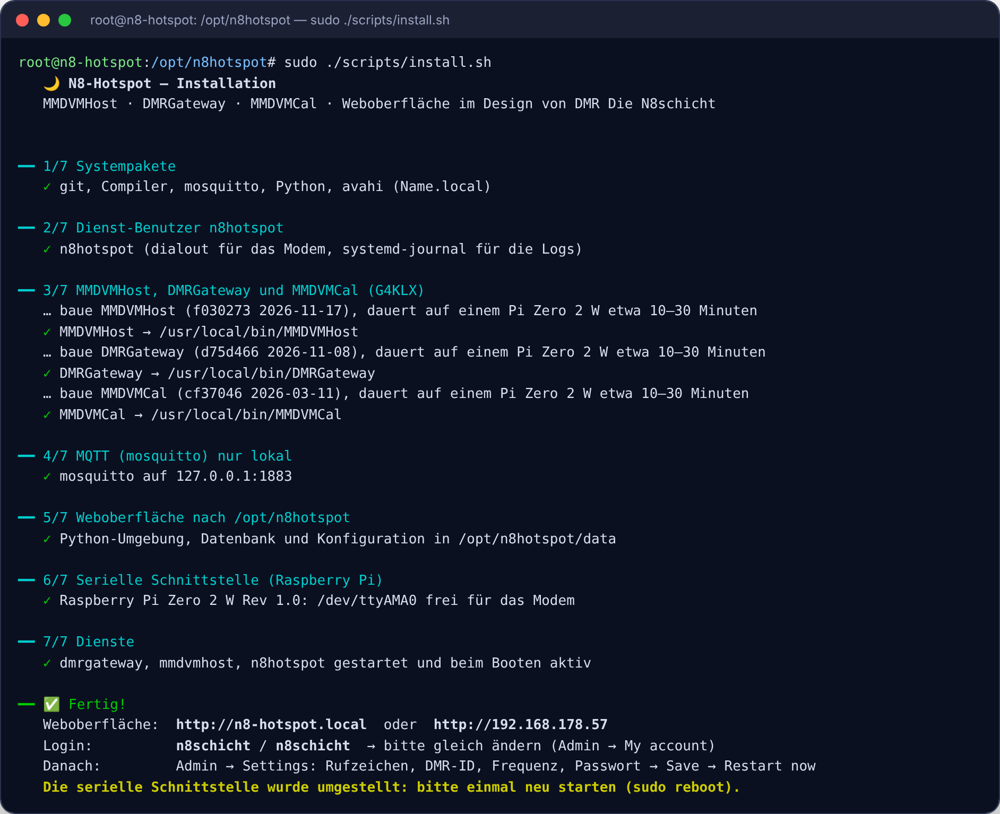
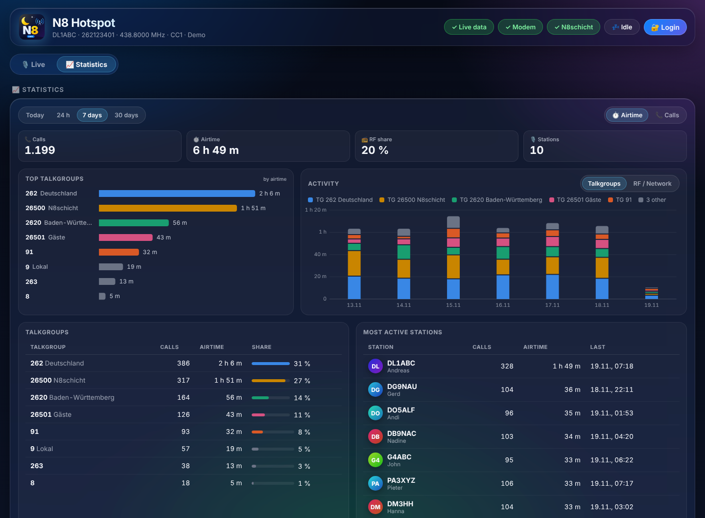
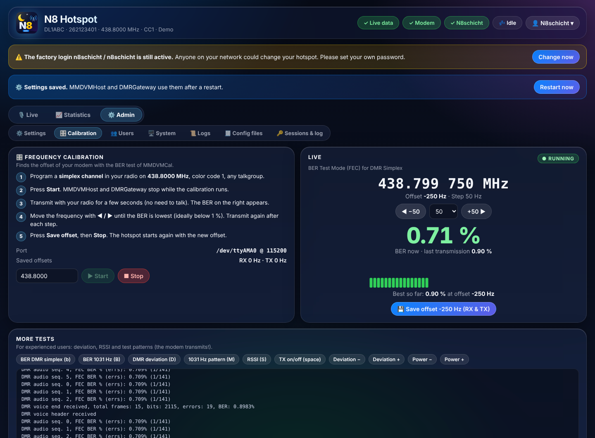
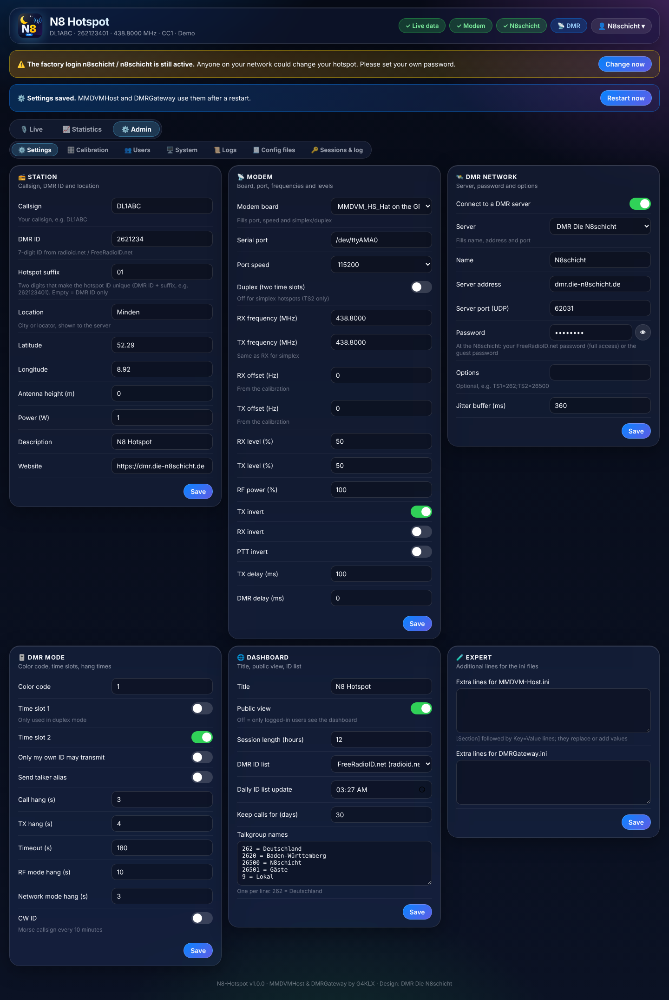
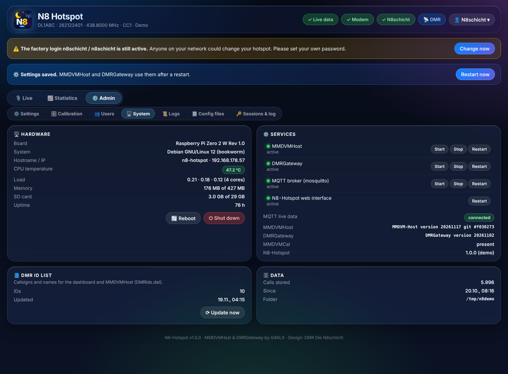
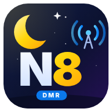

<p align="center">
  
</p>

<p align="center">
  <b>Eigener DMR-Hotspot mit MMDVMHost, DMRGateway und einer Weboberfläche im Design von DMR Die N8schicht</b><br>
  Fertiges Image auf Basis von DietPi · Live-Ansicht · Statistiken · Kalibrierung · Adminbereich · alles in SQLite und Python
</p>

<p align="center">
  <a href="#schnellstart">Schnellstart</a> ·
  <a href="docs/de/installation.md">Installation &amp; Image</a> ·
  <a href="docs/de/bedienung.md">Live &amp; Statistik</a> ·
  <a href="docs/de/adminbereich.md">Adminbereich</a> ·
  <a href="docs/de/kalibrierung.md">Kalibrierung</a> ·
  <a href="docs/de/technik.md">Technik</a> ·
  <a href="docs/de/fehlersuche.md">Fehlersuche</a>
</p>

---

## Was ist das?

**N8-Hotspot** macht aus einem Raspberry Pi mit MMDVM-Board einen DMR-Hotspot, ähnlich wie Pi-Star oder WPSD, aber schlanker und im Look des [N8schicht-Dashboards](https://github.com/dhartmann1979/HBlink4-FreeRadioID). Ab Werk verbindet er sich mit **dmr.die-n8schicht.de**.

| | |
|---|---|
| 🎙️ **Live-Ansicht** | Wer gerade spricht (**ON AIR**), lokal per Funk (RF) oder aus dem Netz, mit BER und RSSI. Dazu Last Heard und der Status von Modem und DMR-Server. |
| 📈 **Statistiken** | Talkgroups, Sprechzeit, RF und Netz, aktivste Stationen; heute, 24 h, 7 oder 30 Tage, als Diagramm und Tabelle |
| 🎛️ **Kalibrierung** | Frequenzabgleich mit MMDVMCal im Browser: BER live, Frequenz per Knopf verschieben, Offset mit einem Klick speichern |
| ⚙️ **Adminbereich** | Station, Modem, Frequenzen, DMR-Server, Zeitschlitze, Expertenzeilen. Dazu Benutzer, Dienste, Logs, System-Infos, Neustart. |
| 👁️ **Sichtbereich** | Die Live-Ansicht ist öffentlich (abschaltbar). Benutzer der Rolle *Viewer* sehen alles, ändern aber nichts. |
| 🔐 **Standard-Login** | `n8schicht` / `n8schicht`. Bis zur Änderung im Adminbereich erscheint eine deutliche Warnung. |
| 🗄️ **SQLite + Python** | Einstellungen, Benutzer, Gespräche und ID-Liste liegen in einer Datenbank; daraus entstehen `MMDVM-Host.ini` und `DMRGateway.ini`. |
| 🥧 **DietPi-Image** | `scripts/build-image.sh` baut ein Image mit WLAN und Passwort. Der Pi installiert sich beim ersten Start selbst. |

<p align="center">
  
  &nbsp;
  
</p>

## Schnellstart

**Variante A – eigenes Image (empfohlen).** Auf einem Linux-PC:

```bash
git clone https://github.com/dhartmann1979/N8-Hotspot
cd N8-Hotspot
sudo ./scripts/build-image.sh
```

Das Image auf eine microSD flashen und den Pi starten. Nach 20–40 Minuten ist der Hotspot unter **http://n8-hotspot.local** erreichbar.

**Variante B – auf einen laufenden Pi** (DietPi, Raspberry Pi OS, Debian):

```bash
sudo git clone https://github.com/dhartmann1979/N8-Hotspot /opt/n8hotspot
sudo /opt/n8hotspot/scripts/install.sh
```

Danach: **Login** `n8schicht` / `n8schicht` → eigenes Passwort setzen → **Admin → Settings**. Dort Rufzeichen, DMR-ID, Frequenz und FreeRadioID-Passwort eintragen, dann **Save** und **Restart now**.

<p align="center">
  
  
</p>

➡️ Ausführlich: **[Installation & Image](docs/de/installation.md)**

## So sieht es aus

<table>
<tr>
<td width="50%"><br><b>📈 Statistik</b>: Top-Talkgroups, Verlauf nach Talkgroup oder RF/Netz, aktivste Stationen.</td>
<td width="50%"><br><b>🎛️ Kalibrierung</b>: BER live, Frequenz verschieben, Offset speichern.</td>
</tr>
<tr>
<td><br><b>⚙️ Einstellungen</b>: Station, Modem, DMR-Server, DMR-Modus, Dashboard, Experte.</td>
<td><br><b>🖥️ System</b>: Temperatur, Speicher, Dienste starten/stoppen, ID-Liste, Neustart.</td>
</tr>
</table>

## Dokumentation

| Anleitung | Inhalt |
|---|---|
| 📦 [Installation & Image](docs/de/installation.md) | Hardware, Image bauen und flashen, Installation auf vorhandenem System, erster Start, Aktualisieren |
| 🎙️ [Live & Statistik](docs/de/bedienung.md) | Kopfzeile, Zeitschlitze, Last Heard, Statistik-Diagramme |
| ⚙️ [Adminbereich](docs/de/adminbereich.md) | Standard-Login, alle Einstellungen, Benutzer, System, Logs, Konfigurationsdateien |
| 🎛️ [Kalibrierung](docs/de/kalibrierung.md) | Frequenz-Offset mit MMDVMCal finden, weitere Tests |
| 🧩 [Technik](docs/de/technik.md) | Aufbau (MMDVMHost ↔ DMRGateway ↔ MQTT), Dateien, Ports, API, Sicherheit |
| 🩺 [Fehlersuche](docs/de/fehlersuche.md) | Modem, Verbindung, Passwort vergessen, Logs, Sicherung |

## Aktualisieren

```bash
sudo /opt/n8hotspot/scripts/update.sh              # Weboberfläche
sudo /opt/n8hotspot/scripts/update.sh --rebuild    # zusätzlich MMDVMHost, DMRGateway, MMDVMCal neu bauen
```

## Danksagung & Lizenz

- **MMDVMHost, DMRGateway, MMDVMCal** von Jonathan Naylor, G4KLX: [github.com/g4klx](https://github.com/g4klx). Die Programme werden bei der Installation aus dem Quellcode gebaut.
- **DietPi**: [dietpi.com](https://dietpi.com)
- Vorbild für den Funktionsumfang: **Pi-Star** und **WPSD**
- Design, Logo und Betrieb des Servers: **DMR Die N8schicht** · ID-Listen von **FreeRadioID.net** (DO5ALF)

N8-Hotspot steht unter der **GNU GPL v3**, siehe [LICENSE](LICENSE).

<p align="center"></p>
